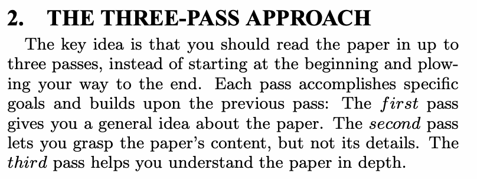

---
版本：v0.11.1
最后更新：2026-10-13
适用课次：第 3 课
文档类型：正式课堂 PPT 逐页内容母稿
状态：现行修订稿；教师复核和现场验证单列
本轮修订状态：2026-10-13 扩展至 32 页并复核内容与节奏；教师复核及现场试教单独登记。
变更记录：
- v0.11.1 (2026-10-13): 移除屏显页脚的讲义及内部文件映射，原文出处保留；映射仍保存在本母稿与教师备注。
- v0.11.0 (2026-10-13): 扩展为 32 页连续课堂主线；展开方法、证据、共同诊断与本人回写；保留 90 分钟与原有交付。
- v0.9.3 (2026-10-01): 评价证据角色、早期试探与内容验收统一；加入 RSI 补充案例，正式提交和评分不变。
- v0.9.2 (2026-09-22): Pi Agent 改为课堂主平台，OpenCode 等为备选；同步相关入口与操作边界，课程结构、评分及提交节点不变。
- v0.9.1 (2026-09-16): 按教师“通过，修改后续课程和PPT”确认推进；统一机制、可复算案例及真实日志字段，修复逐页映射，保持既定目标与 90 分钟安排。
- v0.9.0 (2026-09-15): 整体复审内容修订；统一证据维度、假设与可复演案例，补教学诊断、板书及过渡；本轮源文件状态与 PPT 同步情况见 README。
- v0.8.1 (2026-09-12): 按视觉准则 v1.5.0 把检索式、来源审计、真实论文与候选记录提升为主对象；标题 30–32pt、常规正文 22–24pt、检索/表格工件 18–20pt，正文改以 regular 为主。P14 采用“来源记录→DOI→原文”平面审计，P18 改为两栏实践工作表。页数、屏显语义与 90 分钟结构不变。
- v0.8.0 (2026-09-12): 减负轮重做时长制桌面推演：方法与真实检索演示各 15 分钟；P18 个人实践改为 12+10 分钟，中间插入 5 分钟教师点评；全部逐页建议时间改为整数时长，明确当堂、课后与问题门边界；页数不变，PPTX 待同步。
- v0.7.0 (2026-08-20): 精简 P01 封面，仅保留“第3讲 文献检索与证据角色判断”；在退出卡前新增 P20 本讲知识点总结，原 P20 顺延为 P21；85-90 分钟收束段拆为 2.5 分钟总结 + 2.5 分钟退出卡与预告，总时长、课堂产出与正式提交口径不变；21 页 PPTX 已同步并通过三重检查
- v0.6.0 (2026-08-10): 批次 0 推迟项落地——P16 由课堂构造失败样例改为教师真实 MI 幻觉引用审计（mi-search-trace-demo §6 四条 rejected + 恢复路径 + 案例边界框），四判断点保留；映射表 P16 行同步；时间结构与其余 19 页不变。讲义 §四·5 虚构表仍为学生练习对象
- v0.5.2 (2026-08-09): 随讲义 v1.3.1 更新 P17 映射标注（练习 1-5→练习 1-4 与个人实践最低产出）；页面内容与页任务不变
- v0.5.1 (2026-08-09): 随讲义 v1.3.0 顺延逐页映射表节号（§六常见错误→§七、§七贯穿案例→§八、§八练习→§九）；新增 §六检索质量自评定位为课后持续自评，不设屏显页；页面内容、页任务与时间结构不变
- v0.5.0 (2026-08-09): 同步 handout v1.2.0；明确问题初稿与教学顺序、角色/状态/决定三分、两层入口核验、三类记录与十字段候选表；PPTX 留待 2.0 制作批次重建
- v0.4.0 (2026-08-07): P12 补四态进入规则；P13-P15 改为 Keshav 2007 的真实 Crossref—DOI—原文—候选表 trace；P16 显式标注虚构失败案例；P17-P18 将 27 分钟最低产出收缩为 1 条检索记录 + 2 条审计 + 1 条已核验候选记录 + 1 条 AI 记录
- v0.3.0 (2026-08-07): 正式 PPT 完成——依据本母稿制作 20 页 `slides.pptx`，继承交大模板母版与版式；20/20 页包含 `[Sources]` speaker notes，并通过模板层级、画布边界、LibreOffice 重开导出、全页 contact sheet 与高风险页视觉检查
- v0.2.0 (2026-08-06): gate 3-4 re-fit + gate 2 保守审校——每页建议时间按 备课规划 v2.1.1 第 3 课权威 8 段时长重排（段内均分：回扣 5/目标 5/方法 17/演示 16/说明 5/实践 27/互查 10/退出 5）；修复 P03 时间越段（原 3:00-5:00 跨入回扣段，改为 5:00-7:30）与 P17/P18 停留页时间重叠（P17 改为 43:00-48:00，P18 保持 48:00-75:00 停留）；gate 2 去 P04 备注 meta 自白 1 处（"暴露常见错误"→"来看几个常见错误"）、修 P12 视觉结构状态计数 1 处（三态→四态）；页量预算确认 20 页无超额段，方法段 7 页/17 min 与 lesson-1 合并后 7 页/12 min 密度相当，不合并；逐页映射表无行变更，90 分钟表页码列同步；frontmatter 版本 v0.1.0→v0.2.0
- v0.1.0 (2026-08-06): 从零起草；20 页；含 §一 使用说明/本课目标/适用条件/90 分钟节奏表/逐页映射表 + 逐页 P01-P20 六段结构；节奏对齐 备课规划 v2.1.0 默认节奏与第 3 课目标
---

# 第 3 课逐页母稿｜方法、案例与研究判断

## 使用与教学路由

屏显页脚仅保留公开原文出处。讲义、教案及内部文件对应仅保存在逐页映射与教师备注，不投屏。

32 页按顺序使用。P10–P13 先独立判断和同伴比较，P14–P17 再揭示教师依据。P04–P09 使用相邻示例；P18–P20、P24–P27 是本人项目操作参照。教师详细答案留在本课教师材料，学生任务不预置裁决。

| 时长 | 环节 | 页码 | 课堂结果 |
| --- | --- | --- | --- |
| 5 分钟 | 入口与交付 | P01–P03 | 定位输入与本课交付 |
| 10 分钟 | 方法与相邻示例 | P04–P09 | 理解方法，保留共同题独立判断 |
| 10 分钟 | 独立共同诊断 | P10–P11 | 记录初判、依据与缺证 |
| 10 分钟 | 同伴比较 | P12–P13 | 比较不同判断与证据 |
| 5 分钟 | 教师揭示校准 | P14–P17 | 逐步揭示依据，修订初判 |
| 15 分钟 | 本人迁移一 | P18–P20 | 完成本人决定与第一项核验 |
| 5 分钟 | 中点点评 | P21–P23 | 解决共性卡点，收窄主张 |
| 15 分钟 | 本人迁移二 | P24–P27 | 补第二项核验并完成实际回写 |
| 10 分钟 | 同伴反查与修订 | P28–P30 | 反向检查证据，作者记录处理 |
| 5 分钟 | 总结与下次输入 | P31–P32 | 核对产出并准备下次输入 |

总计 90 分钟。首次书面判断在入口段内开始；独立共同作答在开课 15 分钟后。两段本人实践各 15 分钟，中点点评独立安排 5 分钟。实践页作为操作参照，不额外占用学生实践。

## 逐页映射

| 页码 | 页面任务 | 讲义位置 | 证据角色 | 学生动作 |
| --- | --- | --- | --- | --- |
| P01 | 第3讲 文献检索与证据角色判断 | §导读 | 课程方法与工件要求 | 打开本人研究问题初稿。 |
| P02 | 从来源范围到可用证据 | §一、外部输入摄取在研究链路中的位置 | 课程方法与工件要求 | 写出本人拟用主张，允许随后修改。 |
| P03 | 本课带走一条可复盘检索链 | §九、共同诊断与本人迁移 | 课程方法与工件要求 | 定位已有笔记中的查询、审计和候选记录区域。 |
| P04 | 研究问题的可检索要素 | §二、从研究问题到检索式 | 课程方法与工件要求 | 圈出一个过宽词和一个可能被写成不同术语的概念。 |
| P05 | 同义词与独立查询 | §二、从研究问题到检索式 | 课程方法与工件要求 | 为本人一个概念补两个候选表达，并标待确认项。 |
| P06 | AND、OR 与括号 | §二、从研究问题到检索式 | 课程方法与工件要求 | 用自己的词解释一个括号内的 OR 和括号外的 AND。 |
| P07 | 同一查询在不同字段中的含义 | §二、从研究问题到检索式 | 课程方法与工件要求 | 指出例子中的命中变化来自字段，而非新增论文。 |
| P08 | 筛选条件与反例保留 | §二、从研究问题到检索式 | 课程方法与工件要求 | 给自己的问题写一条纳入和一条排除条件。 |
| P09 | 可重放检索记录的样貌 | §二、从研究问题到检索式 | 课程方法与工件要求 | 标出同伴重放时不可缺少的字段。 |
| P10 | 共同诊断的微型索引 | §九、共同诊断与本人迁移 | 教学构造与执行证据 | 独立逐字检查题名，暂不讨论答案。 |
| P11 | 两套保存结果可靠吗 | §九、共同诊断与本人迁移 | 教学构造与执行证据 | 独立记录初判、题名依据和拟修改的词或字段。 |
| P12 | 同伴比较：分歧在哪个词 | §九、共同诊断与本人迁移 | 教学构造与执行证据 | 同伴各选一条记录，逐组解释命中或漏检。 |
| P13 | 修订查询的比较依据 | §六、检索质量自评 | 教学构造与执行证据 | 比较各自修订式，提出一项能区分两种方案的检查。 |
| P14 | 重放 Q1：保存记录出现误报 | §九、共同诊断与本人迁移 | 教学构造与执行证据 | 对照自己的初判，写出一个改变判断的字段证据。 |
| P15 | 重放 Q2：相关性与命中分开 | §九、共同诊断与本人迁移 | 教学构造与执行证据 | 解释一条逻辑命中但题意不符的记录。 |
| P16 | 修订后的实际命中 | §六、检索质量自评 | 教学构造与执行证据 | 把自己执行的结果与示例比较，解释至少一项差异。 |
| P17 | 覆盖检查的证据与边界 | §六、检索质量自评 | 课程方法与工件要求 | 为本人检索写一个下一步覆盖检查。 |
| P18 | 本人查询：执行并保存 | §九、共同诊断与本人迁移 | 课程方法与工件要求 | 实际执行一条查询并保存输出。 |
| P19 | 本人结果：解释改动的作用 | §九、共同诊断与本人迁移 | 课程方法与工件要求 | 记录自己的一项结果变化；若无变化，写明已检查范围。 |
| P20 | 第一条来源的入口核验 | §四、AI 检索结果的入口核验 | 真实原文及核验记录 | 完成第一条真实来源的身份与主张记录。 |
| P21 | MI 错引：标识符指向哪篇论文 | §四、AI 检索结果的入口核验 | 真实原文及核验记录 | 指出错误发生在“标识符存在”还是“身份对应”。 |
| P22 | 身份错误、内容不符与网络故障 | §四、AI 检索结果的入口核验 | 课程方法与工件要求 | 检查自己是否把访问失败写成来源不存在。 |
| P23 | 错引恢复后的记录 | §四、AI 检索结果的入口核验 | 真实原文及核验记录 | 把本人失败记录与恢复线索相互链接。 |
| P24 | 第二条审计与候选池分区 | §四、AI 检索结果的入口核验 | 课程方法与工件要求 | 完成第二条审计，核对两条来源各自的依据。 |
| P25 | 同一条目有角色、状态和决定 | §三、证据角色 | 课程方法与工件要求 | 为自己的候选分别填三个维度及理由。 |
| P26 | 一条可进入候选表的记录 | §五、候选文献表 | 课程方法与工件要求 | 为本人一条候选写全身份、主张、位置与纳入理由。 |
| P27 | 回写到同一份检索笔记 | §五、候选文献表 | 课程方法与工件要求 | 保存本人记录并确认同伴能够打开原文或存档。 |
| P28 | 同伴重放一条查询 | §九、共同诊断与本人迁移 | 课程方法与工件要求 | 实际重放并记录一项核对结果。 |
| P29 | 候选条目的反向检查 | §九、共同诊断与本人迁移 | 课程方法与工件要求 | 同伴挑一条候选，查原文后提出具体反馈。 |
| P30 | 作者修订与下一步 | §九、共同诊断与本人迁移 | 课程方法与工件要求 | 保存修订后的实际笔记，给同伴指出修改位置。 |
| P31 | 检索方法的四个判断 | §学习目标 | 课程方法与工件要求 | 用自己的记录各指认一项证据。 |
| P32 | 交付自查与第 4 课输入 | §课外预算与下次输入 | 课程方法与工件要求 | 圈出第 4 课拟精读主张与至少一个待查问题。 |

## P01｜第3讲 文献检索与证据角色判断

### 页面任务与内容依据

打开本人研究问题初稿。 内容依据：[讲义](./handout.md) §导读。证据角色：课程方法与工件要求。下一页：从来源范围到可用证据。

### 屏显内容

第3讲 文献检索与证据角色判断

### 视觉结构

保留原交大极简封面与正式课名。

### 教师讲述备注

直接进入本人的研究材料，不增加行政说明。

### 互动／操作

打开本人研究问题初稿。

### 建议时间

本页属于 P01–P03“入口与交付”，该段合计 5 分钟，本页不重复累加。

### 来源与事实边界

handout.md §导读；course/assignments.md 课堂推进与问题门。原文与构造示例按屏显标记区分。

## P02｜从来源范围到可用证据

### 页面任务与内容依据

写出本人拟用主张，允许随后修改。 内容依据：[讲义](./handout.md) §一、外部输入摄取在研究链路中的位置。证据角色：课程方法与工件要求。下一页：本课带走一条可复盘检索链。

### 屏显内容

上课已确定哪些材料可以交给 AI，本课决定哪些材料值得进入研究。

| 已有输入 | 本课要补的判断 |
| --- | --- |
| 个人问题初稿 | 当前问题需要哪类外部依据？ |
| 来源范围与权限 | 查询覆盖了什么，又漏掉什么？ |
| AI 使用记录 | 身份与拟用主张能否回到原文？ |

先写一句：我准备找材料来支持或检验什么？

### 视觉结构

可编辑研究工件表或分栏对照；标题 30 pt，常规正文 22–24 pt，精读表格不低于 18 pt。

### 教师讲述备注

学生只需写一句话。来源可信、问题相关和证据作用分别判断，不把已授权使用等同于可信。

### 互动／操作

写出本人拟用主张，允许随后修改。

### 建议时间

本页属于 P01–P03“入口与交付”，该段合计 5 分钟，本页不重复累加。

### 来源与事实边界

handout.md §一、外部输入摄取在研究链路中的位置；course/assignments.md 课堂推进与问题门。原文与构造示例按屏显标记区分。

## P03｜本课带走一条可复盘检索链

### 页面任务与内容依据

定位已有笔记中的查询、审计和候选记录区域。 内容依据：[讲义](./handout.md) §九、共同诊断与本人迁移。证据角色：课程方法与工件要求。下一页：研究问题的可检索要素。

### 屏显内容

查询改动解决了哪种漏检，又引入什么误纳？

| 记录位置 | 本课完成标志 |
| --- | --- |
| 查询与筛选 | 一条实际执行的查询，保留字段、语义、结果 |
| 两条来源审计 | 分别核对书目身份和一条拟用主张 |
| 一条候选决定 | 原文位置、预期角色、状态与纳入理由 |

保存到 notes/literature-search.md；第 4 课精读其中一条主张。

### 视觉结构

可编辑研究工件表或分栏对照；标题 30 pt，常规正文 22–24 pt，精读表格不低于 18 pt。

### 教师讲述备注

此页只展示交付结构，不提前给共同题答案。AI 使用情况沿用已有记录，没有 AI 时如实注明。

### 互动／操作

定位已有笔记中的查询、审计和候选记录区域。

### 建议时间

本页属于 P01–P03“入口与交付”，该段合计 5 分钟，本页不重复累加。

### 来源与事实边界

handout.md §九、共同诊断与本人迁移；course/assignments.md 课堂推进与问题门。原文与构造示例按屏显标记区分。

## P04｜研究问题的可检索要素

### 页面任务与内容依据

圈出一个过宽词和一个可能被写成不同术语的概念。 内容依据：[讲义](./handout.md) §二、从研究问题到检索式。证据角色：课程方法与工件要求。下一页：同义词与独立查询。

### 屏显内容

贯穿问题：结构化阅读卡能否减少 AI 摘要遗漏关键限定？

| 要素 | 可观察的含义 |
| --- | --- |
| 对象 | 论文摘要中的任务、设置与适用范围 |
| 方法 | 结构化阅读卡或阅读模板 |
| 比较 | 自由摘要或未使用模板的阅读 |
| 结果 | 关键限定的遗漏情况 |

先拆要素，再决定哪些要素需要进入查询。

### 视觉结构

可编辑研究工件表或分栏对照；标题 30 pt，常规正文 22–24 pt，精读表格不低于 18 pt。

### 教师讲述备注

这是课程研究问题，尚无效果结论。查询不必同时塞入所有要素，过多 AND 会使探索过窄。

### 互动／操作

圈出一个过宽词和一个可能被写成不同术语的概念。

### 建议时间

本页属于 P04–P09“方法与相邻示例”，该段合计 10 分钟，本页不重复累加。

### 来源与事实边界

handout.md §二、从研究问题到检索式；course/assignments.md 课堂推进与问题门。原文与构造示例按屏显标记区分。

## P05｜同义词与独立查询

### 页面任务与内容依据

为本人一个概念补两个候选表达，并标待确认项。 内容依据：[讲义](./handout.md) §二、从研究问题到检索式。证据角色：课程方法与工件要求。下一页：AND、OR 与括号。

### 屏显内容

相邻方法例：用不同表达查找“摘要中的条件遗漏”。

| 概念 | 候选表达 |
| --- | --- |
| 摘要 | summary / abstract / summarization |
| 限定 | limitation / scope / condition |
| 遗漏 | omission / missing / retention |
| 独立分支 | 分别查摘要质量、阅读方法，再比较新增相关项 |

同义词要回到真实题名或摘要确认用法。

### 视觉结构

可编辑研究工件表或分栏对照；标题 30 pt，常规正文 22–24 pt，精读表格不低于 18 pt。

### 教师讲述备注

概念组中的 OR 与独立运行的查询分支分开。此处不使用共同题的 read / reading 答案。

### 互动／操作

为本人一个概念补两个候选表达，并标待确认项。

### 建议时间

本页属于 P04–P09“方法与相邻示例”，该段合计 10 分钟，本页不重复累加。

### 来源与事实边界

handout.md §二、从研究问题到检索式；course/assignments.md 课堂推进与问题门。原文与构造示例按屏显标记区分。

## P06｜AND、OR 与括号

### 页面任务与内容依据

用自己的词解释一个括号内的 OR 和括号外的 AND。 内容依据：[讲义](./handout.md) §二、从研究问题到检索式。证据角色：课程方法与工件要求。下一页：同一查询在不同字段中的含义。

### 屏显内容

相邻构造示例，非真实学术库结果。

| 表达式 | 筛选含义 |
| --- | --- |
| summary AND limitation | 两组条件都满足 |
| summary OR abstract | 满足任一表达 |
| (summary OR abstract) AND limitation | 先扩同义词，再约束概念交集 |

AND 增加条件；OR 扩展表达。实际效果用命中记录检验。

### 视觉结构

可编辑研究工件表或分栏对照；标题 30 pt，常规正文 22–24 pt，精读表格不低于 18 pt。

### 教师讲述备注

避免把扩大 OR 机械等同于更好。扩大范围可能增加误纳，需要检查相关性。

### 互动／操作

用自己的词解释一个括号内的 OR 和括号外的 AND。

### 建议时间

本页属于 P04–P09“方法与相邻示例”，该段合计 10 分钟，本页不重复累加。

### 来源与事实边界

handout.md §二、从研究问题到检索式；course/assignments.md 课堂推进与问题门。原文与构造示例按屏显标记区分。

## P07｜同一查询在不同字段中的含义

### 页面任务与内容依据

指出例子中的命中变化来自字段，而非新增论文。 内容依据：[讲义](./handout.md) §二、从研究问题到检索式。证据角色：课程方法与工件要求。下一页：筛选条件与反例保留。

### 屏显内容

相邻构造条目：title 为 Summary evaluation，keywords 为 limitation retention。

| 查询 | 字段 | 结果 |
| --- | --- | --- |
| summary AND limitation | title | 不命中 |
| summary AND limitation | title + keywords | 命中 |
| "summary evaluation" | 支持短语语法的库 | 需核对该库的短语规则 |

记录搜索字段与匹配语义；数据库之间的语法需要转换。

### 视觉结构

可编辑研究工件表或分栏对照；标题 30 pt，常规正文 22–24 pt，精读表格不低于 18 pt。

### 教师讲述备注

本例假定题名与关键词拼接后做子串匹配，仅解释字段效应。后面的本地包只支持单字段，不能直接使用 title + keywords。

### 互动／操作

指出例子中的命中变化来自字段，而非新增论文。

### 建议时间

本页属于 P04–P09“方法与相邻示例”，该段合计 10 分钟，本页不重复累加。

### 来源与事实边界

handout.md §二、从研究问题到检索式；course/assignments.md 课堂推进与问题门。原文与构造示例按屏显标记区分。

## P08｜筛选条件与反例保留

### 页面任务与内容依据

给自己的问题写一条纳入和一条排除条件。 内容依据：[讲义](./handout.md) §二、从研究问题到检索式。证据角色：课程方法与工件要求。下一页：可重放检索记录的样貌。

### 屏显内容

检索前写第一版，调整时留下理由。

| 条件 | 本课阅读卡问题的写法 |
| --- | --- |
| 相关性 | 涉及论文阅读、摘要或限定保留 |
| 证据类型 | 方法建议与效果研究分别标注 |
| 排除理由 | 硬件存储卡、材料回收等题意不符 |
| 冲突结果 | 效果不佳也保留，按条件判断作用 |

筛选依据是问题与方法匹配程度，结论方向另行记录。

### 视觉结构

可编辑研究工件表或分栏对照；标题 30 pt，常规正文 22–24 pt，精读表格不低于 18 pt。

### 教师讲述备注

硬件、回收等只作为类别提示，此处不揭示共同题哪项命中。时间和语言限制需要理由，不能默默删掉反证。

### 互动／操作

给自己的问题写一条纳入和一条排除条件。

### 建议时间

本页属于 P04–P09“方法与相邻示例”，该段合计 10 分钟，本页不重复累加。

### 来源与事实边界

handout.md §二、从研究问题到检索式；course/assignments.md 课堂推进与问题门。原文与构造示例按屏显标记区分。

## P09｜可重放检索记录的样貌

### 页面任务与内容依据

标出同伴重放时不可缺少的字段。 内容依据：[讲义](./handout.md) §二、从研究问题到检索式。证据角色：课程方法与工件要求。下一页：共同诊断的微型索引。

### 屏显内容

相邻构造示例：下面是一份教学记录，不是现场学术库结果。

| 字段 | 示例记录 |
| --- | --- |
| 库 / 字段 / 语义 | 教学索引 A；title；不区分大小写子串 |
| 日期 / 查询 | 2026-10-13；summary AND limitation |
| 结果 / 筛选 | 1 条命中 A1；相关性待读摘要 |
| 版本与改动 | Q0 改为 Q1，增加 condition 同义词 |
| 保留材料 | 原查询、原始输出、筛选理由 |

命中数、筛选数与最终纳入数分开记录。

### 视觉结构

可编辑研究工件表或分栏对照；标题 30 pt，常规正文 22–24 pt，精读表格不低于 18 pt。

### 教师讲述备注

这是独立的单条构造记录，不对应 S1–S5。若工具排序会变，保留当时导出的结果与日期。

### 互动／操作

标出同伴重放时不可缺少的字段。

### 建议时间

本页属于 P04–P09“方法与相邻示例”，该段合计 10 分钟，本页不重复累加。

### 来源与事实边界

handout.md §二、从研究问题到检索式；course/assignments.md 课堂推进与问题门。原文与构造示例按屏显标记区分。

## P10｜共同诊断的微型索引

### 页面任务与内容依据

独立逐字检查题名，暂不讨论答案。 内容依据：[讲义](./handout.md) §九、共同诊断与本人迁移。证据角色：教学构造与执行证据。下一页：两套保存结果可靠吗。

### 屏显内容

教学索引：S1/S2 为真实书目题名，S3–S5 为构造条目。

| ID | title 字段 |
| --- | --- |
| S1 | How to Read a Paper |
| S2 | Guidelines for Performing Systematic Literature Reviews in Software Engineering |
| S3 | Teaching record: structured reading cards |
| S4 | Teaching record: reading memory cards |
| S5 | Teaching record: paper card recycling |

只搜 title，大小写不敏感、子串匹配；keywords 另见任务包。

### 视觉结构

可编辑研究工件表或分栏对照；标题 30 pt，常规正文 22–24 pt，精读表格不低于 18 pt。

### 教师讲述备注

S1 是上游方法书目提供的独立种子，不是从查询结果反向挑选。完整 keywords 在任务包，构造条目不得作为真实候选文献。

### 互动／操作

独立逐字检查题名，暂不讨论答案。

### 建议时间

本页属于 P10–P11“独立共同诊断”，该段合计 10 分钟，本页不重复累加。

### 来源与事实边界

judgment-task.md；assets/search-diagnosis/index.json。原文与构造示例按屏显标记区分。

## P11｜两套保存结果可靠吗

### 页面任务与内容依据

独立记录初判、题名依据和拟修改的词或字段。 内容依据：[讲义](./handout.md) §九、共同诊断与本人迁移。证据角色：教学构造与执行证据。下一页：同伴比较：分歧在哪个词。

### 屏显内容

保存记录是待审计输入，尚未确认正确。

| 查询 | 保存结果 |
| --- | --- |
| Q1：paper AND reading AND card | S5 |
| Q2：(paper OR reading) AND (card OR review) | S2、S3、S4、S5 |
| 独立种子 | S1：How to Read a Paper |

先验证保存结果，再写一条修订查询并执行。

### 视觉结构

可编辑研究工件表或分栏对照；标题 30 pt，常规正文 22–24 pt，精读表格不低于 18 pt。

### 教师讲述备注

保持本页，学生先逐条代入语义。教师此时不告诉正确命中集合，允许发现输入记录本身错误。

### 互动／操作

独立记录初判、题名依据和拟修改的词或字段。

### 建议时间

本页属于 P10–P11“独立共同诊断”，该段合计 10 分钟，本页不重复累加。

### 来源与事实边界

judgment-task.md。原文与构造示例按屏显标记区分。

## P12｜同伴比较：分歧在哪个词

### 页面任务与内容依据

同伴各选一条记录，逐组解释命中或漏检。 内容依据：[讲义](./handout.md) §九、共同诊断与本人迁移。证据角色：教学构造与执行证据。下一页：修订查询的比较依据。

### 屏显内容

把“我觉得相关”改成可复查的字段判断。

| 比较对象 | 双方都要指出的依据 |
| --- | --- |
| 一个声称的命中 | 它满足了哪几个概念组？ |
| 一个漏检 | 缺的是表达、字段还是检索分支？ |
| 独立种子 S1 | 它为何应该纳入覆盖检查？ |

先记录分歧，保留双方初始答案。

### 视觉结构

可编辑研究工件表或分栏对照；标题 30 pt，常规正文 22–24 pt，精读表格不低于 18 pt。

### 教师讲述备注

这里仍不揭示标准答案。只追问实际字段，不以题名印象判定布尔表达式。

### 互动／操作

同伴各选一条记录，逐组解释命中或漏检。

### 建议时间

本页属于 P12–P13“同伴比较”，该段合计 10 分钟，本页不重复累加。

### 来源与事实边界

judgment-task.md；judgment-teacher.md。原文与构造示例按屏显标记区分。

## P13｜修订查询的比较依据

### 页面任务与内容依据

比较各自修订式，提出一项能区分两种方案的检查。 内容依据：[讲义](./handout.md) §六、检索质量自评。证据角色：教学构造与执行证据。下一页：重放 Q1：保存记录出现误报。

### 屏显内容

每次改动都应对应一个具体缺口。

| 修改动作 | 核对的变化 |
| --- | --- |
| 增加表达 | 新增相关项和新增误纳项 |
| 改变字段 | 原词是否仅出现在其他字段？ |
| 另跑查询 | 该分支带来哪些独有命中？ |

记录“改了什么、观察到什么、还漏什么”。

### 视觉结构

可编辑研究工件表或分栏对照；标题 30 pt，常规正文 22–24 pt，精读表格不低于 18 pt。

### 教师讲述备注

学生可以作不同选择。没有独立执行的 OR 组不能写成不同分支的覆盖贡献。

### 互动／操作

比较各自修订式，提出一项能区分两种方案的检查。

### 建议时间

本页属于 P12–P13“同伴比较”，该段合计 10 分钟，本页不重复累加。

### 来源与事实边界

judgment-task.md；handout.md §六。原文与构造示例按屏显标记区分。

## P14｜重放 Q1：保存记录出现误报

### 页面任务与内容依据

对照自己的初判，写出一个改变判断的字段证据。 内容依据：[讲义](./handout.md) §九、共同诊断与本人迁移。证据角色：教学构造与执行证据。下一页：重放 Q2：相关性与命中分开。

### 屏显内容

实际执行：title；paper AND reading AND card。

| 条目 | 逐组核对 | 判定 |
| --- | --- | --- |
| S5 | 含 paper、card；缺 reading | 不命中 |
| 其余条目 | 均未同时满足三个概念组 | 不命中 |
| 实际结果 | [] | 0 条 |

先修复保存记录，再讨论检索式是否合适。

### 视觉结构

可编辑研究工件表或分栏对照；标题 30 pt，常规正文 22–24 pt，精读表格不低于 18 pt。

### 教师讲述备注

此页首次揭示答案。运行 search.py 三个 group 得到空集合；固定保存结果中的错误是教学诊断输入。

### 互动／操作

对照自己的初判，写出一个改变判断的字段证据。

### 建议时间

本页属于 P14–P17“教师揭示校准”，该段合计 5 分钟，本页不重复累加。

### 来源与事实边界

assets/search-diagnosis/search.py；judgment-teacher.md。原文与构造示例按屏显标记区分。

## P15｜重放 Q2：相关性与命中分开

### 页面任务与内容依据

解释一条逻辑命中但题意不符的记录。 内容依据：[讲义](./handout.md) §九、共同诊断与本人迁移。证据角色：教学构造与执行证据。下一页：修订后的实际命中。

### 屏显内容

实际执行：(paper OR reading) AND (card OR review)。

| 条目 | 语义核对 | 结果 |
| --- | --- | --- |
| S2 | 有 reviews，缺 paper / reading | 不命中 |
| S3 | reading + cards | 命中，教学阅读记录 |
| S4 | reading + cards | 命中，硬件语义 |
| S5 | paper + card | 命中，材料回收语义 |

实际结果为 S3、S4、S5；命中还需相关性筛选。

### 视觉结构

可编辑研究工件表或分栏对照；标题 30 pt，常规正文 22–24 pt，精读表格不低于 18 pt。

### 教师讲述备注

子串 review 命中 Reviews，但 Q2 的第一组仍不满足。S3 也是构造条目，仅用于诊断，不进入真实候选表。

### 互动／操作

解释一条逻辑命中但题意不符的记录。

### 建议时间

本页属于 P14–P17“教师揭示校准”，该段合计 5 分钟，本页不重复累加。

### 来源与事实边界

assets/search-diagnosis/search.py；judgment-teacher.md。原文与构造示例按屏显标记区分。

## P16｜修订后的实际命中

### 页面任务与内容依据

把自己执行的结果与示例比较，解释至少一项差异。 内容依据：[讲义](./handout.md) §六、检索质量自评。证据角色：教学构造与执行证据。下一页：覆盖检查的证据与边界。

### 屏显内容

相同本地索引，分别执行以下查询。

| 字段 | 查询 | 实际结果 |
| --- | --- | --- |
| title | read AND paper | S1 |
| keywords | read AND paper | S3 |
| title | (read OR reading) AND (paper OR card) | S1、S3、S4 |

扩大表达找回 S1，也可能带入硬件条目 S4。

### 视觉结构

可编辑研究工件表或分栏对照；标题 30 pt，常规正文 22–24 pt，精读表格不低于 18 pt。

### 教师讲述备注

本地包不能混用字段，两个字段各跑一次。read 已包含 reading 的子串，但显式写出两词帮助比较；不能宣称总体召回率提高。

### 互动／操作

把自己执行的结果与示例比较，解释至少一项差异。

### 建议时间

本页属于 P14–P17“教师揭示校准”，该段合计 5 分钟，本页不重复累加。

### 来源与事实边界

assets/search-diagnosis/search.py；index.json。原文与构造示例按屏显标记区分。

## P17｜覆盖检查的证据与边界

### 页面任务与内容依据

为本人检索写一个下一步覆盖检查。 内容依据：[讲义](./handout.md) §六、检索质量自评。证据角色：课程方法与工件要求。下一页：本人查询：执行并保存。

### 屏显内容

找到独立种子，只说明修复了已知的一处缺口。

| 能检查的事 | 仍需补的事 |
| --- | --- |
| S1 是否被查询找回 | 其他已知相关来源是否遗漏 |
| 分支独有的相关项 | 综述与参考文献追踪的新来源 |
| 哪些误纳被筛掉 | 排除条件是否删去了反例 |

逐步扩候选池；此时尚不能声称检索完整。

### 视觉结构

可编辑研究工件表或分栏对照；标题 30 pt，常规正文 22–24 pt，精读表格不低于 18 pt。

### 教师讲述备注

延续讲义 §六的基准集与滚雪球方法。一个种子没有给出相关文献总体，不能计算全领域召回率。

### 互动／操作

为本人检索写一个下一步覆盖检查。

### 建议时间

本页属于 P14–P17“教师揭示校准”，该段合计 5 分钟，本页不重复累加。

### 来源与事实边界

handout.md §六、检索质量自评；course/assignments.md 课堂推进与问题门。原文与构造示例按屏显标记区分。

## P18｜本人查询：执行并保存

### 页面任务与内容依据

实际执行一条查询并保存输出。 内容依据：[讲义](./handout.md) §九、共同诊断与本人迁移。证据角色：课程方法与工件要求。下一页：本人结果：解释改动的作用。

### 屏显内容

用自己的问题修订查询；同题也要独立选择与验证。

| 操作 | 留下什么 |
| --- | --- |
| 选库与字段 | 库、日期、匹配语义与限制 |
| 执行修订式 | 完整查询和原始返回结果 |
| 记录初筛 | 纳入 / 排除理由，未决项标明缺证 |

断网时使用本地索引执行；另用存档核验真实来源。

### 视觉结构

可编辑研究工件表或分栏对照；标题 30 pt，常规正文 22–24 pt，精读表格不低于 18 pt。

### 教师讲述备注

本人实践第一段开始。P18–P20 合用15分钟，页面是操作参照，教师不逐页追加讲授。学生自行切换工件。

### 互动／操作

实际执行一条查询并保存输出。

### 建议时间

本页属于 P18–P20“本人迁移一”，该段合计 15 分钟，本页不重复累加。

### 来源与事实边界

handout.md §九、共同诊断与本人迁移；course/assignments.md 课堂推进与问题门。原文与构造示例按屏显标记区分。

## P19｜本人结果：解释改动的作用

### 页面任务与内容依据

记录自己的一项结果变化；若无变化，写明已检查范围。 内容依据：[讲义](./handout.md) §九、共同诊断与本人迁移。证据角色：课程方法与工件要求。下一页：第一条来源的入口核验。

### 屏显内容

用结果对照说明选择，命中增加或减少都可能合理。

| 查询版本 | 结果变化 | 我的解释 |
| --- | --- | --- |
| 原查询 | 保留原始命中 | 原先漏了什么？ |
| 修订查询 | 新增 / 消失的条目 | 哪个词或字段造成？ |
| 人工筛选 | 相关 / 不相关 / 待查 | 依据是哪段内容？ |

一个命中与一个漏检都能被同伴逐字重放。

### 视觉结构

可编辑研究工件表或分栏对照；标题 30 pt，常规正文 22–24 pt，精读表格不低于 18 pt。

### 教师讲述备注

此表是待填模板，不能抄成虚构运行记录。无改善或无新增也允许达标，关键是解释与执行证据。

### 互动／操作

记录自己的一项结果变化；若无变化，写明已检查范围。

### 建议时间

本页属于 P18–P20“本人迁移一”，该段合计 15 分钟，本页不重复累加。

### 来源与事实边界

handout.md §九、共同诊断与本人迁移；course/assignments.md 课堂推进与问题门。原文与构造示例按屏显标记区分。

## P20｜第一条来源的入口核验

### 页面任务与内容依据

完成第一条真实来源的身份与主张记录。 内容依据：[讲义](./handout.md) §四、AI 检索结果的入口核验。证据角色：真实原文及核验记录。下一页：MI 错引：标识符指向哪篇论文。

### 屏显内容

身份一致后，继续核对准备使用的那条主张。

- **身份**：题名、作者、年份、正式来源与 DOI / 稳定标识
- **拟用主张**：准备用这篇材料支持什么？
- **原文位置**：章节、页码、图表及对应措辞
- **审计结果**：核验状态、允许用法、仍缺的证据

第 4 课围绕这条主张深入核验指标、对照和局限。

### 视觉结构

左侧真实原文裁图，右侧可编辑解释；来源与原文位置可查。

### 教师讲述备注

以 Keshav §2 裁图作为定位参照。此图只支持方法结构，使用其设计阅读卡是个人判断。学生仍要核对自己的材料。

### 互动／操作

完成第一条真实来源的身份与主张记录。

### 建议时间

本页属于 P18–P20“本人迁移一”，该段合计 15 分钟，本页不重复累加。

### 来源与事实边界

source-audit-demo.md；Keshav 2007 p.83 §2。原文与构造示例按屏显标记区分。

## P21｜MI 错引：标识符指向哪篇论文

### 页面任务与内容依据

指出错误发生在“标识符存在”还是“身份对应”。 内容依据：[讲义](./handout.md) §四、AI 检索结果的入口核验。证据角色：真实原文及核验记录。下一页：身份错误、内容不符与网络故障。

### 屏显内容

教师真实历史 trace，非本次学生运行。

| 记录中的对应 | 正式来源返回 |
| --- | --- |
| 2308.10939 = Attribution Patching | Superconductor-altermagnet memory functionality without stray fields |
| 预期主题：解释性方法 | 实际主题：超导与交错磁体 |

标识符存在，仍可能与记忆题名不匹配。

### 视觉结构

可编辑研究工件表或分栏对照；标题 30 pt，常规正文 22–24 pt，精读表格不低于 18 pt。

### 教师讲述备注

中点校准第一步。历史 trace §6 的一条真实错误，2026-10-13 再核 arXiv 身份。不要把错误引用判成真实论文不存在。

### 互动／操作

指出错误发生在“标识符存在”还是“身份对应”。

### 建议时间

本页属于 P21–P23“中点点评”，该段合计 5 分钟，本页不重复累加。

### 来源与事实边界

mi-search-trace-demo.md §6；https://arxiv.org/abs/2308.10939。原文与构造示例按屏显标记区分。

## P22｜身份错误、内容不符与网络故障

### 页面任务与内容依据

检查自己是否把访问失败写成来源不存在。 内容依据：[讲义](./handout.md) §四、AI 检索结果的入口核验。证据角色：课程方法与工件要求。下一页：错引恢复后的记录。

### 屏显内容

先确定失败对象，再给状态和下一步。

| 观察 | 记录与动作 |
| --- | --- |
| 标识符返回另一题名 | 原对应 rejected，保留审计 |
| 身份正确，拟用主张不符 | 拒绝该用法；重新提出并核验收窄主张 |
| 超时或限流 | pending，记录未核项与恢复入口 |
| 两条均核验通过 | 照实记录，不要求制造失败 |

rejected 针对错误来源对应或拟用主张，不抹掉原始记录。

### 视觉结构

可编辑研究工件表或分栏对照；标题 30 pt，常规正文 22–24 pt，精读表格不低于 18 pt。

### 教师讲述备注

使用三个不同失败对象解释，提醒状态与筛选决定不相同。学生应根据自己的真实结果记录。

### 互动／操作

检查自己是否把访问失败写成来源不存在。

### 建议时间

本页属于 P21–P23“中点点评”，该段合计 5 分钟，本页不重复累加。

### 来源与事实边界

handout.md §四、AI 检索结果的入口核验；course/assignments.md 课堂推进与问题门。原文与构造示例按屏显标记区分。

## P23｜错引恢复后的记录

### 页面任务与内容依据

把本人失败记录与恢复线索相互链接。 内容依据：[讲义](./handout.md) §四、AI 检索结果的入口核验。证据角色：真实原文及核验记录。下一页：第二条审计与候选池分区。

### 屏显内容

历史题名检索恢复到 arXiv:2310.10348。

| 字段 | 恢复记录 |
| --- | --- |
| 正确题名 | Attribution Patching Outperforms Automated Circuit Discovery |
| 作者 | Aaquib Syed、Can Rager、Arthur Conmy |
| 旧对应 | 2308.10939，保留 rejected 审计 |
| 新线索 | 身份已核；拟用主张未核时仍为 pending |

身份恢复后继续读原文，才能确定证据角色。

### 视觉结构

可编辑研究工件表或分栏对照；标题 30 pt，常规正文 22–24 pt，精读表格不低于 18 pt。

### 教师讲述备注

这里只展示历史恢复路径并复核身份，不伪装成今日重新执行的题名检索。新来源不能仅凭身份正确自动成为主证据。

### 互动／操作

把本人失败记录与恢复线索相互链接。

### 建议时间

本页属于 P21–P23“中点点评”，该段合计 5 分钟，本页不重复累加。

### 来源与事实边界

mi-search-trace-demo.md §6；https://arxiv.org/abs/2310.10348。原文与构造示例按屏显标记区分。

## P24｜第二条审计与候选池分区

### 页面任务与内容依据

完成第二条审计，核对两条来源各自的依据。 内容依据：[讲义](./handout.md) §四、AI 检索结果的入口核验。证据角色：课程方法与工件要求。下一页：同一条目有角色、状态和决定。

### 屏显内容

对第二条真实线索重复入口核验，补足不同状态的处理。

| 状态 | 保留位置 |
| --- | --- |
| pending | 候选表线索区，列出缺证 |
| verified | 可进入候选表与证据主格 |
| verified-with-caveat | 随条目保留限定与原文位置 |
| rejected | 只保留审计记录 |

带限定条目可用；单条证据不足以独自支持 stable 结论。

### 视觉结构

可编辑研究工件表或分栏对照；标题 30 pt，常规正文 22–24 pt，精读表格不低于 18 pt。

### 教师讲述备注

本人实践第二段开始。两条通过也合格。断网可用 S1/S2 的现有真实来源存档；构造的 S3–S5 不进入候选池。

### 互动／操作

完成第二条审计，核对两条来源各自的依据。

### 建议时间

本页属于 P24–P27“本人迁移二”，该段合计 15 分钟，本页不重复累加。

### 来源与事实边界

handout.md §四、AI 检索结果的入口核验；course/assignments.md 课堂推进与问题门。原文与构造示例按屏显标记区分。

## P25｜同一条目有角色、状态和决定

### 页面任务与内容依据

为自己的候选分别填三个维度及理由。 内容依据：[讲义](./handout.md) §三、证据角色。证据角色：课程方法与工件要求。下一页：一条可进入候选表的记录。

### 屏显内容

以 Keshav 对“阅读卡降低遗漏率”这个问题的作用为例。

| 维度 | 示例值 | 它回答什么 |
| --- | --- | --- |
| 角色 | 探索线索 | 帮助设计阅读方法 |
| 核验状态 | verified-with-caveat | 三遍法与原文一致，效果未获实验支持 |
| 筛选决定 | 纳入方法线索区 | 保留它用于流程设计 |

主 / 补充 / 对比 / 探索，均相对于当前问题判断。

### 视觉结构

可编辑研究工件表或分栏对照；标题 30 pt，常规正文 22–24 pt，精读表格不低于 18 pt。

### 教师讲述备注

补充证据需有实质独立性，对比证据可能限制解释；同一研究转载两处不会成为两项独立证据。

### 互动／操作

为自己的候选分别填三个维度及理由。

### 建议时间

本页属于 P24–P27“本人迁移二”，该段合计 15 分钟，本页不重复累加。

### 来源与事实边界

source-audit-demo.md；handout.md §三。原文与构造示例按屏显标记区分。

## P26｜一条可进入候选表的记录

### 页面任务与内容依据

为本人一条候选写全身份、主张、位置与纳入理由。 内容依据：[讲义](./handout.md) §五、候选文献表。证据角色：课程方法与工件要求。下一页：回写到同一份检索笔记。

### 屏显内容

真实书目与课程拟用主张分开填写。

| 字段 | Keshav 示例 |
| --- | --- |
| 身份 | S. Keshav，2007，How to Read a Paper |
| 来源与标识 | ACM SIGCOMM CCR 37(3), 83–84；10.1145/1273445.1273458 |
| 拟用主张与位置 | 提出三遍阅读法；p.83 §2 |
| 角色 / 状态 | 探索线索；verified-with-caveat |
| 决定 / 限定 | 纳入方法设计；效率与遗漏率效果待独立证据 |

进入候选表的依据必须可以反查到原文。

### 视觉结构

可编辑研究工件表或分栏对照；标题 30 pt，常规正文 22–24 pt，精读表格不低于 18 pt。

### 教师讲述备注

这是可核验样例，不要求每个学生选同一篇。第6课候选池数量要求仍在第6课验收，不提前转成这节课任务。

### 互动／操作

为本人一条候选写全身份、主张、位置与纳入理由。

### 建议时间

本页属于 P24–P27“本人迁移二”，该段合计 15 分钟，本页不重复累加。

### 来源与事实边界

source-audit-demo.md；https://doi.org/10.1145/1273445.1273458。原文与构造示例按屏显标记区分。

## P27｜回写到同一份检索笔记

### 页面任务与内容依据

保存本人记录并确认同伴能够打开原文或存档。 内容依据：[讲义](./handout.md) §五、候选文献表。证据角色：课程方法与工件要求。下一页：同伴重放一条查询。

### 屏显内容

notes/literature-search.md 中保留过程与决定。

| 区块 | 完成内容 |
| --- | --- |
| 问题与查询 | 当前问题、查询版本、字段、日期、原始输出 |
| 筛选记录 | 相关性理由、纳入排除条件及调整 |
| 来源审计 | 两条真实来源的身份、主张、位置与状态 |
| 候选起始表 | 至少一条可用候选及其角色、限定、决定 |
| AI 与移交 | AI 使用记录链接；第 4 课待深入核验项 |

保留原始查询和修订结果，避免只留下最后的清单。

### 视觉结构

可编辑研究工件表或分栏对照；标题 30 pt，常规正文 22–24 pt，精读表格不低于 18 pt。

### 教师讲述备注

字段可以合并在主文档中，但必须可定位。本课不新增独立正式提交或文档数量硬门槛。

### 互动／操作

保存本人记录并确认同伴能够打开原文或存档。

### 建议时间

本页属于 P24–P27“本人迁移二”，该段合计 15 分钟，本页不重复累加。

### 来源与事实边界

handout.md §五、候选文献表；course/assignments.md 课堂推进与问题门。原文与构造示例按屏显标记区分。

## P28｜同伴重放一条查询

### 页面任务与内容依据

实际重放并记录一项核对结果。 内容依据：[讲义](./handout.md) §九、共同诊断与本人迁移。证据角色：课程方法与工件要求。下一页：候选条目的反向检查。

### 屏显内容

作者展示记录，同伴按原语义执行。

| 核对顺序 | 观察什么 |
| --- | --- |
| 库 / 字段 / 语法 | 是否与记录一致？ |
| 一个命中 | 哪个字段满足各概念组？ |
| 一个漏检 | 遗漏来自词、字段还是筛选？ |
| 结果差异 | 索引更新、语义差异或记录错误？ |

同伴写证据和问题，作者保留最终决定。

### 视觉结构

可编辑研究工件表或分栏对照；标题 30 pt，常规正文 22–24 pt，精读表格不低于 18 pt。

### 教师讲述备注

若在线结果变化，比较存档与当前结果并注明时间差，不能编造一致。离线执行同样需要真实输出。

### 互动／操作

实际重放并记录一项核对结果。

### 建议时间

本页属于 P28–P30“同伴反查与修订”，该段合计 10 分钟，本页不重复累加。

### 来源与事实边界

handout.md §九、共同诊断与本人迁移；course/assignments.md 课堂推进与问题门。原文与构造示例按屏显标记区分。

## P29｜候选条目的反向检查

### 页面任务与内容依据

同伴挑一条候选，查原文后提出具体反馈。 内容依据：[讲义](./handout.md) §九、共同诊断与本人迁移。证据角色：课程方法与工件要求。下一页：作者修订与下一步。

### 屏显内容

从“我准备用它支持什么”回到原文。

| 反查问题 | 合格证据 |
| --- | --- |
| 这条主张在哪？ | 可打开的页码、章节或图表 |
| 与本人问题匹配吗？ | 任务、设置与允许范围 |
| 角色为何成立？ | 相对问题的作用与理由 |
| 状态与筛选一致吗？ | 线索、主格与审计区分明确 |

冲突证据保留，未核项说明下一步检查。

### 视觉结构

可编辑研究工件表或分栏对照；标题 30 pt，常规正文 22–24 pt，精读表格不低于 18 pt。

### 教师讲述备注

互查不是要求找到错误。确认条目成立也应记依据，不设置失败配额。

### 互动／操作

同伴挑一条候选，查原文后提出具体反馈。

### 建议时间

本页属于 P28–P30“同伴反查与修订”，该段合计 10 分钟，本页不重复累加。

### 来源与事实边界

handout.md §九、共同诊断与本人迁移；course/assignments.md 课堂推进与问题门。原文与构造示例按屏显标记区分。

## P30｜作者修订与下一步

### 页面任务与内容依据

保存修订后的实际笔记，给同伴指出修改位置。 内容依据：[讲义](./handout.md) §九、共同诊断与本人迁移。证据角色：课程方法与工件要求。下一页：检索方法的四个判断。

### 屏显内容

把反馈落实到实际记录，保留决定的理由。

| 反馈情形 | 作者动作 |
| --- | --- |
| 查询不可重放 | 补字段、语义或原始输出 |
| 证据不足 | 收窄主张或标待核项 |
| 任务不匹配 | 调整角色或排除并留理由 |
| 核验一致 | 保留判断并记录已查依据 |

采纳、暂不采纳或待核验，都写出理由和回写位置。

### 视觉结构

可编辑研究工件表或分栏对照；标题 30 pt，常规正文 22–24 pt，精读表格不低于 18 pt。

### 教师讲述备注

本页完成形成性评价闭环，不要求当场解决所有证据缺口；必须说明能改变决定的下一项证据。

### 互动／操作

保存修订后的实际笔记，给同伴指出修改位置。

### 建议时间

本页属于 P28–P30“同伴反查与修订”，该段合计 10 分钟，本页不重复累加。

### 来源与事实边界

handout.md §九、共同诊断与本人迁移；course/assignments.md 课堂推进与问题门。原文与构造示例按屏显标记区分。

## P31｜检索方法的四个判断

### 页面任务与内容依据

用自己的记录各指认一项证据。 内容依据：[讲义](./handout.md) §学习目标。证据角色：课程方法与工件要求。下一页：交付自查与第 4 课输入。

### 屏显内容

检索记录应让另一位研究者看懂材料如何被选中。

| 判断 | 对应证据 |
| --- | --- |
| 检索命中与遗漏 | 查询版本与覆盖检查 |
| 来源与主张对应 | 身份记录与原文位置 |
| 对问题的证据作用 | 证据角色及限定 |
| 为何纳入或排除？ | 人工筛选理由与修订记录 |

AI 扩展与整理线索；研究者核验、选择并承担判断。

### 视觉结构

可编辑研究工件表或分栏对照；标题 30 pt，常规正文 22–24 pt，精读表格不低于 18 pt。

### 教师讲述备注

回收方法，不增加新术语。材料数量与证据充分性分开，解释清楚一条完整链优先。

### 互动／操作

用自己的记录各指认一项证据。

### 建议时间

本页属于 P31–P32“总结与下次输入”，该段合计 5 分钟，本页不重复累加。

### 来源与事实边界

handout.md §学习目标；course/assignments.md 课堂推进与问题门。原文与构造示例按屏显标记区分。

## P32｜交付自查与第 4 课输入

### 页面任务与内容依据

圈出第 4 课拟精读主张与至少一个待查问题。 内容依据：[讲义](./handout.md) §课外预算与下次输入。证据角色：课程方法与工件要求。收束到本人项目与下一课输入。

### 屏显内容

带着一条可用候选及其关键主张进入精读。

| 本课自查 | 下一课接力 |
| --- | --- |
| 一条可重放查询 | 保留问题与查询背景 |
| 两条真实来源审计 | 带原文或可核对存档 |
| 候选的角色与决定 | 选定关键主张及尚缺的依据 |

本课不单独提交；第 6 课问题门统一检查累计材料。

### 视觉结构

可编辑研究工件表或分栏对照；标题 30 pt，常规正文 22–24 pt，精读表格不低于 18 pt。

### 教师讲述备注

课外指定阅读15分钟、准备10分钟、补全35分钟，总预算60分钟，排障计入。屏显只写交接动作，不写课堂计时。

### 互动／操作

圈出第 4 课拟精读主张与至少一个待查问题。

### 建议时间

本页属于 P31–P32“总结与下次输入”，该段合计 5 分钟，本页不重复累加。

### 来源与事实边界

handout.md §课外预算与下次输入；course/assignments.md 课堂推进与问题门。原文与构造示例按屏显标记区分。
