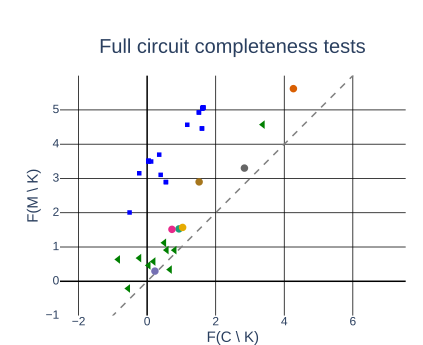

---
版本：v0.12.0
最后更新：2026-10-21
适用课次：第 4 课
文档类型：学生正式讲义
状态：本地修订稿；网站保持冻结基线，新版本未发布；教师内容复核、工具实测和现场教学另登记
本轮修订状态：IOI 主线修订；本轮预览独立检查，教师与现场复核另登记
变更记录：
- v0.12.0 (2026-10-21): 在Fig.6判断前补论文问题、贡献、M/C/K/F与均值消融；恢复比例、代码和Keshav转按需，保留一张本人卡。
- v0.11.0 (2026-10-20): 区分教师MI演示与学生个人项目，补齐跨方向验证和迁移；课程结构与评分不变。
- v0.10.0 (2026-10-20): 围绕 IOI 原文、图表与课程代码统一精读主线；Keshav/SAE 转为按需补充；课堂产出与负荷不变。
- v0.9.1 (2026-10-14): 标明当前修订稿与冻结网站的发布边界；线上基线保持不变。
- v0.9.0 (2026-10-13): 补充 32 页课堂主线对应的方法与工件解释，统一一条主张的精读边界；正式提交与课外预算不变。
- 2026-10-12：共同诊断与本人迁移修订；课外总投入每课不超过 60 分钟，四次提交与评分不变。
- v0.7.0 (2026-10-01): 评价证据角色、早期试探与内容验收统一；加入 RSI 补充案例，正式提交和评分不变。
- v0.6.1 (2026-09-16): 按教师“通过，修改后续课程和PPT”确认推进；统一机制、可复算案例及真实日志字段，修复逐页映射，保持既定目标与 90 分钟安排。
- v0.6.0 (2026-09-12): 减负轮将课堂精读聚焦为一条关键主张的“原文位置—证据—人工判断”；Keshav 只作定位动作校准，MI C02/C16/C31 只用于收窄同一主张；明确课堂一张阅读卡、课后累计与问题门边界。
- v0.5.0 (2026-08-20): 新增 MI SAE 因果有效性公开精读线、证据阶梯图与三张完整主张级阅读卡；Keshav 方法校准示例保留
- v0.4.0 (2026-08-09): 同步第 3 课入口核验边界；明确 L3 已核身份与一条拟用主张，L4 扩展为多主张、位置、证据结构和局限精读；统一阅读卡落点为 `reading-cards.md`
- v0.3.0 (2026-08-07): 将“完整阅读卡”定义为全字段有值或写明不适用及理由；统一四态进入规则；演示替换为 Keshav 2007 真实原文对象和完整阅读卡，虚构 AI 输出逐项标注
- v0.2.1 (2026-08-07): 明确贯穿案例为课程虚构教学样例，不对应真实论文或实证结果，防止构造的页码、图表与样本数字被误当作研究证据
- v0.2.0 (2026-08-07): 统一课堂最低产出为至少 1 张完整阅读卡；偏差审计允许以 AI 错误/遗漏或已检查风险与依据完成；明确第 6 课前累计 3 张完整精读卡的项目推进时间、位置与非正式提交属性
- v0.1.0 (2026-08-06): 从零起草；定位阶段四"外部输入摄取"→阶段五"证据整理"起始；建立 AI 辅助精读五步流程、主张核验、阅读卡字段、错读审计、练习、术语与延伸阅读
---

# 第四讲｜AI 辅助精读与主张核验
## 教师演示与个人项目

MI（机制可解释性）是教师贯穿全课的研究 Demo；学生从第1课起维护自己的个人项目，方向不限于 MI。短时共同诊断用于理解方法，个人实践回到本人课题。尚未确定课题者使用可替换的公开小问题，至L6收敛。L4–L6围绕本人问题累计三张核心精读卡；每人实际执行一个 AI 研究工作流并作一次有依据的改进。 个人验证可采用 ML 对照、系统测试、数据审计或论证反例，按本人的研究问题选择。教师演示的输入、结果和工具要求只适用于对应案例。


## 导读

第 3 课把检索过程变成可复盘的方法，为每条材料分别记录预期证据角色、核验状态和筛选决定，并完成“书目身份 + 一条拟用主张”的入口核验。但一条入口核验通过的论文，如果你没有继续围绕拟用主张核对位置、指标、对照和限定条件，仍然可能成为错读的起点。

一个常见失败是：研究者让 AI 生成一篇论文的摘要，AI 输出结构完整、措辞流畅，研究者据此写下"该论文证明 X 可以降低 Y"，并把这条主张搬进自己的证据地图。问题是：

- 原文研究的任务和当前项目一样吗？
- 原文的指标和对照是什么？
- 原文说的是"降低"还是"在特定条件下降低"？
- AI 给出的页码、图表、公式位置是否真的指向它复述的内容？
- 这条主张是作者写的，还是 AI 从"看起来合理"补出来的？

如果这些没有被处理，"已读"只是一次未核验的转述。本课的目标是把精读过程变成"原文位置—主张—人工判断"的追踪关系：AI 可以建立阅读地图、提出候选解释、暴露遗漏，但每条关键主张必须回到原文位置，并由研究者作出判断。

> **本课学习边界**：当堂不追求“读完一篇论文”，只围绕一条关键主张完成一张全字段阅读卡。身份、主张、原文位置、限定、个人判断和偏差审计必须可检查；其他主张作为后续选读；第二、三张卡在第 5、6 课课堂形成，课外只补已有缺口。

## 本课研究主线：问题导向的原文、图表与代码阅读

IOI 是 Indirect Object Identification（间接宾语识别）。论文要求 GPT-2 small 根据句子补全间接宾语名字。例如：“When John and Mary went to the store, John gave a bag to Mary.” 输入在最后一个 Mary 之前截断，模型预测待补名字。John 是主语 S，第一次出现记为 S1，第二次出现记为 S2；Mary 是间接宾语 IO。模型需要利用名字的角色和重复关系。此句用于说明任务，未当作新的模型运行记录。任务和名字角色定义见 Wang 等 v1 §2。

### 先理解论文要解释什么

论文的研究问题是：GPT-2 small 怎样利用句中信息完成 IOI？作者以内部干预寻找相关注意力头、解释信息流，再检验候选电路的解释力。阅读时先建立这条论证主线，再判断某项检验支持到哪里。原文依据是摘要、§1、§3 与 §4。

电路是完整模型计算图中解释某种行为的子图。注意力头可从某些位置读取信息，并向残差流写入结果；残差流是各层共享的隐藏表示。Fig.2 给出作者提出的电路概览，具体连接的证据要回到对应干预。

### 读 Fig.6 前的操作与指标

| 记号／操作 | 在本案例中的含义 |
| --- | --- |
| M | 完整 GPT-2 small 模型 |
| C | 候选电路；运行它时，C 外节点已经按下述规则消融 |
| K | 从 C 中选出的一组节点，两边再移除同一组 K |
| F | IOI 样本上的平均 logit(IO) − logit(S)，衡量两个名字的相对偏好 |
| 均值消融 | 用参考样本的平均激活替换节点输出。参考分布 p_ABC 用三个不同名字，平均值按同一句式模板计算 |

F 为正只说明 IO 相对 S 更受偏好，不等于全词表准确率。这里“移除”指激活替换，不能理解成删除模型参数或一律置零。比较 C∖K 和 M∖K 时，前者还消融了 C 外节点。这些定义来自 §2、§2.1 和 §4.1，供读图使用；图中各类点说明什么，仍需自行判断。

原文 §4 的 faithfulness 检查候选电路能否保留任务表现，§4.1 的 completeness 进一步检验移除同组 K 后的表现是否对应，§4.2 的 minimality 检查保留组件的作用。本课集中阅读完整性检验，不把三个词当成一套已经自动满足的标准。


**核心判断：移除同一组组件后，候选电路与完整模型的表现为何可能不同？**

先让 AI 为“论文研究什么、提出什么解释、怎样检验”生成阅读地图。核对摘要与 §1 的问题和贡献，再定位 §2／§2.1 的任务与操作、§4.1 的评价。保留原始建议及核验后的采用、修订或维持理由。课程代码比较按需查阅，不列入共同诊断必做项。

完成第一张完整精读卡，保留 AI 初始解释、两个原文位置和本人允许使用的主张；必要时让 AI 根据原文纠正解释。

区分论文作者的结论、代码实际执行与本人的迁移推断；若实验设置不同，写明具体差别。

本课产物：第一张核心精读卡及有依据的主张范围。L5 带入第二项条件不同或结论有冲突的来源。

完整输入、动作与完成标准见[本课研究任务](./judgment-task.md)。教师演示与个人项目的分工见[项目说明](../../course/micro-project.md)。以下示例用于解释方法；本人的主要产物回写自己的研究项目，方向不限于 MI。

## 学习目标

本课核心能力：原文支持哪种转述，支持到哪里？能以可定位证据回答，并将决定落实到本人项目。

完成本讲后，你应该能够：

1. 用五步流程（AI 导航→原文核验→AI 质疑→偏差审计→人工定稿）围绕一篇论文的一条关键主张完成结构化精读；
2. 区分 AI 主张与原文主张，对每条关键主张回到原文检查任务、设置、指标、对照和限定条件；
3. 识别 AI 错读、过度概括和伪造引用；至少记录一处 AI 错误或遗漏，未发现时记录已检查风险与核验依据；
4. 为关键论文建立阅读卡，记录页码、图表或章节位置，区分作者主张、原文证据、个人判断和 AI 建议；
5. 说明 AI 如何参与阅读、提取和评价，以及哪些拟用主张需要回到原文核对。

---

## 一、AI 辅助精读在研究链路中的位置

八阶段研究链路中，本课承接阶段四"外部输入摄取"，并向阶段五"证据整理"输出经过精读的材料。第 3 课解决“材料从哪来、哪一条拟用主张可安全进入候选表”；本课解决“选定主张的依据是什么、支持到什么程度、能怎样用于本人项目”。

> 与第 3 课的连接：第 3 课候选文献表里的 `verified` 或带完整限定的 `verified-with-caveat` 表示书目信息和至少一条拟用主张与原文一致，不表示整篇论文的贡献、证据结构和局限已经完成精读。本课围绕选定主张，建立至少两个原文位置与“主张—证据—判断”的追踪关系。

> 与第 5 课的连接：第 5 课把多篇论文的阅读卡重组为证据地图，按研究问题而非按论文排列。阅读卡里"原文位置—主张—人工判断"的追踪关系，是证据地图能区分支持、反驳、冲突和空白的基础。

AI 辅助精读不是"让 AI 读完告诉我结论"。它是一个有节奏的流程：AI 先建立阅读地图，研究者回到原文核验，AI 再根据已核验内容提出质疑，研究者审计偏差并人工定稿。每一步都有明确的产物和核验点。

---

## 二、AI 辅助精读五步流程

本课程的核心阅读采用以下流程（见 [reading-list.md](../../course/reading-list.md) 第二节）：

### 1. AI 导航

让 AI 给出一篇论文的中心问题、论证结构、关键术语、预期证据和待追问问题。全部标记为"未核验"。

这一步可以让 AI 参与论文结构化阅读，快速建立阅读地图，决定哪些段落、图表或实验值得重点读。AI 生成的地图可作为研究工件和待分析表示；它不能替代原文来证明作者提出的外部主张。常见的导航产物：

- 中心问题（一句话）；
- 论证结构（问题→方法→设置→结果→局限）；
- 关键术语表；
- 预期证据位置（图表、公式、实验编号）；
- 待追问问题（措辞强度、限定条件、对照设计）。

> 注意：AI 给出的"预期证据位置"可能是错的。它可能说"见图 3"，但图 3 说的不是这件事。这正是下一步要核验的。

### 2. 原文核验

人工阅读指定章节或段落，至少记录两个可复查的章节、页码、图表、公式或实验位置。这一步不可跳过。

核验时至少检查：

- AI 给出的中心问题与原文摘要、引言是否一致？
- AI 指向的图表、公式或实验编号是否真的对应它复述的内容？
- 原文的措辞是"降低""改善"还是"消除""解决"？
- 结果来自什么指标、什么对照、什么样本？
- 原文是否限定到特定数据集、模型、任务或条件？

记录方式：每条核验后的主张，标注原文位置（如"§3.2, p.5, Fig.2"）。没有原文位置的主张，不能进入阅读卡的"作者主张"栏。

### 3. AI 质疑

让 AI 根据已核验内容提出反例、遗漏和适用边界，与个人笔记比较。这一步的目的是暴露你自己的盲点：你可能因为觉得方法"看起来合理"而跳过了对照设计或限定条件。

AI 质疑的典型问题：

- 这个结果在什么条件下会被推翻？
- 对照是否公平？baseline 是否有被低估的可能？
- 样本规模是否足以支撑原文的结论强度？
- 原文的限定条件是否被你的笔记遗漏？
- 是否存在原文未讨论的替代解释？

AI 可以参与分析并提出反例、遗漏与适用边界。将这些内容作为研究判断时，回到原文或实验数据检查其依据，并说明采纳、修改、保留或暂缓的理由。

### 4. 偏差审计

记录 AI 解释中实际发现的错误、遗漏或已核查的风险；解释准确时，保存支持它的原文位置和检查理由。

偏差类型见 §三。偏差审计的最小记录：

| AI 输出 | 偏差类型 | 原文实际内容 | 核验位置 | 处理 |
| --- | --- | --- | --- | --- |
| "原文证明 X 消除 Y" | 过度概括 | 原文为"在数据集 D 上降低 Y" | §4.1, p.7 | 改写为限定主张 |
| "见图 3" | 位置错指 | 图 3 讨论的是另一指标 | p.9, Fig.3 | 重新定位 |
| "作者提出 Z 方法" | 张冠李戴 | Z 方法来自参考文献 [12] | §2, p.3, ref [12] | 标注真实来源 |

偏差审计记录是本课课堂产出之一。它不是"AI 出了错"的笑话集，而是后续评价 AI 辅助阅读工作流的重要证据。

### 5. 人工定稿

由学生写出最终阅读卡，区分作者主张、原文证据、个人判断和 AI 建议。阅读卡字段见 §四。

人工定稿的判断责任在学生。AI 可以建议措辞、补充候选、提出质疑，但阅读卡里的"作者主张"必须能回到原文位置，"个人判断"必须写明理由和适用边界。

---

## 三、主张核验：区分 AI 主张与原文主张

### 相邻构造例：观察、解释与迁移

以下两例是课堂构造材料，不是论文结果或模型实测。第一例：同一负载、同一机器上，P95延迟由100 ms降到80 ms。这是给定观察；“改善来自缓存命中变化”是一种解释；“禁用缓存后差距缩小”是尚待检验的预测。即使预测实现，也要检查禁用缓存是否同时改变其他条件，不能只凭一个结果作唯一归因。

第二例的构造原文是：“同16核、并发64、固定请求集，A为8k req/s，B为10k req/s；未测突发流量与尾延迟。”它支持该设置下B的吞吐量高25%，还不能支持“B将改善我项目的突发负载表现”。反查时先将后一句收窄到已测条件，再把突发负载与P95检查列为下一步。没有代码的项目同样核对原文前提与本人用途是否一致。

### 1. 为什么要区分

生成式模型在复述论文时，会把原文内容、模型推断和"看起来合理"的补充混在一起输出。如果不区分，研究者会把 AI 的推断误当成作者的主张，再把这种误认带进证据地图。

一条 AI 复述的可能来源：

- 原文确实写了（作者主张）；
- 原文写了相关内容，AI 推断出更具体的结论（模型推断）；
- 原文没写，AI 根据常识或相关文献补充（模型新增）；
- AI 把不同论文的内容拼装（张冠李戴）；
- AI 改写了措辞强度（过度概括）。

只有第一种能进入阅读卡的"作者主张"栏。后四种必须标为模型推断、待核验或偏差。

### 2. 回到原文检查什么

对每条关键主张，至少回到原文检查以下五项：

| 维度 | 检查问题 | 举例 |
| --- | --- | --- |
| 任务 | 原文研究的任务和当前项目一样吗？ | 原文是医学问答，当前是代码生成——不能直接迁移 |
| 设置 | 输入、规模、条件是什么？ | 原文用 100 条样本，当前项目需要 10k 规模 |
| 指标 | 用什么度量？定义是否一致？ | 原文用准确率，当前用 F1——不能直接比较 |
| 对照 | baseline 是什么？是否公平？ | 原文 baseline 未调参——"降低"可能只是对照过弱 |
| 限定 | 原文限定的范围是什么？ | 原文只验证英语，不能外推到多语言 |

这五项是本课程整理的主张检查框架。Keshav 第二遍强调掌握内容、暂略证明细节，第三遍才指向深入理解；任务、设置、指标、对照、限定并非该文的逐字五项清单。

### 3. 错读、过度概括与伪造引用

本课要求识别的三类常见偏差：

1. **AI 错读**：AI 复述的任务、设置、指标或对照与原文不一致。例如原文研究的是"在固定预算下的检索质量"，AI 复述为"检索质量"。
2. **过度概括**：措辞强度被改写。原文"在条件 C 下降低 Y"，AI 输出"消除 Y"或"解决 Y"。
3. **伪造引用**：AI 给出的题名、作者、年份、页码、DOI 与正式来源无法对应，或把不同论文的内容拼装成一条。

> 与第 3 课的连接：第 3 课入口核验处理“文献身份是否一致，以及一条拟用主张能否安全使用”；本课内容核验处理“选定关键主张、原文位置、证据结构和局限是否被准确理解”。

---

### 4. 拆开断言，核对指标与证据强度（恢复比例算例按需查阅）

“恢复答案偏好，所以已经找到完整 IOI 电路”包含两个层次。前半句描述干预结果，后半句解释原模型怎样完成任务。核验时分别找结果依据与机制验证，明确什么观察会改变你的解释。

课程代码的指标是 `logit(原句间接宾语) − logit(原句主语)`，在原句、扰动和各类干预中使用同一对名字。它衡量这两个候选的相对偏好；正值只表示前者的概率较高，不能据此断言它是整个词表概率最高的词。

**虚构教学算例，非模型运行结果**：clean = 4，corrupt = −2，patch = 1。patch 相对 corrupt 改善 3 个 logit 单位，仍低于 clean。若额外定义恢复比例 `(patch−corrupt)/(clean−corrupt)`，此例为 1/2；它是该定义下的比例，不是准确率。分母接近零、为负或样本间不同，都会改变解释。课程运行器保存原始分数和差值，未把这个比例列为默认评价指标。

允许转述先写清干预对象、输入条件、比较基线与指标。主张从“该位置在指定输入对和干预下改变答案偏好”提升为机制解释，还需要排查替代通路、冗余与跨条件表现。具体检查要跟随所主张的机制，不能机械凑固定证据数量。

### 5. 两处位置与三种声音

至少两个原文位置分别承担不同核验动作，例如结果图支持观察、方法段界定对照，或者方法段说明流程、经验段说明支持强度。位置可以在同一页的不同段，重复摘抄同一句不会增加证据。指出全文未报告某实验时，要检查与断言相关的完整文本；一张局部截图只能说明图中没有该内容。

作者主张与作者自述局限写入作者栏，AI 导航、推断与质疑写入待核建议及审计，本人迁移判断与识别的缺口写入本人判断。原文证据是这些判断的可定位支撑。AI 提出的质疑也需核验，不成立时保留理由并维持原判断；未发现错误时记录已查风险，无模型时注明人工提问与核验。

### 6. 论文干预与课程代码的条件比较（按需查阅）

IOI 论文在注意力头及路径上分析信息流；课程包在指定 Transformer block 输出的一个 token 位置替换整个 hidden 向量。两者都涉及内部干预，但干预粒度、输入构造和验证目标不同。读论文时应把这些差异写入个人判断，而不是仅因模型名字相同就视为复现。

代码中的 `changed[:, pos, :] = replacement` 给出替换范围；`layer = model.transformer.h[policy['layer']]` 给出挂钩对象。`policy-baseline.json` 使用零起始 layer 5 和原句第二次主语位置，属于研究起点。代码可证明程序实现了何种干预，实际效果必须读取真实运行记录。详见[精读输入与代码定位](./ioi-reading-guide.md)。


---

### 从真实方法文核对动作与用途（按需查阅）

Keshav 的 *How to Read a Paper* §2.1要求第一遍阅读结论、标题等，帮助决定是否继续；§2.2第二遍细看图表、概括主线及支持证据，但暂略证明细节；§2.3第三遍尝试在脑中重新实现论文，重建作者假设与推理。课堂据此区分：初筛不能代替证明核验，概括证据也不等于运行复现。原文是作者经验性方法建议，没有在这些段落中提供“三遍法比所有其他方法更高效”的受控比较。本人可按证据缺口选择下一动作，再用实际记录检查是否有效。[公开原文](https://web.stanford.edu/class/ee384m/Handouts/HowtoReadPaper.pdf)

## 四、阅读卡字段

阅读卡是本课的课堂产出，也是第 5 课证据地图的输入。最小字段：

```text
论文：题名 / 作者 / 年份 / DOI
来源核验状态（承接第 3 课）：pending / verified / verified-with-caveat / rejected
证据角色（承接第 3 课）：主证据 / 补充 / 对比 / 探索线索
中心问题（一句话，核验后）
作者主张（每条标注原文位置）：
  - 本课选定的一条关键主张
  - 核验位置 1 → §x.x, p.x, Fig.x（支持依据）
  - 核验位置 2 → §x.x, p.x, Table x（条件、补充或限制）
原文证据（指标、对照、样本、限定）：
  - 指标：
  - 对照：
  - 样本：
  - 限定：
局限与边界（作者自述 + 个人判断）：
  - 作者自述：
  - 个人判断：
个人判断（适用性、待验证、与当前项目的关系）：
AI 建议（待核验，不混入作者主张）：
AI 偏差审计（错误/遗漏，或已检查风险与依据，见 §二·4）：
内容核验状态：pending / verified / verified-with-caveat / rejected
```

字段说明：

- **作者主张**：每条必须标注原文位置（章节、页码、图表、公式或实验编号）。没有位置的主张不能进入此栏。
- **原文证据**：不是 AI 复述的指标，而是你在原文找到的、可复查的数字、表格或实验设置。
- **局限与边界**：区分"作者自述的局限"和"你判断的边界"。作者可能只说"样本小"，你判断"只验证了英语，不能外推到中文"。
- **个人判断**：写明这条主张在当前项目里能支撑什么、不能支撑什么、是否需要补充实验或材料。
- **AI 偏差审计**：至少记录一处 AI 错读、过度概括、位置错指或伪造引用；未发现明显错误时，记录已检查的风险点及核验依据。
- **核验状态**：`pending` 可留在候选表线索区，但不能进证据地图主格；`verified` 可进主格；`verified-with-caveat` 进主格时必须保留范围、方法、版本或措辞限定，不得单独支撑 `stable`；`rejected` 仅留审计记录。

本课所说的“完整阅读卡”不是把整篇论文读完，而是围绕至少 1 条关键主张，将上述所有字段填入可复查内容；不适用的字段必须写明“不适用”及理由，不得留空。

阅读卡统一保存在个人项目 `reading-cards.md`。第 5 课再把其中的主张—位置对重组进证据地图；第 6 课问题门统一检查至少 3 张与个人项目直接相关的完整精读卡。

---

## 五、常见错误

1. **AI 摘要当作原文**：把 AI 输出的摘要直接当成论文主张，不核对原文位置、图表和限定。可记录 AI 的分析与引用位置，但拟用的作者主张须对回原文。
2. **主张无位置**：写"作者认为 X"，但不标原文位置。无法复查的主张不能进入证据地图。
3. **措辞强度被改写**：原文"降低"被写成"消除"，原文"在条件 C 下"被省略。每条主张检查任务、设置、指标、对照、限定五项。
4. **AI 质疑未核对就写成结论**：AI 提出"这个结果可能不成立"，研究者直接写进阅读卡。把它转化为可检查的问题，回到原文或数据核对，并记录自己的处理理由。
5. **偏差审计缺位**：只记录 AI 的结论，没有记录实际核验的风险与依据。未发现错误时也要保存检查记录。
6. **阅读卡不区分判断来源**：作者主张、原文证据、个人判断、AI 建议混在一栏。阅读卡必须四类分栏。
7. **外推未限定**：原文只验证了特定数据集或任务，阅读卡直接写"该方法有效"。必须记录原文限定条件和个人判断的边界。

---

## 六、IOI 精读：原文、图表与代码怎样共同约束主张

本课沿用第 3 课的 Wang 等 IOI 论文 v1。核心问题是：一项干预改善结果，足以支持怎样的机制判断？阅读路线先定位问题、贡献、任务和指标，再检查作者怎样验证解释；课程代码比较作为按需扩展。

### 1. 用问题选择原文位置

§2 提供任务和指标，§2.1 说明完整性检验中的 mean ablation；§3.1 与附录 B 另行说明 path patching，§4–4.2 给出机制解释的验证方式。学生选定一条主张后，至少核对两个承担不同作用的位置：分别说明每处证据如何支持、限定或改变判断。记录章节、图号及其作用，避免只列一串页码。

### 2. 从图中读出作者实际比较什么



*Wang 等，arXiv:2211.00593v1，§4.1 Fig.6(a)，CC BY 4.0。原图未改动，来源登记见 [assets](./assets/README.md)。*

图例见[Fig.6原文共用图例](./assets/ioi-completeness-legend-original.svg)：绿色三角表示随机集合，蓝色方块表示贪心集合，灰圆表示空集合，其余不同颜色圆点表示组件类别。链接中的(b)为naive circuit，当前判断仍用上方(a)的数据。

读取图时先独立回答：两个坐标各测量什么？一个点对应哪个研究对象？不同采样方式如何改变比较？回到原文 §4.1 查明方法，再写两种解释与下一项检查。只记“支持／不支持”不能说明证据的作用。

### 3. 将论文评价问题迁移到自己的项目

依据本人研究问题，选择适用的比较条件。ML 论文可核对数据与消融，系统论文可核对负载与资源，理论材料可核对前提与推导。每处原文位置都应回答一个具体问题，阅读卡中分开保存作者论证与本人的推断。

### 4. 把判断回写为可复查的阅读卡

例如，某系统论文在固定并发负载下比较吞吐量。原图支持该负载下的表现；是否能用于本人的突发负载，需要继续核对负载生成和资源约束。这是教学构造的相邻例，不是 IOI 诊断答案，也不是已执行的实验。

课堂让 AI 先生成阅读地图，再围绕已核原文提出一项可检查的质疑。保存真实输入与相关输出。共同诊断的教师参考判断在初判保存后揭示；学生仍需完成本人论文的卡片。

### 按需补充

[Keshav 阅读卡](./reading-card-demo.md)用于阅读深度和转述强度校准；[SAE 与子空间干预卡](./mi-reading-card-demo.md)用于比较不同条件下的证据。两份材料保留原来源身份，本课不要求额外完成它们。L5 可从已有候选中选第二项条件不同或有冲突的来源。

---

## 七、共同诊断与本人迁移

教师用 IOI 说明如何从原图和实际操作形成研究判断。初判时只分发研究任务、原文输入与原图；学生先写观察、解释和下一检查，再比较意见。完整讲义含下方解析，在 P14 教师校准后开放；折叠或页内提示本身不承担答案保密作用。

随后回到本人研究，选定一条影响下一步的主张，核对两处原文。ML 项目可查消融与数据条件，系统项目可查负载与资源，理论或文献项目可查推导、反例和覆盖范围。机制图、代码和模型实验不是所有项目的要求。

完成第一张完整精读卡，保留本人问题、AI 导航或质疑、两个原文位置、条件与最终决定。未带论文者使用[公开备用短材料](./personal-reading-inputs.md)。L5带入该卡及一项能补足缺口的来源。完整任务见[本课研究任务](./judgment-task.md)。

### 作答后解析：Fig.6(a) 怎样检验完整性

此解析供教师揭示后及课后独立阅读。依据为 Wang 等 v1 §2.1、§4.1 和 Fig.6(a)。

M 是完整模型，C 是候选电路，K 是 C 内选出的被移除节点集合；节点按注意力头及 token 位置界定。F 表示在论文 IOI 输入分布上的平均 logit 差。横轴 F(C∖K)，纵轴 F(M∖K)，一个点对应一组 K，不是一条输入句子。候选电路运行本来就移除了 C 外节点；两者再移除相同 K，所以要同时核对共有的移除集合与各自保留的背景。

“移除”不是把激活简单设零，也不是把一条 clean 样本的完整向量搬过来。§2.1 的 mean ablation 用参考分布 p_ABC 中的平均激活替换节点。p_ABC 沿用 IOI 的句法模板，但改用三个无关随机名字；平均在相同模板内计算，以保留相应位置的句法信息。§3.1 的 path patching 是另一项信息流分析操作，不能直接当作 Fig.6(a) 的 knockout 定义。课程默认 residual patch 又是第三种操作，应分别比较。

对角线 y=x 表示两种表现相等，|x−y| 衡量该 K 下的完整性缺口。随机选择 K 和按组件类别选择 K 得到的小差异，支持电路在这些检查下保留了相关行为；贪心选择会主动寻找较大差异，它找到困难反例。因此不能从随机检查的成功推成所有 K 下都完整，也不能把主动搜索所得的点当作随机输入上的失败率。这些结果支持一项有边界的判断：候选电路解释了重要行为，但尚未通过更强的完整性检查。

原文没有从这些点单独识别缺口的唯一机制。候选电路外的通路、冗余或补偿关系是待研究解释；干预规则和输入分布则是解释成立的条件，不能仅因有偏离就声称它们造成了伪影。可固定输入、K 和均值替换规则，预先指定补入组件并比较差异；也可固定组件和 K，改变参考分布。前者检验特定遗漏解释，后者检验结论对操作条件的敏感性；两者都需新结果，不能用实验设计冒充验证。

阅读卡可写：“§4.1 / Fig.6(a) 的贪心检验暴露完整性缺口；§2.1 规定了该判断的均值替换和参考分布条件。我保留当前电路仍不完整的结论，暂缓唯一归因。先固定替换规则补回预先指定的候选路径：遗漏解释预期偏差缩小；再固定电路改变参考分布：设置依赖预期结论随之变化。两项检查尚未执行，单项结果都不能唯一归因。”选择组件与K的过程须与评价输入分开记录。这是教师示范，学生的实际AI记录和本人决定须自行填写。

## 八、术语表

| 术语 | 本课程中的含义 |
| --- | --- |
| AI 导航 | 让 AI 给出中心问题、论证结构、关键术语和预期证据位置，全部标记"未核验" |
| 原文核验 | 人工阅读指定段落，记录可复查的章节、页码、图表或公式位置 |
| AI 质疑 | 让 AI 根据已核验内容提出反例、遗漏和适用边界，作为候选问题 |
| 偏差审计 | 记录至少一处 AI 错读、过度概括、位置错指或伪造引用，或记录检查过的风险点 |
| 人工定稿 | 由学生写出阅读卡，区分作者主张、原文证据、个人判断和 AI 建议 |
| 作者主张 | 原文确实写了的内容，必须能回到原文位置 |
| 模型推断 | AI 根据原文相关内容推断出的更具体结论，不是作者主张 |
| 过度概括 | 措辞强度被改写，如"降低"被写成"消除" |
| 伪造引用 | AI 给出的题名、作者、年份、页码或 DOI 与正式来源无法对应 |
| 阅读卡 | 记录一篇论文主张、证据、局限、个人判断和 AI 偏差的结构化卡片 |
| 核验状态 | pending / verified / verified-with-caveat / rejected |
| 原文位置 | 章节、页码、图表、公式或实验编号，用于复查主张来源 |

---

## 九、延伸阅读与课程材料

课程内材料：

- [课程大纲](../../course/syllabus.md)
- [备课规划](../备课规划.md) 第 4 课
- [逐课阅读清单](../../course/reading-list.md) 第 4 课
- [早期研究脚手架](../../course/starter-template.md)
- [项目里程碑与研究门](../../course/assignments.md)

正式书目与按需参考（见 [reading-list.md](../../course/reading-list.md) 第 4 课）：

- 核心：Wang 等，*Interpretability in the Wild: a Circuit for Indirect Object Identification in GPT-2 small*，预印本 2022 / ICLR 2023。[v1 原文](https://arxiv.org/html/2211.00593v1)。本课核对 §2、§4.1 / Fig.6(a)，方法按需回查。以下为补充参考：

1. Keshav, S. "How to Read a Paper." *ACM SIGCOMM Computer Communication Review* 37(3), 83–84 (2007). DOI: [10.1145/1273445.1273458](https://doi.org/10.1145/1273445.1273458)。[作者课程 PDF](https://cs.uwaterloo.ca/~brecht/courses/854-http-video-2012/readings/keshav-paper-reading.pdf)。用途：以三遍阅读法控制阅读深度，建立实验论文的检查问题。
2. Booth, W. C. et al. *The Craft of Research*, 5th ed. University of Chicago Press, 2024. 选读 Chapter 4 "Engaging Sources"，重点为 reading for a problem、argument、data and support。[出版社页面](https://press.uchicago.edu/ucp/books/book/chicago/C/bo215874008)。用途：防止把作者主张、数据、证据和个人推断混为一谈。
3. 沈向洋、华刚：《读科研论文的三个层次、四个阶段与十个问题》。[本地转载副本](<../../references/library/research-method/how to search/沈向洋、华刚：读科研论文的三个层次、四个阶段与十个问题 - 知乎.pdf>)。只作为中文提问清单；正式分发前须确认原始出处与许可。

## 补充：早期试探也能帮助收敛问题

第 3–6 课允许有预算上限的数据格式与独立样本审计、环境检查、最小反例和试跑。文献地图不能替代对数据与评价器可用性的检查；完整工程仍在问题与协议基本明确后展开。

把目的、预算上限、输入与来源、观察、对问题的影响及待核验项写入现有笔记或主文档。探索可修改问题；后续验证说明此前已看过哪些数据，保留独立证据。未知失败含义和未确认独立样本数不能直接改写成零收益或独立观察。

[RSI 问题门审计](../lesson-11/assets/rsi-selection-case/README.md#problem-gate)展示如何从缺少可执行历史和表格口径差异，收窄为可控偏差诊断。它是补充材料，不新增个人项目或正式提交。

## 课外预算与下次输入

课外总投入最多 **60 分钟**：指定阅读 15 分钟，准备 10 分钟，项目补全 35 分钟。阅读范围：围绕本人论文的一条关键主张核对两处位置；教师 IOI 输入只补查 §2.1 与 §4.1 / Fig.6(a) 的课堂缺口。§3.1 / 附录 B 仅用于另行方法比较，不增加必读任务。

项目补全：完善第一张卡并选第二项来源的关键段落；不另加两篇整文精读。

安装、下载与排障计入总预算。准备超出预算即采用现成 CPU 起点或纸面备用；未完项带回课堂收窄或补关键检查。三张完整精读卡在 L4、L5、L6 的课堂迁移中逐张完成，课后只补相应缺口。报告、说明和展示从累计项目整理；不增加独立文档或正式提交。
