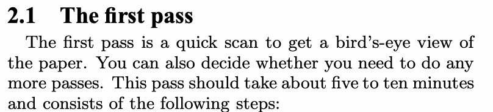
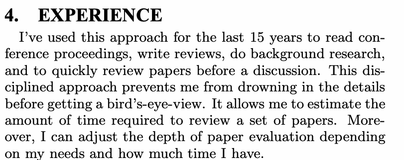
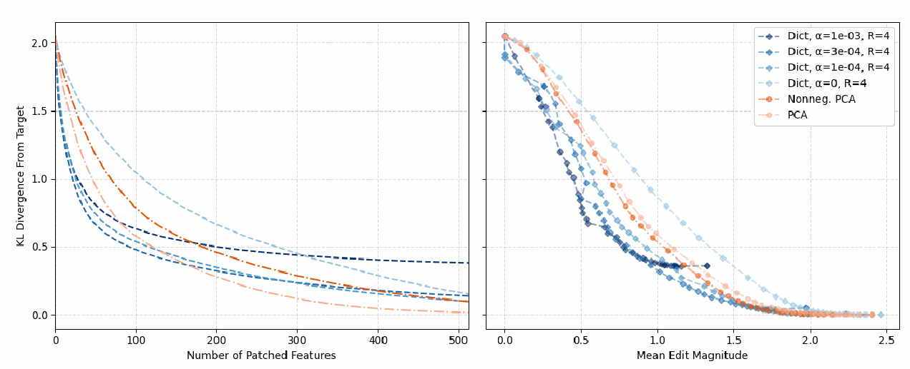

---
版本：v0.12.1
最后更新：2026-10-13
适用课次：第 4 课
文档类型：正式课堂 PPT 逐页内容母稿
状态：现行修订稿；教师复核和现场验证单列
本轮修订状态：2026-10-13 扩展至 32 页并复核内容与节奏；教师复核及现场试教单独登记。
变更记录：
- v0.12.1 (2026-10-13): 移除屏显页脚的讲义及内部文件映射，原文出处保留；映射仍保存在本母稿与教师备注。
- v0.12.0 (2026-10-13): 扩展为 32 页连续课堂主线；展开方法、证据、共同诊断与本人回写；保留 90 分钟与原有交付。
- v0.10.3 (2026-10-01): 评价证据角色、早期试探与内容验收统一；加入 RSI 补充案例，正式提交和评分不变。
- v0.10.2 (2026-09-22): Pi Agent 改为课堂主平台，OpenCode 等为备选；同步相关入口与操作边界，课程结构、评分及提交节点不变。
- v0.10.1 (2026-09-16): 按教师“通过，修改后续课程和PPT”确认推进；统一机制、可复算案例及真实日志字段，修复逐页映射，保持既定目标与 90 分钟安排。
- v0.10.0 (2026-09-15): 整体复审内容修订；统一证据维度、假设与可复演案例，补教学诊断、板书及过渡；本轮源文件状态与 PPT 同步情况见 README。
- v0.9.1 (2026-09-12): 按视觉准则 v1.5.0 把原文、阅读卡和证据阶梯提升为主对象；标题 30–32pt、常规正文 22–24pt、原文/工作表 18–20pt，正文改以 regular 为主。P11 改用 Keshav p.83 §2 真实原文裁图与一项划读任务，P15 改为两栏阅读卡工作表并移除屏显计时。页数、屏显语义与 90 分钟结构不变。
- v0.9.0 (2026-09-12): 减负轮将课堂主线聚焦为一条关键主张的原文位置—证据—判断；方法与演示各 15 分钟，P15 个人实践改为 12+10 分钟并插入 5 分钟教师点评；全部逐页时间改为整数时长；页数不变，PPTX 待同步。
- v0.8.0 (2026-08-20): 封面精简为“第4讲 + 正式课名”并抬至模板两横线之间；新增 P17 独立知识点总结，原退出卡与第 5 课预告顺延为 P18；85-90 分钟收束段各分配 2.5 分钟
- v0.7.0 (2026-08-20): P12-P13 加入 MI-C02/C16/C31 证据阶梯与三卡判断；Keshav P11 保留为快速校准，页数与时间结构不变
- v0.6.0 (2026-08-09): 同步 L3/L4 分工；P02 明确 L3 已完成身份与一条拟用主张入口核验，L4 深化多主张与证据结构；统一阅读卡落点为 `reading-cards.md`
- v0.5.0 (2026-08-07): 统一完整阅读卡全字段验收与四态规则；P11-P13 演示改为 Keshav 2007 真实原文对象 + 显式标注的课堂构造 AI 输出 + 完整阅读卡；P15 模板补齐来源状态、AI 建议与不适用理由
- v0.4.0 (2026-08-07): 完成 17 页正式 PPTX；保留交大模板 master/layout、标题带、校徽与页码；17/17 页 notes 含 `[Sources]`；通过画布边界、模板保真、LibreOffice 重开、全页与高风险页视觉检查；P11-P13 画面与 notes 均标注虚构教学样例
- v0.3.1 (2026-08-07): 同步备课规划 v2.2.0；删除 P09 重复的“张冠李戴”；P11-P13 明确贯穿案例为虚构教学样例，不对应真实论文或实证结果
- v0.3.0 (2026-08-07): 同步 handout v0.2.0 与 teaching-plan v0.3.0——课堂最低产出统一为至少 1 张完整阅读卡；偏差审计允许记录 AI 错误/遗漏或已检查风险与依据；明确第 6 课前累计 3 张完整精读卡；17 页、8 段时间与逐页映射不变
- v0.2.0 (2026-08-06): gate 3-4 re-fit + gate 2 保守审校——方法段合并 3 处去重（P06 吸收 P11 检查五项、P08 吸收 P12 错读类型、P09 吸收 P10 主张区分），全文 20→17 页；每页建议时间按 备课规划 v2.1.0 第 4 课逐时间表 8 段重排（0:00-90:00 段内均分，修复演示段原 6 分钟→16 分钟缺口）；90 分钟节奏表页码列、逐页映射表与正文页码引用同步重编号；gate 2 去除 3 处备注 meta 自白（P05/P07/P08），标题腔保留 P01/P04 两处张力
- v0.1.0 (2026-08-06): 从零起草；20 页；含 §一 使用说明/本课目标/适用条件/90 分钟节奏表/逐页映射表 + 逐页 P01-P20 六段结构；节奏对齐 备课规划 v2.1.0 默认节奏与第 4 课目标
---

# 第 4 课逐页母稿｜方法、案例与研究判断

## 使用与教学路由

屏显页脚仅保留公开原文出处。讲义、教案及内部文件对应仅保存在逐页映射与教师备注，不投屏。

32 页按顺序使用。P10–P13 先独立判断和同伴比较，P14–P17 再揭示教师依据。P04–P09 使用相邻示例；P18–P20、P24–P27 是本人项目操作参照。教师详细答案留在本课教师材料，学生任务不预置裁决。

| 时长 | 环节 | 页码 | 课堂结果 |
| --- | --- | --- | --- |
| 5 分钟 | 入口与交付 | P01–P03 | 定位输入与本课交付 |
| 10 分钟 | 方法与相邻示例 | P04–P09 | 理解方法，保留共同题独立判断 |
| 10 分钟 | 独立共同诊断 | P10–P11 | 记录初判、依据与缺证 |
| 10 分钟 | 同伴比较 | P12–P13 | 比较不同判断与证据 |
| 5 分钟 | 教师揭示校准 | P14–P17 | 逐步揭示依据，修订初判 |
| 15 分钟 | 本人迁移一 | P18–P20 | 完成本人决定与第一项核验 |
| 5 分钟 | 中点点评 | P21–P23 | 解决共性卡点，收窄主张 |
| 15 分钟 | 本人迁移二 | P24–P27 | 补第二项核验并完成实际回写 |
| 10 分钟 | 同伴反查与修订 | P28–P30 | 反向检查证据，作者记录处理 |
| 5 分钟 | 总结与下次输入 | P31–P32 | 核对产出并准备下次输入 |

总计 90 分钟。首次书面判断在入口段内开始；独立共同作答在开课 15 分钟后。两段本人实践各 15 分钟，中点点评独立安排 5 分钟。实践页作为操作参照，不额外占用学生实践。

## 逐页映射

| 页码 | 页面任务 | 讲义位置 | 证据角色 | 学生动作 |
| --- | --- | --- | --- | --- |
| P01 | 第4讲 AI 辅助论文精读与深度分析 | §导读 | 课程方法与工件要求 | 打开第3课候选与原文。 |
| P02 | 入口核验之后继续精读 | §一、AI 辅助精读在研究链路中的位置 | 课程方法与工件要求 | 指出本人主张中最需要深入核对的一项。 |
| P03 | 本课带走第一张完整精读卡 | §四、阅读卡字段 | 课程方法与工件要求 | 定位自己的阅读卡文件并选一条拟用主张。 |
| P04 | 五步阅读各自产生什么 | §二、AI 辅助精读五步流程 | 课程方法与工件要求 | 说出哪一步负责最终采纳。 |
| P05 | AI 导航的输入与待核输出 | §二、AI 辅助精读五步流程 | 教学构造与执行证据 | 从地图中选出一个最先核对的位置并说明理由。 |
| P06 | 一句转述里可能混着多个断言 | §三、主张核验：区分 AI 主张与原文主张 | 教学构造与执行证据 | 给自己的拟用主张圈出对象、比较、结果与范围词。 |
| P07 | 任务与设置决定可比范围 | §三、主张核验：区分 AI 主张与原文主张 | 教学构造与执行证据 | 在自己论文中定位任务和设置段。 |
| P08 | 指标与对照决定结果的含义 | §三、主张核验：区分 AI 主张与原文主张 | 教学构造与执行证据 | 核对分母，说明两种差异表述的区别。 |
| P09 | 限定条件与允许转述 | §三、主张核验：区分 AI 主张与原文主张 | 教学构造与执行证据 | 把本人主张暂写成受限版本，缺项标待查。 |
| P10 | 同一来源的两种转述 | §七、共同诊断与本人迁移 | 真实原文及核验记录 | 逐句圈出需要核验的断言，独立选择并写理由。 |
| P11 | 原文定位任务 | §七、共同诊断与本人迁移 | 教学构造与执行证据 | 打开原文，独立寻找至少两个核验位置。 |
| P12 | 同伴比较：证据支持到哪一步 | §七、共同诊断与本人迁移 | 教学构造与执行证据 | 各自展示一处支持位置和一处待核问题。 |
| P13 | 主张逐项裁决的记录 | §七、共同诊断与本人迁移 | 教学构造与执行证据 | 同伴共同反查，作者独立写下当前裁决。 |
| P14 | 原文支持的方法描述 | §六、真实演示：Keshav 2007 原文到完整阅读卡 | 真实原文及核验记录 | 对照原文修订本人初判中的时长与深度描述。 |
| P15 | 效果断言需要怎样的证据 | §六、真实演示：Keshav 2007 原文到完整阅读卡 | 真实原文及核验记录 | 说明为何单有经验叙述不足以支持 B 的量化效果。 |
| P16 | 作者主张与本人迁移分栏 | §三、主张核验：区分 AI 主张与原文主张 | 课程方法与工件要求 | 把自己卡片中作者的话与自己的设计判断分开。 |
| P17 | 核验后的一条合格转述 | §六、真实演示：Keshav 2007 原文到完整阅读卡 | 真实原文及核验记录 | 写出自己的最终转述及一项尚缺证据。 |
| P18 | 本人主张与精读范围 | §七、共同诊断与本人迁移 | 课程方法与工件要求 | 选定一条主张，写明它与本人项目的联系。 |
| P19 | 本人阅读地图 | §二、AI 辅助精读五步流程 | 课程方法与工件要求 | 保存一份本人阅读地图，给候选位置标“待核验”。 |
| P20 | 第一处证据：主张与研究条件 | §三、主张核验：区分 AI 主张与原文主张 | 课程方法与工件要求 | 完成第一处证据及条件记录，标出仍待查的内容。 |
| P21 | MI 结果：相同 KL 下的干预代价 | §六、真实演示：Keshav 2007 原文到完整阅读卡 | 真实原文及核验记录 | 指出结果中的模型、任务、对照和指标。 |
| P22 | 限制证据是否直接反驳前一篇 | §六、真实演示：Keshav 2007 原文到完整阅读卡 | 真实原文及核验记录 | 说明哪一处条件差异使“直接推翻 C02”过强。 |
| P23 | MI 主张如何收窄 | §六、真实演示：Keshav 2007 原文到完整阅读卡 | 真实原文及核验记录 | 把本人主张也改写成“已支持范围＋下一项证据”。 |
| P24 | 第二处证据：限定与缺证 | §三、主张核验：区分 AI 主张与原文主张 | 课程方法与工件要求 | 记录第二处位置，并说明它怎样影响主张。 |
| P25 | AI 质疑与人工验证 | §二、AI 辅助精读五步流程 | 课程方法与工件要求 | 提出并实际核查一项质疑，允许维持原判断。 |
| P26 | 偏差审计：记录查过什么 | §二、AI 辅助精读五步流程 | 真实原文及核验记录 | 完成一条真实偏差记录，或一条已查风险记录。 |
| P27 | 完整阅读卡的合格样貌 | §四、阅读卡字段 | 课程方法与工件要求 | 确认本人全字段有值或有不适用理由，并完成保存。 |
| P28 | 同伴由转述反查原文 | §七、共同诊断与本人迁移 | 课程方法与工件要求 | 同伴打开两个位置，核对转述并记录依据。 |
| P29 | 三种声音的归属检查 | §三、主张核验：区分 AI 主张与原文主张 | 课程方法与工件要求 | 挑一句容易混淆的话，确认归属或修正分栏。 |
| P30 | 作者修订与未决项 | §七、共同诊断与本人迁移 | 课程方法与工件要求 | 保存修改并向同伴指出一处决定及依据。 |
| P31 | 精读的五步与一条证据链 | §学习目标 | 课程方法与工件要求 | 用自己的卡片说明哪项核验改变或维持了判断。 |
| P32 | 交付自查与第 5 课输入 | §课外预算与下次输入 | 课程方法与工件要求 | 圈出下一项来源及其不同条件，保留本课卡片。 |

## P01｜第4讲 AI 辅助论文精读与深度分析

### 页面任务与内容依据

打开第3课候选与原文。 内容依据：[讲义](./handout.md) §导读。证据角色：课程方法与工件要求。下一页：入口核验之后继续精读。

### 屏显内容

第4讲 AI 辅助论文精读与深度分析

### 视觉结构

保留原交大极简封面与正式课名。

### 教师讲述备注

本课从上节课已选的关键主张开始。

### 互动／操作

打开第3课候选与原文。

### 建议时间

本页属于 P01–P03“入口与交付”，该段合计 5 分钟，本页不重复累加。

### 来源与事实边界

handout.md §导读；course/assignments.md 课堂推进与问题门。原文与构造示例按屏显标记区分。

## P02｜入口核验之后继续精读

### 页面任务与内容依据

指出本人主张中最需要深入核对的一项。 内容依据：[讲义](./handout.md) §一、AI 辅助精读在研究链路中的位置。证据角色：课程方法与工件要求。下一页：本课带走第一张完整精读卡。

### 屏显内容

第 3 课已核身份和一条拟用主张，本课深入检查它的依据与范围。

| 已有材料 | 本课增加的理解 |
| --- | --- |
| 可用候选与拟用主张 | 作者究竟研究了什么问题？ |
| 至少一个原文位置 | 设置、指标、对照与结果如何相连？ |
| 预期角色与限定 | 它支持我的项目什么，仍缺什么？ |

verified 或带完整限定的 verified-with-caveat 都可进入精读。

### 视觉结构

可编辑研究工件表或分栏对照；标题 30 pt，常规正文 22–24 pt，精读表格不低于 18 pt。

### 教师讲述备注

不把L3说成仅核身份，也不要求L4扩展为多条主张或读完整篇。

### 互动／操作

指出本人主张中最需要深入核对的一项。

### 建议时间

本页属于 P01–P03“入口与交付”，该段合计 5 分钟，本页不重复累加。

### 来源与事实边界

handout.md §一、AI 辅助精读在研究链路中的位置；course/assignments.md 课堂推进与问题门。原文与构造示例按屏显标记区分。

## P03｜本课带走第一张完整精读卡

### 页面任务与内容依据

定位自己的阅读卡文件并选一条拟用主张。 内容依据：[讲义](./handout.md) §四、阅读卡字段。证据角色：课程方法与工件要求。下一页：五步阅读各自产生什么。

### 屏显内容

核心判断：原文支持哪种转述，支持到哪里？

| 卡片区域 | 可以被同伴检查的内容 |
| --- | --- |
| 来源与主张 | 书目、拟用主张、至少两个原文位置 |
| 依据与条件 | 任务、设置、指标、对照、样本、限定 |
| 审计与判断 | AI 核验、作者局限、本人判断、剩余缺证 |

全字段有值；不适用项写理由。保存到 reading-cards.md。

### 视觉结构

可编辑研究工件表或分栏对照；标题 30 pt，常规正文 22–24 pt，精读表格不低于 18 pt。

### 教师讲述备注

当前页展示卡片样貌，不揭示共同题答案。至少两个位置可以同页不同段，必须支持不同核验动作。

### 互动／操作

定位自己的阅读卡文件并选一条拟用主张。

### 建议时间

本页属于 P01–P03“入口与交付”，该段合计 5 分钟，本页不重复累加。

### 来源与事实边界

handout.md §四、阅读卡字段；course/assignments.md 课堂推进与问题门。原文与构造示例按屏显标记区分。

## P04｜五步阅读各自产生什么

### 页面任务与内容依据

说出哪一步负责最终采纳。 内容依据：[讲义](./handout.md) §二、AI 辅助精读五步流程。证据角色：课程方法与工件要求。下一页：AI 导航的输入与待核输出。

### 屏显内容

围绕同一条主张，逐步把建议变成有依据的判断。

| 步骤 | 留下的记录 |
| --- | --- |
| AI 导航 | 未核验的阅读地图与候选位置 |
| 原文核验 | 带位置的主张、证据和范围 |
| AI 质疑 | 可回原文检查的问题 |
| 偏差审计 | 输出与原文的差异，或已查风险 |
| 人工定稿 | 区分作者、AI 和本人的最终阅读卡 |

无 AI 时以人工提问替代，并如实标记。

### 视觉结构

可编辑研究工件表或分栏对照；标题 30 pt，常规正文 22–24 pt，精读表格不低于 18 pt。

### 教师讲述备注

流程是课程整理，不宣称是Keshav提出的AI流程。个人承担最终解释与使用责任。

### 互动／操作

说出哪一步负责最终采纳。

### 建议时间

本页属于 P04–P09“方法与相邻示例”，该段合计 10 分钟，本页不重复累加。

### 来源与事实边界

handout.md §二、AI 辅助精读五步流程；course/assignments.md 课堂推进与问题门。原文与构造示例按屏显标记区分。

## P05｜AI 导航的输入与待核输出

### 页面任务与内容依据

从地图中选出一个最先核对的位置并说明理由。 内容依据：[讲义](./handout.md) §二、AI 辅助精读五步流程。证据角色：教学构造与执行证据。下一页：一句转述里可能混着多个断言。

### 屏显内容

相邻构造示例，非真实模型运行或真实论文结果。

| 输入材料 | 候选阅读地图 |
| --- | --- |
| 公开方法段与结果段 | 问题：是否保留摘要中的条件？ |
| 本人拟用主张 | 建议位置：方法段、结果表、局限段 |
| 依据与未知项 | 待查：分母、比较方式、适用语料 |

位置是导航建议；打开原文后才能确认。

### 视觉结构

可编辑研究工件表或分栏对照；标题 30 pt，常规正文 22–24 pt，精读表格不低于 18 pt。

### 教师讲述备注

使用相邻摘要质量示例，不提前讲共同题三遍法。AI可能错指表号，查不到时应重新定位。

### 互动／操作

从地图中选出一个最先核对的位置并说明理由。

### 建议时间

本页属于 P04–P09“方法与相邻示例”，该段合计 10 分钟，本页不重复累加。

### 来源与事实边界

handout.md §二、AI 辅助精读五步流程；course/assignments.md 课堂推进与问题门。原文与构造示例按屏显标记区分。

## P06｜一句转述里可能混着多个断言

### 页面任务与内容依据

给自己的拟用主张圈出对象、比较、结果与范围词。 内容依据：[讲义](./handout.md) §三、主张核验：区分 AI 主张与原文主张。证据角色：教学构造与执行证据。下一页：任务与设置决定可比范围。

### 屏显内容

构造转述：“模板降低遗漏率，因此适用于所有学科。”

| 断言 | 需要什么依据 |
| --- | --- |
| 采用模板 | 方法段中的实际操作 |
| 遗漏率降低 | 指标定义、对照和结果 |
| 适用于所有学科 | 跨学科评价或相应范围证据 |
| 用于本人项目 | 本人任务与原研究的条件比较 |

先拆断言，再选择本课重点核验的一条。

### 视觉结构

可编辑研究工件表或分栏对照；标题 30 pt，常规正文 22–24 pt，精读表格不低于 18 pt。

### 教师讲述备注

此处只是拆解方法，不给共同题答案。主张中出现“因此”时检查是否跨越了证据范围。

### 互动／操作

给自己的拟用主张圈出对象、比较、结果与范围词。

### 建议时间

本页属于 P04–P09“方法与相邻示例”，该段合计 10 分钟，本页不重复累加。

### 来源与事实边界

handout.md §三、主张核验：区分 AI 主张与原文主张；course/assignments.md 课堂推进与问题门。原文与构造示例按屏显标记区分。

## P07｜任务与设置决定可比范围

### 页面任务与内容依据

在自己论文中定位任务和设置段。 内容依据：[讲义](./handout.md) §三、主张核验：区分 AI 主张与原文主张。证据角色：教学构造与执行证据。下一页：指标与对照决定结果的含义。

### 屏显内容

研究对象和评价任务需要写到可以比较的程度。

| 维度 | 要回原文找什么 |
| --- | --- |
| 任务 | 摘要、问答、事实编辑还是其他任务？ |
| 对象与输入 | 论文片段、完整论文、语言与领域 |
| 方法与版本 | 提示、模型、训练或推理设置 |
| 样本与单位 | 论文数、输出数与独立单位 |

把范围写进主张，读者才能判断能否用于自己的问题。

### 视觉结构

可编辑研究工件表或分栏对照；标题 30 pt，常规正文 22–24 pt，精读表格不低于 18 pt。

### 教师讲述备注

用相邻材料说明，一篇论文多次输出未必是独立论文样本。这里只训练读设置，不新增实验设计任务。

### 互动／操作

在自己论文中定位任务和设置段。

### 建议时间

本页属于 P04–P09“方法与相邻示例”，该段合计 10 分钟，本页不重复累加。

### 来源与事实边界

handout.md §三、主张核验：区分 AI 主张与原文主张；course/assignments.md 课堂推进与问题门。原文与构造示例按屏显标记区分。

## P08｜指标与对照决定结果的含义

### 页面任务与内容依据

核对分母，说明两种差异表述的区别。 内容依据：[讲义](./handout.md) §三、主张核验：区分 AI 主张与原文主张。证据角色：教学构造与执行证据。下一页：限定条件与允许转述。

### 屏显内容

构造计算例，非实证结果：同一组片段共有 10 项应保留条件。

| 方法 | 遗漏项 / 应保留项 | 遗漏率 |
| --- | --- | --- |
| 自由摘要 | 4 / 10 | 40% |
| 模板摘要 | 2 / 10 | 20% |
| 差异 | 减少 2 项 | 下降 20 个百分点 |

相对下降 50% 与下降 20 个百分点不同；这个小例不支持总体效果。

### 视觉结构

可编辑研究工件表或分栏对照；标题 30 pt，常规正文 22–24 pt，精读表格不低于 18 pt。

### 教师讲述备注

指标只在构造演示中计算，不冒充论文结果。提示配对材料相同仍需检查评分规则、公平条件和样本独立性。

### 互动／操作

核对分母，说明两种差异表述的区别。

### 建议时间

本页属于 P04–P09“方法与相邻示例”，该段合计 10 分钟，本页不重复累加。

### 来源与事实边界

handout.md §三、主张核验：区分 AI 主张与原文主张；course/assignments.md 课堂推进与问题门。原文与构造示例按屏显标记区分。

## P09｜限定条件与允许转述

### 页面任务与内容依据

把本人主张暂写成受限版本，缺项标待查。 内容依据：[讲义](./handout.md) §三、主张核验：区分 AI 主张与原文主张。证据角色：教学构造与执行证据。下一页：同一来源的两种转述。

### 屏显内容

保留会改变解释的条件，形成可以复查的句子。

| 检查项 | 写法 |
| --- | --- |
| 对象 / 设置 | 在该语料、任务和方法版本下 |
| 指标 / 对照 | 相对具体基线，哪个指标如何变化 |
| 支持强度 | 实验结果、作者解释或经验建议 |
| 迁移判断 | 本人采用什么，仍待验证什么 |

通用句型：在〔条件〕下，相对〔对照〕，〔指标〕出现〔结果〕。

### 视觉结构

可编辑研究工件表或分栏对照；标题 30 pt，常规正文 22–24 pt，精读表格不低于 18 pt。

### 教师讲述备注

非实验论文允许指标、对照写不适用，但必须有理由。不能为填满表格编造样本或对照。

### 互动／操作

把本人主张暂写成受限版本，缺项标待查。

### 建议时间

本页属于 P04–P09“方法与相邻示例”，该段合计 10 分钟，本页不重复累加。

### 来源与事实边界

handout.md §三、主张核验：区分 AI 主张与原文主张；course/assignments.md 课堂推进与问题门。原文与构造示例按屏显标记区分。

## P10｜同一来源的两种转述

### 页面任务与内容依据

逐句圈出需要核验的断言，独立选择并写理由。 内容依据：[讲义](./handout.md) §七、共同诊断与本人迁移。证据角色：真实原文及核验记录。下一页：原文定位任务。

### 屏显内容

真实来源：Keshav (2007)。A、B 均为教学构造，非真实模型输出。

A
作者提出三遍阅读法，第一遍约 5–10 分钟；该方法可作为阅读卡设计的参考。

B
论文以对照实验证明三遍法使阅读时间减少 50%，因此阅读卡可以提高所有科研任务的效率。

可接受部分主张，也可判断仍缺证据；先独立记录依据。

### 视觉结构

两栏转述或判断对照，开放排版，不使用面板装饰。

### 教师讲述备注

原文时长是研究方法的引用内容，不是本课课堂计时。此时不圈正确选项，不说哪些词已经错。

### 互动／操作

逐句圈出需要核验的断言，独立选择并写理由。

### 建议时间

本页属于 P10–P11“独立共同诊断”，该段合计 10 分钟，本页不重复累加。

### 来源与事实边界

judgment-task.md；Keshav 2007。原文与构造示例按屏显标记区分。

## P11｜原文定位任务

### 页面任务与内容依据

打开原文，独立寻找至少两个核验位置。 内容依据：[讲义](./handout.md) §七、共同诊断与本人迁移。证据角色：教学构造与执行证据。下一页：同伴比较：证据支持到哪一步。

### 屏显内容

论文共两页；用完整原文检查转述依据。

| 位置 | 需要检查的对象 |
| --- | --- |
| p.83 摘要、§2 | 方法目的与结构 |
| p.83 §2.1 | 第一遍的参考时长与目标 |
| p.83 §2.2、p.84 §2.3 | 后续阅读深度 |
| p.84 §4 及全文 | 经验依据，有无转述所称实验 |

写下具体原文位置；“没在截图看到”不足以判断全文没有。

### 视觉结构

可编辑研究工件表或分栏对照；标题 30 pt，常规正文 22–24 pt，精读表格不低于 18 pt。

### 教师讲述备注

学生使用完整PDF，定位表只作入口。不能用一张局部截图证明全文不存在实验。

### 互动／操作

打开原文，独立寻找至少两个核验位置。

### 建议时间

本页属于 P10–P11“独立共同诊断”，该段合计 10 分钟，本页不重复累加。

### 来源与事实边界

judgment-task.md；reading-card-demo.md。原文与构造示例按屏显标记区分。

## P12｜同伴比较：证据支持到哪一步

### 页面任务与内容依据

各自展示一处支持位置和一处待核问题。 内容依据：[讲义](./handout.md) §七、共同诊断与本人迁移。证据角色：教学构造与执行证据。下一页：主张逐项裁决的记录。

### 屏显内容

先核对位置，再比较彼此的转述。

| 双方比较 | 问题 |
| --- | --- |
| 方法描述 | 它是作者明确提出，还是个人推断？ |
| 效果断言 | 是否找到相应设置、指标和对照？ |
| 范围词 | “所有”“证明”等词是否有依据？ |
| 缺证记录 | 下一项检查会怎样改变判断？ |

保留初始答案与分歧，教师校准后再修订。

### 视觉结构

可编辑研究工件表或分栏对照；标题 30 pt，常规正文 22–24 pt，精读表格不低于 18 pt。

### 教师讲述备注

保持判断开放，不把同伴一致当作证据。也允许有依据的仍不能判断。

### 互动／操作

各自展示一处支持位置和一处待核问题。

### 建议时间

本页属于 P12–P13“同伴比较”，该段合计 10 分钟，本页不重复累加。

### 来源与事实边界

judgment-task.md。原文与构造示例按屏显标记区分。

## P13｜主张逐项裁决的记录

### 页面任务与内容依据

同伴共同反查，作者独立写下当前裁决。 内容依据：[讲义](./handout.md) §七、共同诊断与本人迁移。证据角色：教学构造与执行证据。下一页：原文支持的方法描述。

### 屏显内容

一句话中的断言可以得到不同处理。

| 断言 | 原文位置 | 决定 |
| --- | --- | --- |
| 方法描述 | 填写支持段落 | 保留 / 修订 / 待核 |
| 量化效果 | 填写实验或缺证依据 | 保留 / 删除 / 待核 |
| 本人迁移 | 填写条件比较 | 采用 / 暂缓及理由 |

每项决定都对应具体位置或明确的缺证。

### 视觉结构

可编辑研究工件表或分栏对照；标题 30 pt，常规正文 22–24 pt，精读表格不低于 18 pt。

### 教师讲述备注

此页是待填工作表，无预置答案。下一页才揭示教师依据。

### 互动／操作

同伴共同反查，作者独立写下当前裁决。

### 建议时间

本页属于 P12–P13“同伴比较”，该段合计 10 分钟，本页不重复累加。

### 来源与事实边界

judgment-task.md；judgment-teacher.md。原文与构造示例按屏显标记区分。

## P14｜原文支持的方法描述

### 页面任务与内容依据

对照原文修订本人初判中的时长与深度描述。 内容依据：[讲义](./handout.md) §六、真实演示：Keshav 2007 原文到完整阅读卡。证据角色：真实原文及核验记录。下一页：效果断言需要怎样的证据。

### 屏显内容

Keshav p.83 §2.1，真实原文片段。

- **about five to ten minutes**：约 5–10 分钟
- **a bird’s-eye view**：先建立鸟瞰式理解
- **any more passes**：判断是否继续深入阅读

“约 5–10 分钟”保留范围；“固定 5 分钟”改变了原意。

### 视觉结构

左侧真实原文裁图，右侧可编辑解释；来源与原文位置可查。

### 教师讲述备注

校准第一步。课堂计时与原文时长分开，原文中的时长可展示。此页支持方法建议，不支持量化效果。

### 互动／操作

对照原文修订本人初判中的时长与深度描述。

### 建议时间

本页属于 P14–P17“教师揭示校准”，该段合计 5 分钟，本页不重复累加。

### 来源与事实边界

Keshav 2007 p.83 §2.1；reading-card-demo.md。原文与构造示例按屏显标记区分。

## P15｜效果断言需要怎样的证据

### 页面任务与内容依据

说明为何单有经验叙述不足以支持 B 的量化效果。 内容依据：[讲义](./handout.md) §六、真实演示：Keshav 2007 原文到完整阅读卡。证据角色：真实原文及核验记录。下一页：作者主张与本人迁移分栏。

### 屏显内容

p.84 §4 陈述作者经验；全文两页未报告转述 B 所称的对照实验。

- **作者使用该方法的经验**：支持方法来源与使用背景
- **“阅读时间减少 50%”**：未找到对应实验与测量
- **“所有科研任务”**：超出文中方法建议的支持范围

裁决依据来自全文核查；右侧片段展示经验陈述的性质。

### 视觉结构

左侧真实原文裁图，右侧可编辑解释；来源与原文位置可查。

### 教师讲述备注

展示§4原文，同时说明已检查全文。避免将“未报告该实验”夸大为“该方法没有效果”。

### 互动／操作

说明为何单有经验叙述不足以支持 B 的量化效果。

### 建议时间

本页属于 P14–P17“教师揭示校准”，该段合计 5 分钟，本页不重复累加。

### 来源与事实边界

Keshav 2007 pp.83–84 全文，重点 §4；reading-card-demo.md。原文与构造示例按屏显标记区分。

## P16｜作者主张与本人迁移分栏

### 页面任务与内容依据

把自己卡片中作者的话与自己的设计判断分开。 内容依据：[讲义](./handout.md) §三、主张核验：区分 AI 主张与原文主张。证据角色：课程方法与工件要求。下一页：核验后的一条合格转述。

### 屏显内容

A 也包含不同来源的内容，需要拆开记录。

| 内容 | 归属 | 处理 |
| --- | --- | --- |
| 提出三遍阅读法 | 作者主张，p.83 §2 | 保留并定位 |
| 第一遍约 5–10 分钟 | 作者建议，p.83 §2.1 | 保留约数与范围 |
| 用于阅读卡设计 | 本人迁移判断 | 说明采用方式与待测效果 |

阅读卡可以采用方法建议；效果改善仍需独立评价。

### 视觉结构

可编辑研究工件表或分栏对照；标题 30 pt，常规正文 22–24 pt，精读表格不低于 18 pt。

### 教师讲述备注

明确不是整句A都由作者直接提出。学生可以不采用该方法，只要理由和条件比较成立。

### 互动／操作

把自己卡片中作者的话与自己的设计判断分开。

### 建议时间

本页属于 P14–P17“教师揭示校准”，该段合计 5 分钟，本页不重复累加。

### 来源与事实边界

reading-card-demo.md；judgment-teacher.md。原文与构造示例按屏显标记区分。

## P17｜核验后的一条合格转述

### 页面任务与内容依据

写出自己的最终转述及一项尚缺证据。 内容依据：[讲义](./handout.md) §六、真实演示：Keshav 2007 原文到完整阅读卡。证据角色：真实原文及核验记录。下一页：本人主张与精读范围。

### 屏显内容

作者提出分层加深理解的三遍阅读法。

作者主张
该方法用于逐步加深论文理解。依据：p.83 §2 与 p.84 §2.3。

本人判断
将其用作阅读卡设计线索。本文提供方法建议和作者经验，阅读效率及遗漏率效果仍待验证。

verified-with-caveat：保留方法建议的证据性质与迁移边界。

### 视觉结构

两栏转述或判断对照，开放排版，不使用面板装饰。

### 教师讲述备注

不把暂未证实写成已证伪；保留有用方法及其支持强度。

### 互动／操作

写出自己的最终转述及一项尚缺证据。

### 建议时间

本页属于 P14–P17“教师揭示校准”，该段合计 5 分钟，本页不重复累加。

### 来源与事实边界

reading-card-demo.md；Keshav 2007。原文与构造示例按屏显标记区分。

## P18｜本人主张与精读范围

### 页面任务与内容依据

选定一条主张，写明它与本人项目的联系。 内容依据：[讲义](./handout.md) §七、共同诊断与本人迁移。证据角色：课程方法与工件要求。下一页：本人阅读地图。

### 屏显内容

从第 3 课候选中选一条关键主张。

| 选择 | 写入阅读卡 |
| --- | --- |
| 来源 | 正式书目、版本、核验状态 |
| 本人问题 | 希望这项材料支持或检验什么？ |
| 拟用主张 | 一句可核验的转述 |
| 范围 | 准备核对的任务、指标或限定 |

本课完成一张完整卡；其他论文留作后续课堂输入。

### 视觉结构

可编辑研究工件表或分栏对照；标题 30 pt，常规正文 22–24 pt，精读表格不低于 18 pt。

### 教师讲述备注

第一段本人实践开始，P18–P20 合用15分钟。时间用于真实定位与记录，不另开讲授段。

### 互动／操作

选定一条主张，写明它与本人项目的联系。

### 建议时间

本页属于 P18–P20“本人迁移一”，该段合计 15 分钟，本页不重复累加。

### 来源与事实边界

handout.md §七、共同诊断与本人迁移；course/assignments.md 课堂推进与问题门。原文与构造示例按屏显标记区分。

## P19｜本人阅读地图

### 页面任务与内容依据

保存一份本人阅读地图，给候选位置标“待核验”。 内容依据：[讲义](./handout.md) §二、AI 辅助精读五步流程。证据角色：课程方法与工件要求。下一页：第一处证据：主张与研究条件。

### 屏显内容

让导航服务于当前主张，保留待核验身份。

| 导航输入 | 需要的输出 |
| --- | --- |
| 公开论文与拟用主张 | 可能支持主张的位置 |
| 本人问题与关注条件 | 设置、结果、局限的位置 |
| 已有不确定项 | 需要核对的术语和候选问题 |

记录 AI 输入与用途；无 AI 时手工列同样的阅读问题。

### 视觉结构

可编辑研究工件表或分栏对照；标题 30 pt，常规正文 22–24 pt，精读表格不低于 18 pt。

### 教师讲述备注

不上传无授权的材料。导航只是查找帮助，原文不存在的表或段落应更正，而非推测补全。

### 互动／操作

保存一份本人阅读地图，给候选位置标“待核验”。

### 建议时间

本页属于 P18–P20“本人迁移一”，该段合计 15 分钟，本页不重复累加。

### 来源与事实边界

handout.md §二、AI 辅助精读五步流程；course/assignments.md 课堂推进与问题门。原文与构造示例按屏显标记区分。

## P20｜第一处证据：主张与研究条件

### 页面任务与内容依据

完成第一处证据及条件记录，标出仍待查的内容。 内容依据：[讲义](./handout.md) §三、主张核验：区分 AI 主张与原文主张。证据角色：课程方法与工件要求。下一页：MI 结果：相同 KL 下的干预代价。

### 屏显内容

定位方法或结果段，保留可反查的细节。

| 记录项 | 本人填写 |
| --- | --- |
| 原文位置 | 章节、页码、图表或实验编号 |
| 主张与依据 | 作者究竟报告了什么？ |
| 任务与设置 | 对象、输入、方法版本 |
| 指标与对照 | 定义、分母、比较条件；不适用写理由 |

把作者主张与 AI 转述并排核对。

### 视觉结构

可编辑研究工件表或分栏对照；标题 30 pt，常规正文 22–24 pt，精读表格不低于 18 pt。

### 教师讲述备注

个人材料优先。对于方法经验文，不应为了填表虚构指标与对照。中点收集三类卡点：无位置、弱证据强措辞、混淆个人推断。

### 互动／操作

完成第一处证据及条件记录，标出仍待查的内容。

### 建议时间

本页属于 P18–P20“本人迁移一”，该段合计 15 分钟，本页不重复累加。

### 来源与事实边界

handout.md §三、主张核验：区分 AI 主张与原文主张；course/assignments.md 课堂推进与问题门。原文与构造示例按屏显标记区分。

## P21｜MI 结果：相同 KL 下的干预代价

### 页面任务与内容依据

指出结果中的模型、任务、对照和指标。 内容依据：[讲义](./handout.md) §六、真实演示：Keshav 2007 原文到完整阅读卡。证据角色：真实原文及核验记录。下一页：限制证据是否直接反驳前一篇。

### 屏显内容

C02，Pythia-410M layer 11，IOI；原文 Fig.3。

- **SAE 与 PCA / 非稀疏字典**：相同目标 KL 下比较
- **左图：patch 数量**：稀疏字典需要更少 patch
- **右图：编辑量**：稀疏字典需要更小编辑量

结果支持该设置下的干预效率；重构误差也影响最低 KL。

### 视觉结构

左侧真实原文裁图，右侧可编辑解释；来源与原文位置可查。

### 教师讲述备注

中点点评用真实图示范如何收窄主张。KL为相对目标输出的差异，不等于因果忠实度本身；原文p.6 §4.2同时讨论重构精度代价。

### 互动／操作

指出结果中的模型、任务、对照和指标。

### 建议时间

本页属于 P21–P23“中点点评”，该段合计 5 分钟，本页不重复累加。

### 来源与事实边界

mi-reading-card-demo.md 卡1；C02 arXiv:2309.08600v3 pp.5–6 Fig.3 / §4.2。原文与构造示例按屏显标记区分。

## P22｜限制证据是否直接反驳前一篇

### 页面任务与内容依据

说明哪一处条件差异使“直接推翻 C02”过强。 内容依据：[讲义](./handout.md) §六、真实演示：Keshav 2007 原文到完整阅读卡。证据角色：真实原文及核验记录。下一页：MI 主张如何收窄。

### 屏显内容

C16 与 C31 提供不同类型的限制。

| 来源 | 提供什么 | 比较边界 |
| --- | --- | --- |
| C16 | SAE 控制性弱于监督字典；任务特定 SAE 优于冻结随机 decoder 对照 | GPT-2 Small IOI，设置不同于 C02 |
| C31 | 子空间 patching 可经 dormant pathway 改变输出 | 同时给出成功案例，需要额外机制证据 |

限制、效度威胁与同设置反驳应分别表述。

### 视觉结构

可编辑研究工件表或分栏对照；标题 30 pt，常规正文 22–24 pt，精读表格不低于 18 pt。

### 教师讲述备注

保留C16任务特定SAE的冻结随机decoder对照结果和C31的成功案例，避免只选负面结果。二者均非C02同设置复现失败。

### 互动／操作

说明哪一处条件差异使“直接推翻 C02”过强。

### 建议时间

本页属于 P21–P23“中点点评”，该段合计 5 分钟，本页不重复累加。

### 来源与事实边界

mi-reading-card-demo.md 卡2–3；C16 §5.2；C31 pp.1–5。原文与构造示例按屏显标记区分。

## P23｜MI 主张如何收窄

### 页面任务与内容依据

把本人主张也改写成“已支持范围＋下一项证据”。 内容依据：[讲义](./handout.md) §六、真实演示：Keshav 2007 原文到完整阅读卡。证据角色：真实原文及核验记录。下一页：第二处证据：限定与缺证。

### 屏显内容

判断对象：一次 patching 成功，能否证明正常计算机制？

| 层次 | 允许判断 |
| --- | --- |
| 已观察结果 | C02 的特定设置下，SAE 干预更稀疏有效 |
| 替代解释与限制 | 控制性受对照影响，干预可能激活替代路径 |
| 下一步证据 | 更匹配的对照、机制检查与跨条件验证 |

保留受限结果；“SAE 因果忠实”仍需进一步证据，记为 review。

### 视觉结构

可编辑研究工件表或分栏对照；标题 30 pt，常规正文 22–24 pt，精读表格不低于 18 pt。

### 教师讲述备注

review是研究工件成熟度，不是来源核验状态；三条来源仍分别保留自己的verified-with-caveat限定。详尽MI卡供参考，不要求学生再完成三张。

### 互动／操作

把本人主张也改写成“已支持范围＋下一项证据”。

### 建议时间

本页属于 P21–P23“中点点评”，该段合计 5 分钟，本页不重复累加。

### 来源与事实边界

mi-reading-card-demo.md；references/material-contracts.md。原文与构造示例按屏显标记区分。

## P24｜第二处证据：限定与缺证

### 页面任务与内容依据

记录第二处位置，并说明它怎样影响主张。 内容依据：[讲义](./handout.md) §三、主张核验：区分 AI 主张与原文主张。证据角色：课程方法与工件要求。下一页：AI 质疑与人工验证。

### 屏显内容

选择能补充、限制或检验第一处主张的位置。

| 检查对象 | 需要记录的区别 |
| --- | --- |
| 作者自述局限 | 作者明确说了什么，位置在哪里？ |
| 结果中的范围 | 哪些任务、样本或模型实际被评价？ |
| 本人识别的缺口 | 我的推断，依据是什么？ |
| 相互关系 | 支持、限制、冲突或仍不能判断 |

两个位置应完成不同核验动作；重复抄同一句不能增加证据。

### 视觉结构

可编辑研究工件表或分栏对照；标题 30 pt，常规正文 22–24 pt，精读表格不低于 18 pt。

### 教师讲述备注

第二段本人实践开始。至少两个位置可以在同一页，但应分别检查不同内容。本人缺口不要写成作者自述。

### 互动／操作

记录第二处位置，并说明它怎样影响主张。

### 建议时间

本页属于 P24–P27“本人迁移二”，该段合计 15 分钟，本页不重复累加。

### 来源与事实边界

handout.md §三、主张核验：区分 AI 主张与原文主张；course/assignments.md 课堂推进与问题门。原文与构造示例按屏显标记区分。

## P25｜AI 质疑与人工验证

### 页面任务与内容依据

提出并实际核查一项质疑，允许维持原判断。 内容依据：[讲义](./handout.md) §二、AI 辅助精读五步流程。证据角色：课程方法与工件要求。下一页：偏差审计：记录查过什么。

### 屏显内容

只给已经核对的内容，让 AI 提出可查问题。

| 候选质疑 | 人工回查 |
| --- | --- |
| 对照是否公平？ | 原文是否保持相同条件？ |
| 范围是否被放大？ | 结果覆盖了哪些任务或人群？ |
| 是否存在替代解释？ | 原文是否有区分它的检查？ |
| 找不到相关依据？ | 记录未决项与下一步证据 |

AI 的质疑也可能不成立；采纳与否都写依据。

### 视觉结构

可编辑研究工件表或分栏对照；标题 30 pt，常规正文 22–24 pt，精读表格不低于 18 pt。

### 教师讲述备注

避免把AI的问题当成已发现缺陷。无模型时由本人或同伴提出问题，并记录人工替代。

### 互动／操作

提出并实际核查一项质疑，允许维持原判断。

### 建议时间

本页属于 P24–P27“本人迁移二”，该段合计 15 分钟，本页不重复累加。

### 来源与事实边界

handout.md §二、AI 辅助精读五步流程；course/assignments.md 课堂推进与问题门。原文与构造示例按屏显标记区分。

## P26｜偏差审计：记录查过什么

### 页面任务与内容依据

完成一条真实偏差记录，或一条已查风险记录。 内容依据：[讲义](./handout.md) §二、AI 辅助精读五步流程。证据角色：真实原文及核验记录。下一页：完整阅读卡的合格样貌。

### 屏显内容

下面是已讲共同题的构造输出审计示例。

| 待核输出 | 核验依据 | 处理 |
| --- | --- | --- |
| “固定 5 分钟” | p.83 §2.1 为约 5–10 分钟 | 保留约数与范围 |
| “对照实验减少 50%” | 全文未报告对应实验 | 删除量化效果 |
| 本人未发现错误 | 记录已查风险和具体位置 | 保留转述与核验依据 |

构造输出非真实模型日志；本人记录按实际核验结果填写。

### 视觉结构

可编辑研究工件表或分栏对照；标题 30 pt，常规正文 22–24 pt，精读表格不低于 18 pt。

### 教师讲述备注

偏差审计包括原始输出、原文事实、位置与处理。未发现错误不需制造错误，没有AI时标人工核验。

### 互动／操作

完成一条真实偏差记录，或一条已查风险记录。

### 建议时间

本页属于 P24–P27“本人迁移二”，该段合计 15 分钟，本页不重复累加。

### 来源与事实边界

reading-card-demo.md；Keshav 2007。原文与构造示例按屏显标记区分。

## P27｜完整阅读卡的合格样貌

### 页面任务与内容依据

确认本人全字段有值或有不适用理由，并完成保存。 内容依据：[讲义](./handout.md) §四、阅读卡字段。证据角色：课程方法与工件要求。下一页：同伴由转述反查原文。

### 屏显内容

Keshav 示例；完整展开见阅读卡演示包。

| 字段 | 核验后的记录 |
| --- | --- |
| 身份 / 状态 / 角色 | Keshav 2007，DOI 10.1145/1273445.1273458；verified-with-caveat；方法线索 |
| 问题 / 主张 / 位置 | 如何分层阅读；三遍法；p.83 §2、p.84 §4 |
| 依据 / 设置 | 方法建议、使用经验；指标 / 对照 / 样本不适用：未报告效果实验 |
| 作者局限 / 本人判断 | §2.2 二遍后仍可能不理解；用于流程设计，效果待测 |
| AI / 审计 / 下一步 | 保留导航与质疑记录；删除构造的 50% 效果；寻找独立评价 |

保存到 reading-cards.md；AI 使用记录可链接已有记录。

### 视觉结构

可编辑研究工件表或分栏对照；标题 30 pt，常规正文 22–24 pt，精读表格不低于 18 pt。

### 教师讲述备注

这是完整卡的压缩索引，P14–P17与P26已经展开原文和审计。实际卡仍需写清作者主张、原文依据、本人判断和待核AI建议。

### 互动／操作

确认本人全字段有值或有不适用理由，并完成保存。

### 建议时间

本页属于 P24–P27“本人迁移二”，该段合计 15 分钟，本页不重复累加。

### 来源与事实边界

reading-card-demo.md。原文与构造示例按屏显标记区分。

## P28｜同伴由转述反查原文

### 页面任务与内容依据

同伴打开两个位置，核对转述并记录依据。 内容依据：[讲义](./handout.md) §七、共同诊断与本人迁移。证据角色：课程方法与工件要求。下一页：三种声音的归属检查。

### 屏显内容

先读最终转述，再去找原文依据。

| 反查步骤 | 完成标志 |
| --- | --- |
| 第一处位置 | 找到主张、设置或结果 |
| 第二处位置 | 找到限定、补充或冲突 |
| 范围与语气 | 转述强度与证据一致 |
| 缺证 | 下一项检查具体可执行 |

同伴能定位，作者能解释为何这样使用。

### 视觉结构

可编辑研究工件表或分栏对照；标题 30 pt，常规正文 22–24 pt，精读表格不低于 18 pt。

### 教师讲述备注

互查以作者实际卡片为对象，不互抄模板。暂无法联网使用存档，来源暂不可核项明确留下。

### 互动／操作

同伴打开两个位置，核对转述并记录依据。

### 建议时间

本页属于 P28–P30“同伴反查与修订”，该段合计 10 分钟，本页不重复累加。

### 来源与事实边界

handout.md §七、共同诊断与本人迁移；course/assignments.md 课堂推进与问题门。原文与构造示例按屏显标记区分。

## P29｜三种声音的归属检查

### 页面任务与内容依据

挑一句容易混淆的话，确认归属或修正分栏。 内容依据：[讲义](./handout.md) §三、主张核验：区分 AI 主张与原文主张。证据角色：课程方法与工件要求。下一页：作者修订与未决项。

### 屏显内容

原文证据支撑判断，各种声音分别注明。

| 声音 | 应放在哪里 |
| --- | --- |
| 作者主张与自述局限 | 带位置的作者栏 |
| AI 的导航与质疑 | 待核建议与审计记录 |
| 本人迁移与局限判断 | 本人判断及其依据 |
| 原文事实 | 作为各项判断的可定位支撑 |

“作者没说”与“我认为还有缺口”分别记录。

### 视觉结构

可编辑研究工件表或分栏对照；标题 30 pt，常规正文 22–24 pt，精读表格不低于 18 pt。

### 教师讲述备注

原文证据不是第四个发言者，而是核验依据。本人判断可以超出作者自述，但必须说明推理和范围。

### 互动／操作

挑一句容易混淆的话，确认归属或修正分栏。

### 建议时间

本页属于 P28–P30“同伴反查与修订”，该段合计 10 分钟，本页不重复累加。

### 来源与事实边界

handout.md §三、主张核验：区分 AI 主张与原文主张；course/assignments.md 课堂推进与问题门。原文与构造示例按屏显标记区分。

## P30｜作者修订与未决项

### 页面任务与内容依据

保存修改并向同伴指出一处决定及依据。 内容依据：[讲义](./handout.md) §七、共同诊断与本人迁移。证据角色：课程方法与工件要求。下一页：精读的五步与一条证据链。

### 屏显内容

反馈最终落实为本人阅读卡中的可见变化。

| 检查结果 | 回写动作 |
| --- | --- |
| 转述过强 | 收窄范围与措辞 |
| 位置有误 | 替换为真实支持位置 |
| AI 质疑不成立 | 保留核验理由，维持判断 |
| 仍缺关键证据 | 列出待查项与改变判断的条件 |

记录采纳、暂不采纳或待核验，以及实际回写位置。

### 视觉结构

可编辑研究工件表或分栏对照；标题 30 pt，常规正文 22–24 pt，精读表格不低于 18 pt。

### 教师讲述备注

作者独立负责最终判断，不能由同伴直接替写。无修改也可记已查项与维持判断的理由。

### 互动／操作

保存修改并向同伴指出一处决定及依据。

### 建议时间

本页属于 P28–P30“同伴反查与修订”，该段合计 10 分钟，本页不重复累加。

### 来源与事实边界

handout.md §七、共同诊断与本人迁移；course/assignments.md 课堂推进与问题门。原文与构造示例按屏显标记区分。

## P31｜精读的五步与一条证据链

### 页面任务与内容依据

用自己的卡片说明哪项核验改变或维持了判断。 内容依据：[讲义](./handout.md) §学习目标。证据角色：课程方法与工件要求。下一页：交付自查与第 5 课输入。

### 屏显内容

围绕关键主张完成核验，再决定如何用于研究。

| 阅读步骤 | 完成证据 |
| --- | --- |
| AI 导航、原文核验 | 地图与至少两个位置 |
| AI 质疑、偏差审计 | 候选问题与实际核验记录 |
| 人工定稿 | 作者主张、原文依据和本人判断分开 |

一条受限且可反查的主张，才能继续进入证据综合。

### 视觉结构

可编辑研究工件表或分栏对照；标题 30 pt，常规正文 22–24 pt，精读表格不低于 18 pt。

### 教师讲述备注

完整回收五步，不遗漏AI质疑。真实效果未证实与方法本身无效要区分。

### 互动／操作

用自己的卡片说明哪项核验改变或维持了判断。

### 建议时间

本页属于 P31–P32“总结与下次输入”，该段合计 5 分钟，本页不重复累加。

### 来源与事实边界

handout.md §学习目标；course/assignments.md 课堂推进与问题门。原文与构造示例按屏显标记区分。

## P32｜交付自查与第 5 课输入

### 页面任务与内容依据

圈出下一项来源及其不同条件，保留本课卡片。 内容依据：[讲义](./handout.md) §课外预算与下次输入。证据角色：课程方法与工件要求。收束到本人项目与下一课输入。

### 屏显内容

带第一张完整卡和一项条件不同的证据进入综合。

| 本课自查 | 下一课接力 |
| --- | --- |
| 关键主张与两个位置 | 比较支持、限制与冲突 |
| 条件、局限与判断 | 形成证据矩阵 / 地图 |
| AI 核验与实际回写 | 课堂补第二张完整卡 |

第 4–6 课逐课形成三张卡；第 6 课问题门统一检查。

### 视觉结构

可编辑研究工件表或分栏对照；标题 30 pt，常规正文 22–24 pt，精读表格不低于 18 pt。

### 教师讲述备注

课外只补已有缺口：阅读15分钟、准备10分钟、补全35分钟，总预算60分钟。不会另外布置两篇整文精读。

### 互动／操作

圈出下一项来源及其不同条件，保留本课卡片。

### 建议时间

本页属于 P31–P32“总结与下次输入”，该段合计 5 分钟，本页不重复累加。

### 来源与事实边界

handout.md §课外预算与下次输入；course/assignments.md 课堂推进与问题门。原文与构造示例按屏显标记区分。
