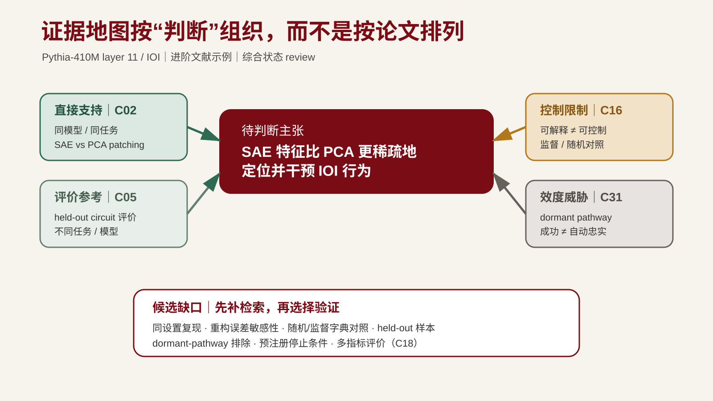

---
版本：v1.6.0
最后更新：2026-10-14
适用课次：第 5 课
文档类型：学生正式讲义
状态：本地修订稿；学生网站保持冻结基线，本轮新版本未发布，教师复核另登记
本轮修订状态：2026-10-12 内容修订与文件检查；教师内容复核及现场试教另行登记，历史通过不继承。
变更记录：
- v1.6.0 (2026-10-20): 区分教师MI演示与学生个人项目，补齐跨方向验证和迁移；课程结构与评分不变。
- v1.5.1 (2026-10-14): 标明当前修订稿与冻结网站的发布边界；线上基线保持不变。
- 2026-10-12：共同诊断与本人迁移修订；课外总投入每课不超过 60 分钟，四次提交与评分不变。
- v1.4.0 (2026-10-01): 评价证据角色、早期试探与内容验收统一；加入 RSI 补充案例，正式提交和评分不变。
- v1.3.1 (2026-09-16): 按教师“通过，修改后续课程和PPT”确认推进；统一机制、可复算案例及真实日志字段，修复逐页映射，保持既定目标与 90 分钟安排。
- v1.3.0 (2026-09-15): 整体复审内容修订；统一证据维度、假设与可复演案例，补教学诊断、板书及过渡；本轮源文件状态与 PPT 同步情况见 README。
- v1.2.0 (2026-09-12): 减负轮聚焦“两张阅读卡对同一子问题是否可比、是否真正冲突”；矩阵与证据地图改为同一组记录的两个视图；将课堂最低闭环与课后候选题池、第 6 课问题门完整条件分开。
- v1.1.1 (2026-08-23): 练习 5/6 补充工件指引——`ai-usage-log.md` 标注个人项目位置与脚手架 §6 空表；`evidence-map.md` 标明本课新建文件、字段见 §三·2；不改变课堂产出与核验要求
- v1.1.0 (2026-08-20): 增加 MI SAE 因果有效性公开证据地图、真实失败回写和 L6-L9 缺失证据接口；虚构案例继续作为学生练习线
- v1.0.0 (2026-08-10): G3 选题训练增强——§四新增"问题的来源：生成路径"小节（六类路径，据 Qian 六种构思模式）与"候选题池"小节（≥3 候选题、覆盖 ≥2 条路径、≥1 个非文献空白路径；当堂记候选题与路径标签，完整题池第 6 课前补齐）；原"三类空白""三步检验""不是空白的情况"重编号为 §四·2、§四·3、§四·5；学习目标 4 微改；练习 4 扩为候选题生成，练习 6 增候选题记录；术语表增补；学习目标变更，升 major；90 分钟时间结构不变
- v0.4.0 (2026-08-07): 转为现行正式讲义；统一四态进入规则；将 27 分钟课堂最低产出收缩为 1 个子问题、2 张已核验阅读卡、1 个窄矩阵、2 条地图主格、4 句 mini review 和 1 条 AI 记录；空白候选当堂只记类型/状态/下一步，三步完整检验课后补齐
- v0.3.0 (2026-08-07): 将第 3 课“候选文献证据角色”与问题门“证据地图四视图”明确映射；证据地图统一为直接证据、补充证据、冲突和空白，对比证据保留为条目角色而不自动等同冲突；贯穿案例显式标为虚构教学样例，不预设真实检索命中；保留四句 mini literature review 阶段产出
- v0.2.0 (2026-08-07): 对齐课程大纲，将 mini literature review 明确为第 5 课阶段产出；修正证据地图主格四类与探索线索的关系；把课堂任务收束为四句最小可行草稿
- v0.1.0 (2026-08-06): 从零起草；定位阶段五"证据整理"；承接第 4 课阅读卡，建立综述结构、证据地图、研究空白识别、AI 辅助归纳核验、练习、术语与延伸阅读；为第 6 课问题门铺垫
---

# 第五讲｜综述结构、证据地图与研究空白
## 教师演示与个人项目

MI（机制可解释性）是教师贯穿全课的研究 Demo；学生从第1课起维护自己的个人项目，方向不限于 MI。短时共同诊断用于理解方法，个人实践回到本人课题。尚未确定课题者使用可替换的公开小问题，至L6收敛。L4–L6围绕本人问题累计三张核心精读卡；每人实际执行一个 AI 研究工作流并作一次有依据的改进。 个人验证可采用 ML 对照、系统测试、数据审计或论证反例，按本人的研究问题选择。教师演示的输入、结果和工具要求只适用于对应案例。


## 导读

第 3 课把检索过程变成可复盘的方法，并给每条材料标了证据角色。第 4 课对核心论文做了结构化精读，把作者主张、关键证据、实验设置和局限逐条定位到原文，并审计了 AI 摘要中的错读与过度概括。但仅有阅读卡仍不够：当五篇、十篇文献摆在一起时，研究者常犯的错误是按论文顺序堆叠摘要，得到一份"读书报告"，而不是一份能支撑研究判断的综述。

本课对应八阶段研究链路的阶段五"证据整理"，向阶段六"研究判断"和第 6 课问题门输出材料。它的核心转换是：

> 从"按论文排列"转向"按研究问题排列"，从"摘要堆叠"转向"证据地图"，从"还没有论文写过"转向"可检验的研究空白"。

完成本课后，你将形成一份 mini literature review 最小可行草稿和证据地图初版，并带着研究空白候选与候选题池进入第 6 课，把它们作为问题门的直接输入。

## 本课研究主线：证据综合与候选问题生成

**核心判断：两项结果能够比较吗，证据冲突能产生什么可检验问题？**

对比 GPT-2 IOI 干预与原有 Pythia／SAE 文献链：模型、层、数据和干预对象有差异。让 AI 提出两种综合方式，判断哪些关系有依据、哪些只是类比。

完成第二张精读卡和证据地图；与 AI 共同提出两个候选问题，分别写出证据来源、替代解释和低成本试探。

不合并不可比的效应量；问题可由检索与综合生成，也可由异常、需求或第一性原理生成。

本课产物：证据地图、第二张卡与两个候选问题。L6 用问题价值和可行性选择一个分支。

完整输入、动作与完成标准见[本课研究任务](./judgment-task.md)。教师演示与个人项目的分工见[项目说明](../../course/micro-project.md)。以下示例用于解释方法；本人的主要产物回写自己的研究项目，方向不限于 MI。

## 学习目标

本课核心能力：两项结果是在回答同一个问题吗？能以可定位证据回答，并将决定落实到本人项目。

完成本讲后，你应该能够：

1. 区分叙事性综述与系统性综述，并说明两者在证据强度、可复现性和适用边界上的差别；
2. 把多篇阅读卡重组为按研究问题排列的相关工作矩阵；
3. 绘制证据地图，显式区分直接证据、补充证据、冲突和空白，并保留对比证据揭示的不可比性或替代解释；
4. 区分问题的多条生成路径，识别冲突空白、缺角空白和新问题空白三类研究空白，判断哪些是真实问题、哪些只是表述差异，并从多条路径生成候选题池；
5. 基于已核验条目写出四句 mini literature review 最小可行草稿，呈现直接证据、补充或对比证据、冲突或局限以及证据空白；
6. 对 AI 辅助归纳出的综述草稿执行核验，把虚构引文、过度概括和来源不可追溯的条目归位为探索线索；
7. 说明 mini literature review、证据地图与研究空白为何是问题门的直接输入。

---

## 一、证据整理在研究链路中的位置

八阶段研究链路中，阶段五"证据整理"承接阶段四"外部输入摄取"产出的候选文献表和第 4 课的阅读卡，向阶段六"研究判断"输出一份能支撑取舍的材料组织。它的任务不是"再多读几篇"，而是把已核验的材料按问题、冲突和缺口重新排列。

| 输入（来自第 3-4 课） | 本课处理 | 输出（向第 6 课问题门） |
| --- | --- | --- |
| 候选文献表（含证据角色和核验状态） | 按研究问题重组为相关工作矩阵 | mini literature review 最小可行草稿 |
| 核心论文阅读卡（含原文位置） | 抽取主张、证据、设置和局限进入证据地图 | 证据地图初版与研究空白候选 |
| AI 摘要错读审计记录 | 对 AI 综述草稿执行相同核验清单 | 一条 AI 使用记录 |

> 与第 1 课的连接：第 1 课 §2.5 给出了一个简化证据地图样例（E1/E2/E3），本课把它扩展为问题门所需的直接证据、补充证据、冲突和空白四视图。

证据整理不等于文献综述的最终写作。本课仍需形成一份基于已核验证据的 mini literature review 最小可行草稿，但它不是论文 related work 段的最终成稿。证据地图保留判断过程，四句草稿练习最小综合；面向读者的完整论证结构在第 14 课展开。

---

## 二、从摘要堆叠到按问题组织综述

### 1. 摘要堆叠为什么不算综述

一份典型的失败综述长这样：

> 论文 A 提出了方法 X；论文 B 提出了方法 Y；论文 C 在数据集 D 上比较了 X 和 Y；论文 E 指出了 X 的局限。因此，方法 Y 较优。

它的问题不是缺少文献，而是没有说明：

- A、B、C、E 各自的主张在什么条件下成立；
- 它们比较的对象、指标和设置是否一致；
- "较优"在哪个维度上、相对什么 baseline；
- 哪些主张相互冲突、哪些相互加强、哪些根本不可比；
- 综述本身要回答什么研究问题。

摘要堆叠的根本原因是没有把综述组织在一个研究问题周围。没有问题，就无法判断哪条证据支持什么、反驳什么、缺失什么。

### 2. 叙事性综述与系统性综述

文献综述有两种典型形态，它们在证据强度、可复现性和适用边界上不同：

| 维度 | 叙事性综述 | 系统性综述 |
| --- | --- | --- |
| 范围界定 | 研究者根据问题选取核心文献，范围可调整 | 预先定义检索式、纳入排除和时间窗，过程可复盘 |
| 综合方式 | 按主题、机制或冲突组织叙述 | 按固定字段提取，结构化合成（meta-analysis 或定性合成） |
| 可复现性 | 取决于作者是否记录检索与筛选 | 高；他人可重现检索和筛选 |
| 适用边界 | 适合概念厘清、方法谱系、领域现状 | 适合对已有实证研究作证据合成 |
| 主要风险 | 选择性引用、忽视冲突、把作者主张写成共识 | 机械套用、把不可比研究强行合并、忽视灰色文献 |

计算机与 AI 研究中，叙事性综述更常见，但系统性综述的方法约束（预先写检索式、记录命中数、显式纳入排除）可以显著降低选择性偏倚。本课不要求做完整 SLR，但要求借鉴其可复盘逻辑：综述的纳入、排除和组织方式应留下可供复核的理由和来源定位。

> 来源参考：Kitchenham & Charters, *Guidelines for Performing Systematic Literature Reviews in Software Engineering*, EBSE-2007-01, 2007。选读 study quality assessment、data extraction 和 synthesis 部分。用途：从"列举文献"转向质量判断、结构化提取与证据综合（见 [reading-list.md](../../course/reading-list.md) 第 5 课）。

### 3. 相关工作矩阵：从按论文排列到按问题排列

把阅读卡重组为相关工作矩阵，是本课的核心动作。矩阵的行是已有文献（或其核心主张），列是研究问题或子问题。每格填入该文献对该问题的回答、限定条件和证据角色。

一个最小样例（贯穿第 1 课案例，问题：结构化阅读卡是否降低 AI 摘要的限定条件遗漏率）：

| 文献（核验后） | 子问题：阅读卡是否强制定位原文？ | 子问题：遗漏率指标是否可操作？ | 子问题：是否存在对照流程？ | 证据角色 |
| --- | --- | --- | --- | --- |
| [论文 A] | 是；§3.2 要求逐条标注页码 | 给出字段缺失率定义；限定于 CS 论文 | 与自由摘要对照 | 主证据 |
| [论文 B] | 部分；使用总结式阅读卡 | 未定义遗漏率 | 无对照 | 补充证据 |
| [论文 C] | 不直接研究阅读卡 | 给出召回率定义；用于检索任务 | 与基线检索对照 | 对比证据 |
| [论文 D] | — | — | — | 证据空白候选 |

矩阵的核心价值是让冲突、缺口和不可比性直接可见：论文 A 与 B 的"是"和"部分"暴露了"结构化"的操作定义不一致；论文 C 的指标来自检索任务，不能直接搬到摘要任务；论文 D 那一列空白说明还没有文献直接回答某个子问题。

构造矩阵时注意：

1. 列来自你的研究问题分解，不是从论文关键词反推；
2. 一篇文献可以同时出现在多个子问题列，但每格只填它对该问题的贡献，不堆叠全文摘要；
3. 空格不是"没有相关文献"的同义词——空格可能是"还没找到"、"不可比"或"确实没人做过"，三者必须区分。

---

## 三、证据地图

### 1. 四类标注

第 3 课给出四种**候选文献角色**：主证据、补充证据、对比证据和探索线索。第 5 课把已核验条目重组为问题门要求的**证据地图四视图**：直接证据、补充证据、冲突和空白。两层口径的关系如下：主证据在对应当前子问题时进入直接证据视图；补充证据进入补充视图；对比证据用于记录替代解释、反例或不可比边界，只有在问题、条件和指标可比且结论相反时才形成冲突；探索线索不进入主格，单列在线索区。

| 类别 | 定义 | 在地图中能做什么 | 不能做什么 |
| --- | --- | --- | --- |
| 直接证据 | 已核验主证据中直接回答当前子问题的条目 | 支撑或反驳当前核心主张 | 不能单独支撑外推 |
| 补充证据 | 从不同来源、测量或路径补充支持同一主张 | 提供独立性 | 不能替代主证据回答核心因果问题 |
| 冲突 | 可比条件下，已核验条目对同一子问题给出相反结论 | 暴露需要解释或进一步验证的分歧 | 不能把任务不同或指标不同误写成冲突 |
| 空白 | 当前地图中没有可直接回答某子问题的核验材料 | 指向下一步检索或研究空白候选 | 不能直接写成"领域没人做过"或"已有方法无效" |

几个要点：

1. 冲突必须显式呈现。如果论文 A 支持、论文 B 反对同一主张，地图里两格都要保留，并记录取舍理由或"待核验"。
2. "独立"不等于两个不同网页（见第 3 课）。两篇互相转载、同一数据集、同一团队的不同论文都不自动构成独立证据。
3. 空白不是"领域空白"的同义词。它只指在你当前地图范围内、针对你当前子问题，没有可直接对应的核验材料。领域是否真的没人做过，要进一步检索才能判断。
4. 探索线索（含 AI 综述草稿、博客、issue）不进入证据地图的主格，但可以单列一区，作为下一步检索的提示。

### 2. 证据地图的最小字段

```text
| 编号 | 子问题 | 文献 | 原文位置 | 主张 | 证据角色 | 冲突/局限 | 核验状态 |
```

字段说明：

- 子问题来自相关工作矩阵的列；
- 原文位置填页码、章节、图表或 commit hash，沿用第 4 课阅读卡的定位要求；
- 主张只填该文献对该子问题的回答，不填全文摘要；
- 冲突/局限记录与其他条目的冲突、该条目的样本或设置限制；
- 核验状态沿用第 3 课的 `pending` / `verified` / `verified-with-caveat` / `rejected`：`pending` 可留候选表，但只在线索区；`verified` 可进主格；`verified-with-caveat` 可进主格，但必须保留范围、方法、版本或措辞限定，不得单独支撑 `stable`；`rejected` 仅留审计记录。

### 3. 证据地图与相关工作的关系

证据地图是研究者的内部工件，服务于问题判断和问题门检查。论文 related work 段在第 14 课系统展开写作时再从地图中提炼。不要把证据地图当成 related work 段的初稿——它保留冲突、空白和未核验条目，而成稿综述要面向读者取舍。

---

## 四、研究空白识别与候选问题生成

"还没有论文写过"不等于"这是一个真实的研究空白"。研究空白必须能被表述为：在某个具体条件、对照或机制下，已有证据不能回答的问题，并且这个问题值得回答、能在课程周期内做出最小验证。

### 1. 问题的来源：生成路径

三类研究空白（下一小节）都是文献驱动路径的产物：先有证据地图，再找地图回答不了的格子。这只是研究问题的来源之一。如果问题只从"关键词 → 找论文 → 找空白"产生，项目容易在文献既有的问题框架里打转，做出"换个数据集再跑一遍"式的增量工作。检索的角色是**检验**一个候选题的新颖性与可行性，不是**生成**候选题；问题可以来自文献之外。

CS/AI 研究中常见的问题生成路径：

| 生成路径 | 典型形态 | 检索对它的角色 |
| --- | --- | --- |
| 文献冲突/缺口 | 已有证据互相矛盾，或某子问题无回答（本节三类空白） | 确认空白真实，不是"我没找到" |
| 异常观察 | 实验或数据中出现与预期不符、现有解释覆盖不了的现象 | 检验该现象是否已被解释，或是已知假象 |
| 实践痛点 | 自己科研或工程实践里遇到的一手问题：慢、不稳、不可解释 | 检验是否已有解法、解法适用条件 |
| 新条件失效 | 新能力、新数据或新场景使旧的默认假设不再成立 | 检验旧结论依赖哪些假设 |
| 第一性原理反推 | 从基本约束推导什么必须成立，与现状对照 | 检验推导前提；推导不替代实证（第 6 课） |
| 重构/迁移 | 换问法、换视角：把一个领域的机制放进新任务 | 检验新提法是否真新，而非表述换新 |

> 来源参考：Qian, Z. *How to Look for Ideas in Computer Science Research*. [本地转载副本](<../../references/library/research-method/how to think/How to Look for Ideas in Computer Science Research _ by Zhiyun Qian _ Jan, 2021 _ Medium.pdf>)。他总结的六种构思模式——填空（fill in the blank）、扩展（expansion）、造锤找钉（build a hammer and find nails）、小处泛化（start small, then generalize）、复现前作（reproduction of prior work）、外部来源（external sources: industry, news feed）——分别对应上表中文献空白、扩展与迁移、异常观察与实践痛点等路径；"表格空位"只是其中一种，且不自动证明问题重要或真实（见 [reading-list.md](../../course/reading-list.md) 第 5 课课堂案例）。

### 2. 三类研究空白

| 类型 | 定义 | 识别方法 | 常见误判 |
| --- | --- | --- | --- |
| 冲突空白 | 已有证据对同一问题给出相反结论，且差异未被解释 | 在证据地图中找到主证据与对比证据对同一子问题给出不同回答的格子；检查条件、指标、样本是否一致 | 把任务设置不同导致的表面分歧当作实质冲突 |
| 缺角空白 | 某子问题在地图中完全没有核验材料，但相关条件已具备 | 相关工作矩阵整列空白，但相邻子问题已有材料 | 把"我没找到"等同于"没人做过" |
| 新问题空白 | 在已有材料之外，由新场景、新条件或新机制衍生的问题 | 从对比证据的局限、新数据条件或第一性原理反推 | 把表述换新当成问题换新；新问题仍需可证伪 |

### 3. 从证据空白到可检验问题

研究空白候选不直接进入问题门，要先经过三步检验：

1. **真实性检验**：再执行一次窄检索（沿用第 3 课检索式构造方法），确认不是"我没找到"而是"确实没有可直接对应的核验材料"。记录检索式、库、日期和命中数。
2. **重要性检验**：说明这个空白如果不被回答，当前证据地图的哪条主张无法成立，或哪个机制假设无法被检验。重要性来自它在论证链上的位置，不是因为它"新"。
3. **可行性检验**：在课程周期内，是否能设计一个最小实验、最小对照或最小分析来部分回答它。如果不能，它可能是真实空白但不是本课项目可做的空白。

通过三步检验的候选进入候选题池（下一小节），与来自其他生成路径的候选题一起接受第 6 课的比较筛选与第一性原理推导。

> 来源参考：Qian, Z. *How to Look for Ideas in Computer Science Research*. 本课只分析其构思模式与 gap 候选生成逻辑；"表格空位"不能自动证明问题重要或真实（见 [reading-list.md](../../course/reading-list.md) 第 5 课课堂案例）。

### 4. 候选题池：从多条路径生成多个候选

通过检验的空白候选不直接成为唯一问题。本课结束前，把空白候选、由冲突改写的候选和来自非文献路径的候选集中为候选题池，一次生成至少 3 个候选题，每个记录：

- 一句话问题表述（条件、对象、干预或观察、结果）；
- 生成路径标签（§四·1 六类之一）；
- 当前证据与核验状态；
- 留存或淘汰理由。

约束：候选题须覆盖至少 2 条不同生成路径，且至少 1 个来自非文献空白路径（异常观察、实践痛点、新条件失效、第一性原理反推或重构/迁移）。如果题池全部来自文献空白，至少补一个从自己经历中的异常或痛点出发的候选，并说明将如何用窄检索或证据地图检验它。

当堂最低要求：记录 1 个候选题的问题表述与生成路径标签；完整的 ≥3 候选题池与三步完整检验一样，在第 6 课前补齐。第 6 课用四维选题标准卡（意义、新颖性、可行性、兴趣）对题池比较筛选。

### 5. 不是空白的情况

- **表述差异**：两篇论文用不同术语描述同一机制，看似分歧实则一致——要回到操作定义判断。
- **范围差异**：一篇限定于数据集 X，一篇限定于数据集 Y，结论不直接可比——不是冲突空白，是不可比。
- **工程未做**：某个具体产品或配置还没有被评测——可能只是工程任务，不是研究空白；要回到机制层面判断。
- **新但不重要**：换一个数据集或换一个模型再跑一遍——如果没有机制假设更新，只是增量。

---

## 五、AI 辅助归纳的核验

### 1. AI 在综述阶段可以做什么

AI 可以在综述阶段提供辅助：

- 从多篇阅读卡中抽取共同主张或分歧点，生成矩阵草稿；
- 按子问题聚类，提示可能的冲突或缺角；
- 草拟综述段落，供研究者修订；
- 给出检索式扩展建议，帮助确认缺角空白。

这些产出可以进入研究工作流，前提是保留输入来源、生成记录和后续检查。对其中的事实主张、引文和页码回到原文核对；对证据角色、实质冲突和领域空白的判断，说明采用的标准、证据范围和剩余缺口。

### 2. 综述阶段的核验清单

对 AI 给出的综述草稿、矩阵草稿或空白候选，至少检查：

1. 每条引文是否真实存在、题名作者年份 DOI 是否与原文一致（沿用第 3 课来源审计）；
2. AI 归纳的"共同主张"是否真的出现在每条引用的原文中，还是模型从其中一篇外推；
3. AI 标注的"冲突"是否来自原文的不同结论，还是来自任务设置不同导致的表面分歧；
4. AI 提示的"缺角"是否经过窄检索确认；
5. AI 草拟的综述段落是否把模型推断写成原文结论，是否丢失限定条件。

完成相称核验后，AI 辅助形成的综合可以进入证据地图和问题门材料；记录具体来源、证据位置、适用范围与本人处理理由。尚未核验的外部事实主张标明待查。

### 3. 一条 AI 使用记录的最小字段

本课至少记录一条 AI 使用记录，包含：工具或模型、用途（如"草拟相关工作矩阵"）、Context（提供的阅读卡和子问题）、输出用途（作为草稿或线索）、人工核验方式（哪些条目回原文核验）、问题（发现的错读或过度概括）。

### 4. mini literature review 的最小可行草稿

完成矩阵、证据地图和 AI 核验后，用四句话把已核验材料综合成一份 mini literature review 最小可行草稿：

1. 本段回答哪个子问题，范围和限定条件是什么；
2. 已核验的主证据支持或反驳什么；
3. 补充或对比证据提供了什么不同视角，当前有哪些冲突或局限；
4. 尚存什么证据空白，下一步需要怎样核验。

四句话必须能回指证据地图中的 `verified` 或带限定的 `verified-with-caveat` 条目；`pending` 只能留在线索区，`rejected` 只留审计记录。本课不要求形成完整综述，也不要求润色为论文 related work 段。

---

## 六、常见错误

1. **摘要堆叠**：把多篇阅读卡摘要按论文顺序拼接，得到读书报告而非综述。应按子问题重组。
2. **选择性引用**：只收录支持当前假设的文献，把反例或对比证据排除。冲突必须显式呈现。
3. **把"我没找到"当空白**：没有执行窄检索就声称领域空白。要先确认检索可复盘。
4. **不可比当冲突**：任务、设置或样本不同的研究给出不同结论，被误判为实质冲突。
5. **AI 综述直接进地图**：把 AI 归纳的共同主张和引文直接搬进证据地图主格。必须逐条核验。
6. **新但不重要**：把换数据集或换模型再跑一遍当作研究空白，没有机制假设更新。
7. **矩阵列从论文反推**：从已有论文关键词构造子问题，而不是从研究问题分解。会让综述被文献牵着走。
8. **把证据地图或四句草稿当成 related work 成稿**：地图保留判断过程，四句草稿只练习最小综合；面向读者的完整论证仍需在第 14 课展开。

---

## 七、方法示例：从阅读卡到证据地图

以下保留阅读卡方法示例。以下论文 A-E、主张、检索式和拟议实验均为**虚构教学样例，不对应真实论文、真实检索结果或实证结论**；它们只用于练习从阅读卡到证据地图的动作。假设第 4 课已为 5 篇材料建立了阅读卡。本课的动作链：

第一步，写出研究问题和子问题分解：

> 主问题：在需要逐条核验引用的计算机论文阅读任务中，结构化阅读卡是否降低 AI 摘要的限定条件遗漏率？
>
> 子问题：a. 阅读卡是否强制定位原文？b. 遗漏率是否有可操作定义？c. 是否存在与自由摘要的对照？

第二步，把 5 篇阅读卡按子问题填入相关工作矩阵（§二·3 样例）。

第三步，从矩阵抽取条目进入证据地图：A 进入直接证据视图（直接回答 a、b），B 进入补充证据视图（部分回答 a，不回答 b），C 保留为对比证据并记录“任务不同、不可比”的边界；若 D 在可比条件下给出相反结论，则 A 与 D 形成冲突。某子问题整列空白时，才形成缺角空白候选。

第四步，对空白候选执行窄检索：构造检索式 `"reading card" AND "omission rate" AND "computer science"`，记录实际使用的库、日期、命中数和筛选结果。课堂演示必须使用真实检索记录或明确标注的预录/虚构字段，不预设“命中 0”；若检索到可比材料则补入地图并重新判断空白。

第五步，对 D 做重要性检验：如果没有这条证据，机制假设"阅读卡强制定位原文从而降低遗漏"无法被直接检验——它位于论证链的关键位置。

第六步，对 D 做可行性检验：课堂先用 3 份明确标注为教学构造的源文本校准；真实项目另论证论文抽样与样本量，分别用阅读卡和自由摘要生成摘要，用固定 rubric 标注遗漏率——可行。

通过三步检验后，D 列空白进入候选题池，记一句话问题表述与生成路径标签（文献缺角路径）；第 6 课由第一性原理分析进一步推导为可证伪命题，并与其他路径的候选题比较筛选。非文献路径的候选题在样例中从略，学生项目须按 §四·4 补齐。

第七步，让 AI 围绕这 5 篇阅读卡草拟一份综述段落，执行 §五·2 核验清单。记录一条 AI 使用记录：把 AI 归纳的"5 篇文献共同支持阅读卡降低遗漏"改写为"1 篇主证据支持、1 篇部分支持、1 篇任务不同不可比、2 篇不直接回答"。

第八步，把核验后的结果写成四句 mini literature review：界定子问题与范围，概括直接证据，呈现补充、对比或冲突证据及局限，最后写出空白和下一步核验。

本课不要求填满证据地图，也不要求写成完整 related work；只要求跑通一次"阅读卡 → 矩阵 → 地图 → 空白候选 → 三步检验 → 候选题 → 四句 mini review"的可复盘链路。

### 公开 MI 平行演示：支持、限制与效度威胁同图

教师演示改用第 4 课三张 MI 阅读卡，并补入 C18 与 C05。完整可编辑工件见 [mi-evidence-map-demo.md](./mi-evidence-map-demo.md)。



*图注：课程自绘证据结构图。C02 是同任务直接支持；C05 是不同任务的外部支持；C16 与 C31 分别提供控制性限制和 patching 效度威胁；C18 提供多指标评价。来源与许可见 [assets/README.md](./assets/README.md)。*

这张图的关键不是论文数量，而是一个判断的证据结构：

- 当前可支持：复现 C02 的 SAE-vs-PCA 最小比较有研究价值且可执行；
- 当前不可支持：仅凭 patching efficiency 把结论升级为因果忠实；
- 当前缺失：同设置的重构误差敏感性、随机/监督字典对照、held-out 样本和 dormant-pathway 排除；
- 失败回写：初版把 Fig.3 写成“因果忠实证明”，经 C31 核验后收窄为 intervention-efficiency 主张，并把效度缺口回写到 L6 问题与 L9 对照。

因此这条失败不是要删除的错误，而是 CP1 可接受的真实“被放弃问题版本”：记录原因、处理方式与回写位置后，它成为研究判断证据。

---

## 共同诊断与本人迁移

完成第二张精读卡和证据地图；与 AI 共同提出两个候选问题，分别写出证据来源、替代解释和低成本试探。

验证：不合并不可比的效应量；问题可由检索与综合生成，也可由异常、需求或第一性原理生成。

产物：证据地图、第二张卡与两个候选问题。完整任务见[本课研究任务](./judgment-task.md)。

## 九、术语表

| 术语 | 本课程中的含义 |
| --- | --- |
| 叙事性综述 | 按主题、机制或冲突组织的综述，范围由研究者选取，可复现性取决于过程记录 |
| 系统性综述 | 预先定义检索、纳入排除和合成方法的综述，过程可复盘 |
| 相关工作矩阵 | 行为文献、列为子问题的表格，把多篇阅读卡按问题重组 |
| 证据地图 | 将已核验条目组织为直接证据、补充证据、冲突和空白四视图；对比证据的不可比边界或替代解释仍保留在条目中 |
| mini literature review | 基于已核验证据、围绕一个子问题形成的最小综合草稿；本课采用四句骨架，不等于最终 related work 成稿 |
| 证据空白 | 在当前地图范围内、针对当前子问题没有可直接对应的核验材料 |
| 冲突空白 | 已有证据对同一问题给出相反结论且差异未被解释的研究空白 |
| 缺角空白 | 某子问题整列空白但相关条件已具备的研究空白 |
| 新问题空白 | 由新场景、新条件或新机制衍生、仍需可证伪的研究空白 |
| 生成路径 | 候选题的来源类别：文献冲突/缺口、异常观察、实践痛点、新条件失效、第一性原理反推、重构/迁移；检索用于检验而非生成候选题 |
| 候选题池 | 集中多条生成路径产生的候选题的清单；≥3 个候选题、覆盖 ≥2 条路径、含 ≥1 个非文献空白路径候选，第 6 课比较筛选 |
| 真实性/重要性/可行性检验 | 研究空白候选进入问题门前依次通过的三步检验 |
| 三步检验 | 真实性（窄检索确认不是"我没找到"）、重要性（论证链位置）、可行性（课程周期内可最小验证） |

---

## 十、延伸阅读与课程材料

课程内材料：

- [课程大纲](../../course/syllabus.md)
- [备课规划](../备课规划.md) 第 5 课
- [逐课阅读清单](../../course/reading-list.md) 第 5 课
- [早期研究脚手架](../../course/starter-template.md)
- [项目里程碑与研究门](../../course/assignments.md)（第 6 课问题门条件）

正式书目（见 [reading-list.md](../../course/reading-list.md) 第 5 课）：

1. Kitchenham, B., & Charters, S. *Guidelines for Performing Systematic Literature Reviews in Software Engineering*. EBSE-2007-01, 2007. 选读 study quality assessment、data extraction 和 synthesis。[机构索引](https://ebse.webspace.durham.ac.uk/ebse-bibliography/guidelines-for-performing-systematic-literature-reviews-in-software-engineering/)。用途：从"列举文献"转向质量判断、结构化提取与证据综合。
2. Booth, W. C. et al. *The Craft of Research*, 5th ed. University of Chicago Press, 2024. 选读 4.3–4.5：reading for a problem、arguments、data and support。[出版社页面](https://press.uchicago.edu/ucp/books/book/chicago/C/bo215874008)。用途：从来源中提取问题、论证与证据角色。
3. Pautasso, M. "Ten Simple Rules for Writing a Literature Review." *PLOS Computational Biology* 9(7):e1003149 (2013). DOI: [10.1371/journal.pcbi.1003149](https://journals.plos.org/ploscompbiol/article?id=10.1371/journal.pcbi.1003149)。用途：检查综述的范围、批判性、结构和迭代。

课堂案例：

4. Qian, Z. *How to Look for Ideas in Computer Science Research*. [本地转载副本](<../../references/library/research-method/how to think/How to Look for Ideas in Computer Science Research _ by Zhiyun Qian _ Jan, 2021 _ Medium.pdf>)。本课分析其六种构思模式（填空/扩展/造锤找钉/小处泛化/复现前作/外部来源）与 gap 候选生成逻辑；"表格空位"不能自动证明问题重要或真实。


## 补充：早期试探也能帮助收敛问题

第 3–6 课允许有预算上限的数据格式与独立样本审计、环境检查、最小反例和试跑。文献地图不能替代对数据与评价器可用性的检查；完整工程仍在问题与协议基本明确后展开。

把目的、预算上限、输入与来源、观察、对问题的影响及待核验项写入现有笔记或主文档。探索可修改问题；后续验证说明此前已看过哪些数据，保留独立证据。未知失败含义和未确认独立样本数不能直接改写成零收益或独立观察。

[RSI 问题门审计](../lesson-11/assets/rsi-selection-case/README.md#problem-gate)展示如何从缺少可执行历史和表格口径差异，收窄为可控偏差诊断。它是补充材料，不新增个人项目或正式提交。

## 课外预算与下次输入

课外总投入最多 **60 分钟**：指定阅读 15 分钟，准备 10 分钟，项目补全 35 分钟。阅读范围：Kitchenham & Charters 中 search strategy 与 study selection 的段落；检查检索范围如何影响空白判断。

项目补全：完善第二张卡、给第三项来源标两个原文位置；候选列表按同一筛选理由累计。

安装、下载与排障计入总预算。准备超出预算即采用现成 CPU 起点或纸面备用；未完项带回课堂收窄或补关键检查。三张完整精读卡在 L4、L5、L6 的课堂迁移中逐张完成，课后只补相应缺口。报告、说明和展示从累计项目整理；不增加独立文档或正式提交。
