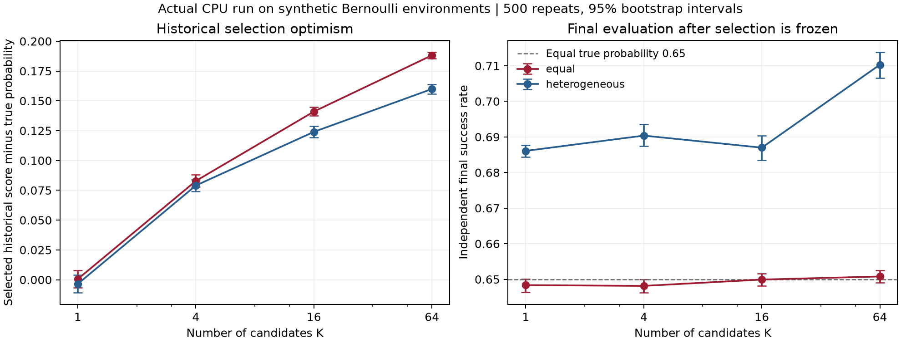

版本：v1.0.0
最后更新：2026-10-01
文档类型：真实公开材料审计＋合成环境上的实际 CPU 实验

# RSI：反复选优后的评价证据

本案例使用真实 RSI 课题收敛问题，在可控 Bernoulli 环境上实际运行偏差诊断。阅读卡仍是课程工作流主线；RSI 供第 3–6、9、11、13、16 课按需复用，不要求学生再完成一个 RSI 项目。

公开资料审计、合成环境运行与工业迁移是不同证据层级。以下数值来自本包真实运行，条件和真实成功率由教学模拟器设定；它们不代表 Dream-RSI 系统或工业实验的实测表现。

## 内容定位 {#content-index}

这是一份合并主文档示例。README 的四个研究门章节承载问题、计划、证据地图、命题、实验规格、工作流、评价、伦理和复盘；代码与原始记录单独保存。教师按内容定位验收，文件数量不计分。

| 内容 | 定位与记录 |
| --- | --- |
| 问题、证据地图、早期失败／放弃项 | [问题门](#problem-gate)，E1/E2/F1 |
| 研究计划、命题、协议、判断 | [判断门](#judgment-gate)，Q1/Q2/H1/A1/J1/J2 |
| 工作流、结果、成本与不确定性 | [验证门](#validation-gate)，W1、逐次结果 ID |
| 结论、评审处理、伦理和 AI 披露 | [论证门](#argument-gate)，J3、R1 |
| 完整协议与重跑 | [config.json](config.json)、[run.py](run.py)、[test_case.py](test_case.py) |
| 原始计数与全部策略结果 | [计数记录](recorded/raw-counts.csv)、[逐次结果](recorded/results.csv) |
| 汇总、配置和指纹 | [summary.json](recorded/summary.json)、[运行配置](recorded/config.json)、[manifest.json](recorded/manifest.json) |

学生本人的四次研究门提交仍需保留当时的项目版本链接、tag 或压缩包；本案例是冻结的教学版本，不替代学生个人门条件或学生项目的同行评审。教学内容复核见 R1。

## 问题门 {#problem-gate}

**当前问题：**在有限、含噪的历史评价上增加候选数量，会怎样影响最佳历史分数的乐观程度与最终选择？

范围为固定候选池、固定真实成功率、有限次独立 Bernoulli 执行。非例包括工业工况迁移、真实策略树的相关性、候选生成能力和领域安全判断。基本约束是有限样本评价有噪声；选优使被报告的候选依赖这些观察。因此先隔离选优，而不直接归因于记忆或回放机制。

### 公开材料审计与问题收敛

审计日期为 2026-10-01；版本、原文件路径与 SHA-256 保存在 [source-audit.json](source-audit.json)。

| 证据 ID | 核查对象 | 已观察事实 | 对研究判断的影响 |
| --- | --- | --- | --- |
| E1 | [Dream-RSI 固定版本](https://github.com/zhengkid/Dream-RSI/tree/4149ea9181ab1db80f85717ffda2c9f0f130e85b) | 本地固定版本有论文、README 与图形资产，未发现可执行源码或 CSV/JSON 历史表；README 说明代码正在准备发布 | 放弃本轮直接运行该系统，采用可控偏差诊断；这不评价后续发布版本 |
| E2 | [DASH 固定版本](https://github.com/ruiding-uchicago/DASH/tree/76b7209bc04cf5bd0f73947a5f92f8a8ea335776) | 五轮 CSV 各 64 行；同版本 `AL Full Experimental Records.xlsx` 有五个同名工作表，每表 64 行；README 则报告 258 次实验 | 行数不能直接作为独立实验数；需继续对齐样品、批次与曲线 |

| 五轮表格 | 行数 | 过电位数值行 | Failed Sample 行 |
| --- | ---: | ---: | ---: |
| 1st_final.csv | 64 | 34 | 30 |
| 2nd_final.csv | 64 | 39 | 25 |
| 3rd_final.csv | 64 | 52 | 12 |
| 4th_final.csv | 64 | 64 | 0 |
| 5th_final.csv | 64 | 64 | 0 |
| 合计 | 320 | 253 | 67 |

67 个 `Failed Sample` 行的过电位为 `Null`。标签不能独自说明合成失败、测量失败或原因，也不能赋予未测候选真实标签。独立样本数与失败原因保持待确认；本轮没有据此开展新的电化学结论或跨实验室推断。

**F1 已放弃项：**直接复现 Dream-RSI。依据是 E1 中当前材料缺少运行器与历史表；处理为收窄到选优偏差，回写 J1 和下述协议。CPU 实跑没有技术失败，测试注入故障另行标识。

### 命题与解释候选

| ID | 类型 | 内容 | 改变判断所需证据 |
| --- | --- | --- | --- |
| Q1 | 结果命题 | 在等质量 A 中，更多候选使选中者的历史分数产生更大的平均乐观偏差 | 预定 K 的实际轨迹与重复运行区间；不把单次反例当稳定趋势 |
| Q2 | 结果命题 | 在异质量 B 中，均匀与随机新增验证在相同预算下的选择损失是否不同 | 同重复配对差异；不要求所有 K 同方向 |
| H1 | 机制候选 | 选优把含噪评价中的有利波动纳入被报告分数 | 等质量控制固定真实收益，检查历史分数与独立最终分数 |
| A1 | 替代解释 | 候选本来具有更高真实质量，或池扩张包含更好的候选 | 比较等质量与异质量场景，并使用已知真实成功率参考 |

H1 是受控模型中的解释候选；它对真实 RSI 的适用程度仍需在真实任务上检验。采用判断还需成本，不能由 Q1/Q2 直接决定。

## 判断门 {#judgment-gate}

**J1：**使用固定候选池和已知真实成功率的模型，避免在诊断阶段同时引入候选生成、回放语义和工况变化。真实成功率只由环境与报告阶段使用，选择接口只接收观察计数。

**J2：**独立性和预算公平性分别检查。参与候选选择的新增验证属于开发证据；独立最终测试用于报告，不能再用于选择规则调优。

### 实验规格

| 字段 | 冻结内容 |
| --- | --- |
| 假设对应 | Q1、Q2、H1 与 A1，引用上表 ID |
| 变量 | K=1/4/16/64；场景 A/B；选择方式；候选池顺序固定 |
| 步骤 | 生成历史与新增验证→冻结全部选择→揭示所选候选和父版本的最终评价→统计 |
| 度量标准 | 历史乐观偏差、参考选择损失、最终成功率、相对父版本差异、未知比例；报告区间 |
| 对照 | 历史选优、独立均匀验证选择、等预算随机验证选择 |
| 随机化与重复 | 每场景 500 个重复；按场景、重复、证据角色、候选派生独立随机流；根种子 20261001 |
| 停止条件 | 固定配置完成 500 次；不因观察到有利结果提前停止；错误配置明确失败 |

候选池含 64 个候选，异质量真实成功率等距分布于 0.55–0.75，顺序打乱一次冻结；等质量均为 0.65。每候选历史 32 次。均匀新增验证每候选 32 次；随机分配相同总预算 32K，按新增观察均值选择，零观察标为未知并排除排名。平分取较小固定候选 ID。父版本为 C00。

三种方式共享同一历史。后两种新增预算相同，直接用于 Q2；历史选优没有新增预算，它与补测方式的差异不能仅归因于选择策略。K 增加也改变可见候选与预算，异质量选择损失不预设单调性。

### 评价证据角色

| 角色 | 记录与允许用途 |
| --- | --- |
| 真实材料探索 | E1/E2，仅用于问题收敛与可行性判断 |
| 历史选择 | `history`；可用于历史选优 |
| 追加验证选择 | `validation_uniform` / `validation_random`；可用于对应候选选择，属于开发证据 |
| 独立最终评价 | `final`；候选选择完成后才生成，每候选 512 次，只用于报告 |
| 真实成功率参考 | 模拟器参数；用于参考损失，不提供给选择接口 |

独立统计单位为重复运行；同一重复内的 K 与方法共享部分证据，方法差异按重复配对。相同候选的最终记录共享，不能作为多项独立证据。bootstrap 使用独立统计随机流和 2,000 次重采样，区间是固定候选池条件下的模拟不确定性。各条件报告点态 95% 区间，未作多重比较校正；不能选择单个有利 K 推出普遍优越性。

## 验证门 {#validation-gate}

### 实际运行结果

本次实际执行完成 219,705 条计数记录、12,000 条策略结果。全部结果、配置与指纹保留在 `recorded/`。下表为历史选优方式，数值均为均值 [95% bootstrap 区间]。

| 场景 | K | 历史乐观偏差 | 参考选择损失 | 独立最终成功率 |
| --- | ---: | --- | --- | --- |
| 等质量 A | 1 | 0.0006 [-0.0066, 0.0077] | 0.0000 [0.0000, 0.0000] | 0.6484 [0.6464, 0.6501] |
| 等质量 A | 4 | 0.0828 [0.0779, 0.0880] | 0.0000 [0.0000, 0.0000] | 0.6481 [0.6463, 0.6499] |
| 等质量 A | 16 | 0.1410 [0.1374, 0.1447] | 0.0000 [0.0000, 0.0000] | 0.6499 [0.6482, 0.6517] |
| 等质量 A | 64 | 0.1882 [0.1854, 0.1908] | 0.0000 [0.0000, 0.0000] | 0.6508 [0.6491, 0.6525] |
| 异质量 B | 1 | -0.0035 [-0.0106, 0.0039] | 0.0000 [0.0000, 0.0000] | 0.6861 [0.6844, 0.6877] |
| 异质量 B | 4 | 0.0790 [0.0740, 0.0839] | 0.0298 [0.0273, 0.0324] | 0.6904 [0.6874, 0.6935] |
| 异质量 B | 16 | 0.1240 [0.1193, 0.1286] | 0.0336 [0.0308, 0.0365] | 0.6870 [0.6834, 0.6904] |
| 异质量 B | 64 | 0.1600 [0.1559, 0.1638] | 0.0398 [0.0368, 0.0431] | 0.7103 [0.7065, 0.7138] |



等质量 A 中，K=64 的历史乐观偏差约为 0.1882，而最终成功率约为 0.6508；候选真实成功率都为 0.65，所以参考选择损失始终为零。**“分数越来越乐观”与“选中了更差候选”是不同判断。**

异质量 B 中，均匀减随机验证的配对参考选择损失如下；负值表示均匀分配在本设置下损失较低。

| K | 均匀减随机：选择损失均值 [95% 区间] |
| ---: | --- |
| 1 | 0.0000 [0.0000, 0.0000] |
| 4 | 0.0018 [-0.0018, 0.0056] |
| 16 | -0.0068 [-0.0111, -0.0023] |
| 64 | -0.0011 [-0.0052, 0.0033] |

K=16 的区间位于零以下；K=4、64 的区间跨零。该结果支持限定设置下的比较，并未形成“均匀分配普遍更好”或“定向补测机制有效”的结论。本包没有实现新的定向补测算法。

### 成本与未知

各 K 的历史成本为 32K；均匀和随机各新增 32K；历史选优新增成本为零。每种方法的最终评价包含所选候选与父版本，每个 512 次，同候选共享一条记录。

本次唯一实际执行数：历史 2,048,000；均匀新增验证 2,048,000；随机新增验证 2,720,000；最终评价 3,432,960。嵌套 K 复用历史与均匀证据，不能直接将各表行预算相加。费用与 token 为零，执行数是本包成本单位，不等同于工业试验成本。逐次未知比例也保留，零观察不是零质量。

### W1 可审计工作流

输入是冻结配置、原始计数与结果记录。流程为读取→核查唯一 ID、记录完整性、选择证据角色与预算→复算选择、指标与最终证据引用→汇总区间。输出为可追溯统计报告；失败处理为明确报错并停止，不跳过坏记录。

[测试](test_case.py)覆盖平分、未知、非法配置、缺失记录、证据角色错置、预算或报告篡改、相同输入复现，以及最终测试变化不影响选择。手工参考：两候选真值均 0.65，历史计数为 1/4 与 3/4；选择后历史乐观偏差 0.10，参考损失 0。这个参考计算与测试吻合。代码接口隔离不是操作系统沙箱；人工复核者仍需检查数据角色和结论范围。

真实实跑技术失败为零；测试注入的错误是明确构造的检查输入，不能充作研究实跑失败。本轮教师已复核教学内容；真实课堂教学效果待实际观察，自动测试与教师确认分别记录。

## 论证门 {#argument-gate}

**有限结论：**本可控模型实际展示了反复选优后的历史分数乐观偏差；独立最终评价使历史分数与真实质量区别可见。异质量下的等预算分配差异随候选数量而异。结果来自固定模拟设置，不标为工业有效性或 `stable` 结论。

**J3 回写：**保留“先冻结选择、后揭示最终评价”；将原“分数改善即可采用”收窄为“独立最终表现、证据范围与成本共同支撑采用判断”。真实 RSI 还需共享历史相关性、候选生成、评价器约束与新任务验证。

**未决项：**DASH 表格行数与 258 次实验的映射、失败原因、真实回放语义与相关性、跨任务或工业迁移。下一步先补材料与原始样品映射，再决定真实任务是否可评价。

### 评审处理与版本追溯

R1 本轮教学内容已由教师确认“可以，已完成复核”：采用有限结论与第 9/11/13 课实际替换内容。该确认针对教学内容，不替代学生项目的同行评审。评审时检查 Q1/Q2 是否由正确证据支持、新增验证是否被误称最终测试、机制与结果是否分开、内容索引能否找到原始记录。意见收到后在本节追加处理与影响 ID，不复制另一份报告。正式研究门版本由个人项目另行保存。

### 伦理与 AI 使用披露

仅使用公开仓库与合成数据；原始下载不被修改，网站仅发布审计摘要、源链接与自建实验包，不复制未公开研究计划。AI 辅助代码和文档起草；数值由运行器计算，参考例与合同测试核对；人工教学复核状态如上。无外部模型调用、真实学生资料、工业设备控制或新电化学实验。

## 重跑与冻结记录复算

仅运行与测试需要 Python 3.10+ 标准库；绘图另需已有 matplotlib。不会访问网络或调用模型。使用新的输出目录，避免覆盖证据：

```sh
python3 test_case.py
python3 run.py --output new-run
python3 run.py --records recorded --output recomputed-report
```

`new-run` 重新执行完整协议；`recomputed-report` 审计并复算冻结计数与结果。修改最终记录后必须重新形成可追溯结果，不能保持旧报告。完整配置中的 bootstrap 可能比单次运行耗时；课堂使用本包已保存结果与图表，故障时纸面审计相同证据角色。

课程衔接：[评价报告模板](../../../lesson-13/evaluation-report-template.md) · [最终提交要求](../../../../course/assessment.md)。

## 方法参考

- [Cawley 与 Talbot，JMLR 2010](https://www.jmlr.org/papers/v11/cawley10a.html)：有限样本评价准则的选优偏差。
- [研究团队对自适应留出评价的说明](https://research.google/blog/the-reusable-holdout-preserving-validity-in-adaptive-data-analysis/)：反馈参与开发后，留出证据的独立性改变。本包不实现 reusable holdout。
