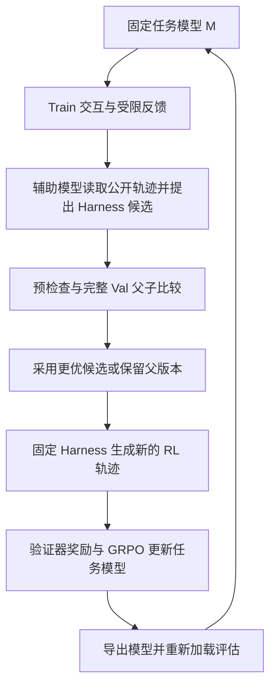

---
版本：v1.0.0
最后更新：2026-09-26
文档类型：源码审查、产品信息核验与课程选用报告
适用课程：智能科研方法（AI for Research: Methods and Practice）
状态：教师备课参考；教学采用建议待教师选用，不代表已修改现行课程
源码锚点：Gen-Verse/ScienceBuddy@53177995fd549068cbe25282273bed771e843f50
变更记录：
- v1.0.0 (2026-09-26)：整合仓库整体分析、CPU 测试与专项复现、模型与 JEV 核验，映射现行 16 课结构并提出低成本教学方案。
---

# ScienceBuddy 与 JEV：源码、证据边界及 AI4Research 课程价值评估

## 1. 结论与选用建议

**ScienceBuddy 对本课程有较高的案例价值，最佳用途是第 11–13 课的工作流改进、证据约束与评价复盘。建议纳入教师案例池，以固定版本源码和可复演失败为主，不增加课程平台依赖。**

这个判断基于三项匹配：课程要求学生围绕真实科研动作设计个人 Agent Workflow；ScienceBuddy 把工作流程序与任务模型分开优化；本次源码审查又提供了“程序有检查，但检查强度不足”的具体实例，可以训练学生从主张追溯到控制流和实验记录。

| 用途 | 价值判断 | 建议 |
| --- | --- | --- |
| 第 11–13 课的工程与评价案例 | 高 | 优先采用双循环图、候选选择规则、来源标签绕过和 PRM 引文检查案例 |
| 第 3–4 课的来源核验练习 | 高 | 对照产品帖子、论文、当前源码和本地测试，判断各自支持哪些主张 |
| 第 7–9 课的实验设计补充 | 中高 | 讨论方法改进与模型训练的贡献如何分离、验证集复用及材料组重叠 |
| 全体学生的完整 RL 复现 | 当前不适合 | 需要专门计算环境与任务资产，准备成本会挤占研究方法训练 |
| 替代课程 Pi Agent 主平台 | 不建议 | 现有平台与个人项目链路已建立，ScienceBuddy 的公开仓库也未包含完整产品 |
| JEV 在线演示 | 可选 | 可用作结构化判断的对照；先准备离线材料，授课前复核服务与预算 |
| 证明“AI 已学会科研品味” | 证据不足 | 当前开源实验主要优化固定任务的首答正确率 |

本报告对应现行[课程定位](../../course/curriculum.md)、[课程大纲](../../course/syllabus.md)、[阅读清单](../../course/reading-list.md)和[第 12 课八要素框架](../../lessons/lesson-12/handout.md)。保留 Pi Agent 主平台、MI 贯穿案例、个人项目与固定同伴组安排；正式提交仍在第 6、9、13、16 课。本报告只提出案例选用方案。

## 2. 对象、证据与核验状态

### 2.1 四类材料必须分开

| 对象 | 内容 | 本轮能够核实的范围 |
| --- | --- | --- |
| 线上 ScienceBuddy 产品 | 对话、材料上传、工具执行、轨迹与结果查看 | 发布说明与公开展示；没有独立实测在线科研任务 |
| ScienceBuddy 论文 | 科研协作与双层递归自改进框架、案例和实验结果 | 核对了所引用的实验段落；数值为作者报告 |
| 开源 Simple-SciBuddy 实验 | 固定任务集、Python Harness 搜索、SkyRL 训练及交接 | 固定 commit 的源码与配置，完成 CPU 测试及专项复现 |
| TypeSafe Jev 与 JEV 产品宣称 | 结构化决策模型及 ScienceBuddy 的集成发布信息 | Jev 官方接口说明；ScienceBuddy 作者确有集成宣称，具体调用节点未公开核实 |

仓库 README 明确说明：完整工作台前端、账户系统和产品 API 服务未包含在公开源码中。产品描述的“224 个工具、22 个模块”不能解释成克隆当前仓库就获得整套线上平台。[固定版本 README](https://github.com/Gen-Verse/ScienceBuddy/blob/53177995fd549068cbe25282273bed771e843f50/README.md)

### 2.2 使用课程既有证据规则

遵循[参考资料索引](../README.md)与[材料契约](../material-contracts.md)：`verified` 表示拟用主张与直接来源相符；`verified-with-caveat` 保留版本、范围或方法限制；`pending` 留在线索区。源码与据其编写的文档不是两项独立效果证据；同一次审查的多个复现也不是独立团队重复研究。本报告不把教学价值判断或产品性能标为 `stable`。

| 主张 | 证据 | 状态及边界 |
| --- | --- | --- |
| 存在交替的 Harness 搜索与模型训练调度 | 固定版本源码与配置 | `verified`：确认程序结构 |
| 本地 172 项 CPU 测试分批通过 | 原始检查日志及受限项重跑 | `verified`：确认本机测试记录，不覆盖 GPU 训练 |
| 工具标签可绕过工具历史专项预算 | 实际 broker 与模拟环境专项用例 | `verified-with-caveat`：合成输入、字符 tokenizer；未证明真实搜索曾生成该行为 |
| PRM 不存在的引文可进入证据 | 校验器及 public_evidence 专项用例 | `verified-with-caveat`：证明检查缺口，不直接估计实际错误率 |
| 论文给出性能提升 | 论文 v1 对应段落 | `verified-with-caveat`：作者实验结果，本地未复现 |
| 线上产品宣称集成 JEV | 作者 X 原帖 | `verified-with-caveat`：只确认发布宣称，不等同于后台实测 |
| JEV 在产品中负责具体工具路由或 RL 奖励 | 尚无接口与调用记录 | `pending`：不能写成已知实现 |

## 3. 核心机制：工作方法与模型能力交替更新

### 3.1 三个不同角色

| 角色 | 当前开源默认配置 | 是否随循环更新 |
| --- | --- | --- |
| 任务模型 | `models/Qwen3.5-4B` | 是；外循环通过 GRPO 更新权重 |
| 辅助改进模型 | `gpt-6-astra`，远程 Chat Completions 接口，medium reasoning | 参数固定；选择模拟反馈、解释轨迹、提出新 Harness |
| 答案验证器 | 宿主规则程序 | 固定；解析提交答案并对照私有参考答案 |

辅助服务地址为 `https://your-provider.example/v1`，属于配置占位符。因此默认模型字符串支持“配置如此”，不能单独证明历史运行或当前线上服务实际调用了哪个提供商。[defaults.json](https://github.com/Gen-Verse/ScienceBuddy/blob/53177995fd549068cbe25282273bed771e843f50/configs/defaults.json)、[train.toml](https://github.com/Gen-Verse/ScienceBuddy/blob/53177995fd549068cbe25282273bed771e843f50/configs/train.toml)

这里的 PRM 是辅助模型的一次结构化反馈解释请求；公开实现没有为此单独训练或加载一个过程奖励模型。它输出的诊断标签也不替代 RL 的任务奖励。

### 3.2 双层递归



内循环固定模型，修改 `run(task, api)` 工作流：提示构造、工具编排、解析、上下文组织与提交顺序都可改变。外循环固定选中的工作流，生成新的 on-policy 任务尝试并训练模型。辅助模型保持固定，任务集与验证器也保持固定。这种递归体现的是两个优化过程相互改变条件。[algorithm.md](https://github.com/Gen-Verse/ScienceBuddy/blob/53177995fd549068cbe25282273bed771e843f50/docs/algorithm.md)

一个教学假例是：旧程序直接打印整张表导致证据被截断；候选程序改为先查字段，再过滤和汇总。只有候选在独立任务比较中通过接受规则，才能称为被采用的方法修改。这个例子用于说明机制，不是本轮观测到的真实训练结果。

### 3.3 维护配置与资源

| 项目 | 当前值 |
| --- | --- |
| 任务划分 | 715 Train / 90 Val / 90 Test |
| 任务族 | DbQA、GWAS、LitQA2、ProtocolQA |
| 完整循环 | 3 轮 Harness + RL |
| 每阶段 Harness 搜索 | 3 步；每步 16 个 Train 交互、3 个候选 |
| 候选评估 | 父版本与有效候选在全部 90 个 Val 任务上配对比较 |
| 每阶段 RL | 30 次更新；每批 8 个任务实例 × 8 次尝试 |
| 主要预算 | 上下文 24,576 token；每次生成最多 4,096 token；模型/工具调用各最多 9 次 |
| 交互反馈 | Harness 交互最多 1 次；RL 和评估为 0 次 |
| 训练后端 | SkyRL、FSDP、vLLM；学习率 `1e-6`；KL loss 与 KL reward penalty 均关闭 |

这些是配置值，不是实际运行消耗或已复现性能。文档目标环境是 Linux、Python 3.12、CUDA 13、Docker 和八张 A100；八卡是维护配方，不是已验证最低硬件要求。权重与授权任务资产需要另行准备。部署指南还使用了 `ScienceBuddy-RSI.git` 克隆地址，与当前项目入口 `ScienceBuddy` 命名不一致，复现前需要核实。[实验指南](https://github.com/Gen-Verse/ScienceBuddy/blob/53177995fd549068cbe25282273bed771e843f50/docs/experiments.md)

## 4. 源码调用链与值得借鉴的设计

### 4.1 最小阅读路径

所有源码链接固定在本轮审查 commit。

| 文件 | 看什么 | 对课程的用途 |
| --- | --- | --- |
| [coevolve/loop.py](https://github.com/Gen-Verse/ScienceBuddy/blob/53177995fd549068cbe25282273bed771e843f50/src/simple_scibuddy/coevolve/loop.py) | 阶段调度、训练请求和新模型继承 | 分清循环、状态与停止条件 |
| [coevolve/phase.py](https://github.com/Gen-Verse/ScienceBuddy/blob/53177995fd549068cbe25282273bed771e843f50/src/simple_scibuddy/coevolve/phase.py) | 收集交互、积累证据、候选生成与评估 | 检查学习与评价数据流 |
| [coevolve/selection.py](https://github.com/Gen-Verse/ScienceBuddy/blob/53177995fd549068cbe25282273bed771e843f50/src/simple_scibuddy/coevolve/selection.py) | 候选有效性、完整覆盖、严格胜出与平局规则 | 固定评价契约 |
| [harness/broker.py](https://github.com/Gen-Verse/ScienceBuddy/blob/53177995fd549068cbe25282273bed771e843f50/src/simple_scibuddy/harness/broker.py) | 三个 API、预算、首答奖励、清理与终止 | 执行者与裁判分工 |
| [coevolve/feedback.py](https://github.com/Gen-Verse/ScienceBuddy/blob/53177995fd549068cbe25282273bed771e843f50/src/simple_scibuddy/coevolve/feedback.py) | 模板反馈与 PRM 解释 | 分开真实观察与模型归因 |
| [coevolve/program.py](https://github.com/Gen-Verse/ScienceBuddy/blob/53177995fd549068cbe25282273bed771e843f50/src/simple_scibuddy/coevolve/program.py) | 完整程序提案、证据引用与修复预算 | 将失败转化为待检验修改 |
| [training/trajectory.py](https://github.com/Gen-Verse/ScienceBuddy/blob/53177995fd549068cbe25282273bed771e843f50/src/simple_scibuddy/training/trajectory.py) | token、轨迹身份、终局奖励和 mask | 区分调用次数、尝试次数和训练样本 |
| [data/verifier.py](https://github.com/Gen-Verse/ScienceBuddy/blob/53177995fd549068cbe25282273bed771e843f50/src/simple_scibuddy/data/verifier.py) | 答案格式与参考匹配 | 指标究竟测量了什么 |
| [coevolve/worker.py](https://github.com/Gen-Verse/ScienceBuddy/blob/53177995fd549068cbe25282273bed771e843f50/src/simple_scibuddy/coevolve/worker.py) | 导出后重新加载与交接检查 | 工程完成条件与研究成功条件 |

### 4.2 五项可借鉴设计

1. **保留父版本并固定比较条件。** 候选先生成，再揭示 Val 结果；排除字节相同的程序，要求完整任务覆盖、无候选运行错误且正确数严格提高。平局保留父版本；多个更优候选同分时先出现者胜出。普通工具错误与 `episode.error` 的候选程序错误有区别。
2. **宿主保留评分与预算权。** Harness 通过 `generate / execute / submit` 组织行为，宿主处理答案评分与资源限制。程序提示中的约束仍需逐项检查是否被宿主实际执行，见下一节。
3. **首答与纠错结果分别记录。** 首答错误、后续改对时，`reward=0`、`final_reward=1`；交互纠错不倒写首答成绩。
4. **训练保留实际上下文与行为概率。** 每次模型调用形成一行，同一 episode 共享轨迹身份；终局奖励只放在最后一次 completion 的最后一个 token。工具输出属于输入，completion token 才是训练目标。后端如何广播优势需要 SkyRL 集成验证。
5. **产物交接可审计。** 模型、Harness、任务、验证器和运行时有身份记录；导出要重新加载并评估。续跑从可验证阶段边界开始，新目录保存新实验，未保存的优化器更新不会被假装恢复。

执行环境将 Harness 控制器和科学计算分置两个 Docker 容器，禁用网络并设置内存/CPU限制；绑定数据湖时只读。宿主记录轨迹和清理结果。容器隔离与外部模型数据治理是两个问题：公开给辅助模型的证据可能包含题目、工具观察及实际模型输入输出，“公开”在代码里主要表示不含隐藏参考答案，并不自动表示可对外披露。

## 5. 本地检查结果与问题清单

### 5.1 已执行的验证

2026-09-26，在 macOS ARM64、Python 3.12.13 下建立独立 CPU 环境，使用 pytest 9.1.1、ruff 0.16.9、jsonschema 4.26.0。检查遵循项目 `scripts/check.sh`，排除 `tests/integration`。

| 检查 | 实际结果 |
| --- | --- |
| Ruff | `All checks passed!` |
| 原有 CPU 测试首次执行 | `169 passed, 3 failed`；3 项均因沙箱禁止绑定 `127.0.0.1` 端口 |
| 仅重跑受限的 3 项 HTTP 模拟测试 | `3 passed, 11 deselected` |
| 汇总 | 172 项不同测试分批全部通过；不是一轮完整无失败运行 |
| 专项审查 | 来源标签绕过、虚构工具来源、虚构 PRM 引文、PRM 无效导致提案跳过均复现 |
| 未执行 | GPU 训练、真实 Docker 科研运行、真实任务集实验、SkyRL 优势计算集成检查、线上产品任务实测 |

本地 SkyRL 子模块尚未初始化，锁定提交为 `0b286bacba2bb51dfe50186b6b5d6b1e0b5f5518`。CPU 成功支持的是所覆盖的软件契约，不证明整套训练链路或论文成绩已复现。

配套附件：[专项复现脚本](./sciencebuddy-audit-2026-09-26/source_audit_checks.py)、[原始专项输出](./sciencebuddy-audit-2026-09-26/results.json)。脚本中的断言描述审查版本当前行为；修复后需改成期望拒绝这些输入的回归测试。

### 5.2 工具来源标签与预算：已复现

`harness/messages.py:6–43` 允许用户消息声明 `source="harness"`；`harness/context.py:59–100` 按 `source="tool"` 选择要裁剪的历史。实际 broker 将这两步串联，但没有把工具文本绑定到宿主 observation。

五份相同输入、每份 1,900 个字符，只改变标签，得到：

| 来源标签 | 模型实际收到的证据 token | 历史裁剪记录数 |
| --- | ---: | ---: |
| `tool` | 8,184 | 1 |
| `harness` | 9,500 | 0 |

复现用字符 tokenizer、模拟容器与模型，但执行真实 broker、RecordingPolicy 和校验器。每次工具返回限制及全局上下文上限仍有效，被绕过的是工具历史专项预算。此外，发生一次 execute 后，任意未与实际结果比对的文本也能声明为工具证据。

**判断：** 文档中“重新命名也不能逃脱预算”的承诺强于实现。这影响候选比较的一致性和来源审计，不是容器逃逸或数据泄漏复现。

**修复方向：** 由宿主保存 observation 并分配 ID，程序引用真实结果；摘要保留派生关系。关键词过滤难以可靠区分“指令”和“改写后的工具证据”。

### 5.3 PRM 引文可不存在于原文：已复现

`coevolve/context.py:50–58` 检查 schema、字段地址和类别，但不匹配引文。用不存在的用户引文与执行引文构造 assessment，校验返回 `(True, None)`，随后仍进入 `public_evidence` 的 PRM 注释。

这是源码和测试明确保留的宽松策略：允许引文格式差异，却也接受完全不存在的内容。提示要求逐字引用不等于宿主完成逐字校验。Val 仍约束最终采用，因此当前证据支持“归因与提案输入可失真”，不支持“错误候选必定被采用”。

**修复方向：** 用原文字段加字符区间定位，或有限规范化后匹配；未验证引文降级为解释假说。通用纠正是否指出具体科学问题，可由宿主按反馈模板直接限定。

### 5.4 PRM 无效会影响提案资格：已复现

`public_evidence` 仅保留 `valid=true` 的纠正回复；`propose` 只从这些回复与运行诊断建立证据目录，并要求两个不同任务。两个答错任务虽有原始轨迹，但若 PRM 均无效且没有工具错误等诊断，提案返回：

```json
{"status": "skipped", "reason": "Need evidence from two distinct training tasks"}
```

原始轨迹确实保留，但本身不足以通过提案门槛。**修复方向是把真实反馈与解释有效性分开记录**：辅助模型失败不应抹掉宿主已返回的通用纠正。实际如何放宽提案资格，需要继续保持证据不足时的约束。

### 5.5 模型交接没有性能提升门槛：源码确认

`worker.py:156–188` 检查训练完成、导出、覆盖、输出及身份一致；`protocol.py` 检查交接产物；`loop.py:221–222` 继承新模型。它们没有要求新模型正确率超过旧模型。

因此，结构有效但准确率下降的导出也可能进入下一轮。这是控制流结论，本轮未训练一个退化模型来实测。默认 `always_debug` 运行固定阶段属于实验设计选择。Harness 的当次 Val 接受规则不能推导出整个系统性能单调上升。

若需要质量回退，应另设选择集与接受规则；直接用 Test 控制接受会改变其独立评估角色。可选 `improvement` 触发器会用 Harness 阶段 Test 增益控制是否交接，采用这种模式时还需最终独立留出集。

## 6. 如何解释论文效果与研究局限

以下数值重新核对了[论文 v1 第 4.2–4.4 节](https://arxiv.org/html/2609.17523v1)。它们是作者报告，未由本地训练复现。

| 实验 | 报告结果 | 课堂需要保留的区别 |
| --- | --- | --- |
| 联合改进 | 单次 Test 准确率 42.2% → 73.3% | 联合系统前后变化 |
| 固定模型改 Harness | 独立验证比较 31.1% → 51.1% | 该独立案例在 adaptation set 选择，在 validation set 比较；不同于当前代码用 Val 选候选 |
| 固定 Harness 训练模型 | pass@4 48.3% → 67.8% | 四次内至少一次成功的题目覆盖率，不是首答准确率 |

论文联合案例每轮 10 次 Harness 搜索、20 次 RL 更新；当前代码每轮 3 次搜索、30 次更新。论文第 4.2 节标题写 Two-Cycle，但正文与图注写三轮，引用时应以正文和图注明确说明版本差异。

结合源码，研究解释有五个关键边界：

1. **验证集重复选择。** 90 道题上多答对一道约增加 1.11 个百分点，足以触发接受；接受规则本身不是统计显著性保证。需重复运行、按任务配对分析并报告不确定性。
2. **材料组不独立。** 仓库披露 Train–Val 重叠 20 个材料组、Train–Test 重叠 18 个材料组。它不是重叠题目数量，也不能直接换算性能高估程度；泛化到新材料需要另行验证。
3. **奖励主要测答案匹配。** 验证器提取唯一 `<answer>`、处理选项格式后比较参考答案。它没有直接评价问题重要性、因果解释、实验判别力或证据充分性。
4. **模拟反馈范围有限。** 宿主根据验证结果限制回复模板，辅助模型选模板并解释轨迹。该设计适合受控实验，对真实专家意见中的歧义、冲突与错误反馈仍需额外研究。
5. **协同收益需要统一预算下的对照。** 各实验的指标、选择协议不同，不能简单拼接成机制归因。研究上可比较原始系统、仅改 Harness、仅训练模型、联合优化，并记录搜索与训练开销。

课程可由此训练“结论强度”：代码能运行、一个任务成功、固定测试集提高、跨材料泛化、形成更好的科研方法，是需要不同证据支持的层次。

## 7. JEV：产品宣称、模型能力与开源实现的关系

### 7.1 已确认的事实与修正

用户提供的[AI Research Tools 帖子](https://x.com/airesearchtools/status/2103019419693941219)转述 ScienceBuddy 提供 GPT-6 并集成 JEV。进一步读取[作者原帖](https://x.com/Charles_Y_Wu/status/2102771719744458959)，确认其发布说明确有“fused with our JEV framework”的表述。

因此，早期回答应限定为：**当前审查的开源实验代码没有找到 JEV 接入；线上产品作者则明确宣称集成 JEV。** 不能以源码未出现关键词否定未开源服务的实现。对源码、配置、README、文档、依赖与锁文件检索 `jev / typesafe / rlcd` 未发现匹配。

作者原帖没有给出 TypeSafe API、模型版本、具体调用节点或 RL 奖励接线。把这项发布信息进一步解释为“Jev 一定是 ScienceBuddy 的过程奖励模型”或“主推理引擎”，仍属待核验。

### 7.2 TypeSafe Jev 的接口与使用边界

TypeSafe 将 Jev 定义为 System One 决策模型：输入状态和类型化问题，输出可被程序消费的结果与概率。官方文档提供三种原语：[Introduction](https://docs.typesafe.ai/introduction)。

| 原语 | 用途 | 教学中的假设性例子 |
| --- | --- | --- |
| Choice | 从给定选项选择 | 对给定论文片段选择“支持／反驳／不足以判断” |
| Score | 按 rubric 评分 | 对证据与目标主张的相关性评分 |
| Noul | 命题成立程度，0–1 | 判断片段是否包含一个明确对照条件 |

这些例子是本报告提出的教学设计，不代表 ScienceBuddy 的已知实现。Jev 不生成自由文本，不能原样替代当前用于编写完整 Python Harness 的辅助模型；它可以作为分类、路由或审核候选组件。

官方发布文介绍了并行结构化决策和 RLCD，并报告速度、价格与校准优势。其“不会幻觉”说法的技术限定重点是 schema 保证；**选项合法与语义正确要分别测量**。同样，返回置信度不自动证明它在科研任务分布中校准良好。[TypeSafe 发布说明](https://typesafe.ai/blog/introducing-system-one-models-and-jev)

### 7.3 对本次源码问题的作用

用 Jev 替换某个判断调用，可能降低延迟或避免 JSON 类型错误，但不会自动修复观察来源绑定、引文真实性和隐藏测试隔离。这些宿主能确定性检查的事项，应优先由程序验证。

课程若设计 Jev 对照，可使用同一批公开材料，对比规则基线、通用模型结构化判断与 Jev；记录错误类型、置信度、延迟、失败/弃权、成本与人工复核比例。先定义标签与人工复核标准，再比较模型。Jev 服务不可用时使用明确标记的示例响应完成接口设计练习，不把示例当实测。

## 8. 对 AI4Research 的具体增量价值

### 8.1 和现有主线的关系

现行课程以 Pi Agent 为主平台，第 11 课已有 AutoResearch 与 Prime Agent 分析，第 12 课已有八要素拆解和个人工作流，第 13 课评价同一工作流。ScienceBuddy 的增量是：**将“程序修改”和“模型更新”放在同一链条中，并让学生检查证据如何被压缩、解释和用于选择。**

建议把它作为现有案例段的可替换补充，保持同一个人研究动作从第 10 课延续至第 13 课。现有第 11/12 课阅读列表已各有五项，优先放教师案例池，选用时替换一个案例片段，不叠加必读任务。

与课程 MI 案例也可连接：让学生区分“某次干预成功”与“支持机制解释”，对应这里“候选分数提高”与“解释为何提高”。二者都要求补充对照、失败记录与跨条件复核。这个联系是教学类比，不是 ScienceBuddy 已执行 MI 研究的事实。

### 8.2 课次映射

| 课次 | 可采用材料 | 学生需要完成的判断 | 进入现有工件的位置 |
| --- | --- | --- | --- |
| 2 伦理与权限 | 容器禁网但宿主仍向辅助服务发送公开轨迹 | 哪些材料可以外发，谁控制评分与权限 | 权限矩阵与 AI 使用记录 |
| 3–4 检索与精读 | 产品帖子、论文、README、配置四份材料 | 哪份支持“有宣称”“有代码”“有效果” | 阅读卡与证据角色标注 |
| 5–6 证据地图与问题定义 | 固定奖励、模拟反馈、材料组重叠 | 把“会自我改进”改写为可检验问题 | 证据地图与问题门材料 |
| 7–9 机制与 baseline | 四组对照、配对 Val、统一预算 | 收益来自哪种变化，什么结果会反驳假设 | 实验规格与判断记录 |
| 10 受限执行 | broker 与工具标签复现 | 提示约束是否落成程序强制检查 | 受限执行及失败记录 |
| 11 自动迭代 | 候选生成、评估、保留父版本与停止 | 什么被优化，何时接受，何时停止 | 既有循环说明与追踪记录 |
| 12 工作流设计 | 下表八要素映射 | 学生自己的工作流缺少哪项关键契约 | 个人 Agent Workflow |
| 13 评价复盘 | PRM 引文、首答/终答、模型交接 | 哪项失败属于实现、泛化或假设层 | 评价报告与验证门材料 |
| 14–15 表达与评审 | 论文指标差异及产品/代码边界 | 将过强主张改成有证据支持的论断 | 短文、评审与修订记录 |

### 8.3 按课程八要素拆解

| 要素 | ScienceBuddy 中的具体对象 | 应迁移给学生的设计问题 |
| --- | --- | --- |
| 任务契约 | `task`、`run(task, api)`、答案格式、资源预算 | 成功是否可检验，非目标是什么 |
| Context | 真实模型输入、工具观察、来源元数据与裁剪 | 谁控制来源，摘要如何追溯 |
| Memory / 状态 | Train cursor、pending evidence、proposal history、继承 Harness | 哪些经验跨步保留，模型变化后哪些状态重置 |
| 工具与权限 | 三个 API、两类容器、宿主验证器 | 哪些约束由代码强制，哪些只是提示 |
| 执行循环 | 内层候选搜索、外层模型训练 | 单步预算与总轮数如何约束 |
| 工件与追踪 | episode、selection、request、result、模型与程序 hash | 一个结论能否追回实际输入与执行版本 |
| Evals 与人工审核 | Train/Val/Test、首答评分、出口检查 | 指标是否覆盖研究目标，哪种判断需要人工 |
| 失败恢复 | 显式终止原因、资源清理、阶段边界续跑 | 什么可恢复，什么必须重新运行并报告 |

## 9. 可直接选用的教学活动设计

以下为教师备课建议，不是已批准的新教案；采用时替换现有相应片段，仍以每课既定 90 分钟和个人项目为准。

### 活动 A：同一个“使用 JEV”主张，为何得到不同答案

**适用：** 第 3–4 课。**教师建议时长：** 10 分钟。

提供作者发布帖、固定版本 README、模型配置与关键词检索结果。学生各写一句：已验证事实、合理推断、待确认事项。最低产出是一条带来源角色和限定的阅读卡记录。

**验收：** 能同时保留“作者宣称线上集成”与“开源代码未发现接入”；能指出社交媒体是产品宣称证据，不能替代后台实现证据。备用路径是带日期的文字摘录与固定源码片段。

### 活动 B：给同一份工具输出换标签

**适用：** 第 10 或 12 课。**教师建议时长：** 演示 5 分钟、个人判断 10 分钟。

先展示两组同文不同 `source` 的消息，要求学生预测哪组被裁剪，再展示本轮 8,184／9,500 的真实合成复现输出。学生指出检查发生在哪一层，并把自己工作流的一条提示约束改写成可执行检查。

**验收：** 找到来源声明与宿主观测未绑定的根因；说明全局预算仍在；提出可测试修复，不仅增加“请勿违规”的提示。备用路径使用本报告表格与源码，仍完成相同判断。

### 活动 C：一句“请再检查”，能够推出什么原因

**适用：** 第 12–13 课。**教师建议时长：** 教师引入 5 分钟、个人练习 10 分钟、点评 5 分钟。

提供通用纠正、原始模型输出，以及带有不存在引文的 PRM 对象。学生分开标注“发生的事实”“解释假说”“尚缺证据”，并指出 JSON 合法、字段合法和引文真实之间的区别。

**验收：** 不从不满意推断特定科学原因；保留真实反馈而拒绝虚构引文；把修改后的核验要求写入现有 trace 或评价工件。此活动与课程 2.0 的失败归因训练衔接。

### 活动 D：新模型是否应当继承

**适用：** 第 11 或 13 课。**教师建议时长：** 10 分钟。

教师提供一个明确标为“教学假例”的模型导出检查通过、评价下降的记录，让学生分别作出工程交接与研究采用判断，再设计保留、回退或继续实验的规则。

**验收：** 区分运行有效性与性能改善；选择规则不偷用最终 Test；说明继续固定实验日程与部署更优版本是不同决策。产出回写现有停止条件与评价报告。

## 10. 适合课程规模的实验路线

**优先级一：CPU 审查与离线证据练习。** 固定源码，运行已有检查与专项脚本；使用公开或合成材料。该路径已具备本报告附件，不依赖 GPU、产品账号或付费模型调用。

**优先级二：固定模型的小规模 Harness 对照。** 如教师提供模型资源，围绕学生已有科研动作比较初始工作流与修改后工作流，固定输入、预算与评分规则，按材料来源隔离选择集和测试集，保留所有失败。小样本只支持方法练习与局部判断，报告分母和不确定性。

**优先级三：研究型选做。** 有计算条件的学生再比较四组：原始模型/原始 Harness、仅改 Harness、仅训练模型、联合优化。分别记录科学任务成功、证据可核验性、失败恢复、调用量、延迟与单位成功成本；比较统一资源预算，预先说明不能完全匹配的差异。完整 RL 不进入全体学生共同门槛。

关于“科研品味”，可提出进一步研究问题：给定两个能解释现有观测的机制，Agent 能否通过专家纠错学会选择更有判别力的下一次实验？这里需要仿真、实验选择和机制区分的评价任务，当前答案匹配验证器不足以支撑此目标。Wolfram、仿真工具或机理模型属于可能的扩展方向，本轮没有接入实现。

## 11. 教师采用决策与剩余工作

建议本轮将 ScienceBuddy 登记为**教师案例池中的已审查工程对象**，重点选一个证据核验活动和一个工作流评价活动。它补足的是“看源码检验 Agent 主张”的训练机会，而不是增加一个需要学生学习的产品。

进入正式课堂前完成以下事项：

1. 冻结本报告源码 commit，助教在教学机重跑 CPU 与专项检查，保留环境记录。
2. 按所选课次准备最少必要的代码片段、输入和输出；由教师复核题目与验收标准。
3. 如果使用线上 ScienceBuddy/Jev，复核实际可用性、模型标识、数据处理与课程预算；离线方案保持可用。
4. 若正式采用，才同步相应 handout、teaching-plan、slides 母稿、来源状态及发布检查；不直接把本报告视为学生讲义。

仍待验证：完整训练可复现性、真实反馈效果、跨材料与跨领域泛化、JEV 后台接入方式及科研分布上的判断校准。已有 CPU 结果和产品发布信息分别记录，不互相替代。

## 附录 A：核验附件与复演方式

本报告的代码审查来自本机 ScienceBuddy 固定版本；原始检查记录位于该项目 `runs/logs/lint.log`、`tests.log`、`local-http-recheck.log` 和 `source-audit.json`。本报告保留了测试统计、失败原因及范围，配套 JSON 为专项原始输出的副本。

在所审查的 ScienceBuddy 仓库根目录、已准备 Python 3.12 和项目 CPU 检查依赖的环境中，先运行项目 `scripts/check.sh`。再将配套 `source_audit_checks.py` 作为文件参数执行，设置 `PYTHONPATH=src`。脚本使用临时目录并在退出时清理，不发起模型 API 或 Docker 调用。

测试失败需按根因报告：本轮 HTTPServer 绑定端口受沙箱限制的三项，属于检查环境故障；不能归因成科学模型错误。修复环境后只重跑受影响项，结果为 3 passed。

## 附录 B：来源索引与用途

| 来源 | 角色与状态 | 用途 |
| --- | --- | --- |
| [ScienceBuddy 固定版本](https://github.com/Gen-Verse/ScienceBuddy/tree/53177995fd549068cbe25282273bed771e843f50) | 上游工程源；相关代码主张 `verified` | 实现、配置、文档和测试入口 |
| [ScienceBuddy 论文 v1](https://arxiv.org/html/2609.17523v1) | 原始预印本；所引结果 `verified-with-caveat` | 指标、实验协议及作者报告；未独立复现 |
| [专项脚本](./sciencebuddy-audit-2026-09-26/source_audit_checks.py)与[输出](./sciencebuddy-audit-2026-09-26/results.json) | 本地实验记录；`verified-with-caveat` | 合成环境中的检查缺口，可复演 |
| [作者 X 发布](https://x.com/Charles_Y_Wu/status/2102771719744458959) | 产品发布宣称；按课程社交媒体线索管理 | 确认作者说过 GPT-6/JEV 集成，不证明后台实现 |
| [AI Research Tools 转述](https://x.com/airesearchtools/status/2103019419693941219) | 二手社交媒体线索 | 保留检索路径；技术判断回到作者与代码 |
| [TypeSafe Jev 文档](https://docs.typesafe.ai/introduction) | 官方产品文档；接口说明 `verified` | Choice、Score、Noul 及结构化决策边界 |
| [TypeSafe 发布说明](https://typesafe.ai/blog/introducing-system-one-models-and-jev) | 官方产品博客；性能宣称 `verified-with-caveat` | 解释 schema 保证与语义正确的区别，授课前复核 |
| [课程大纲](../../course/syllabus.md)与[八要素讲义](../../lessons/lesson-12/handout.md) | 课程内部权威源 | 课次映射、个人项目与既有教学边界 |

信息核验截至 2026-09-26。产品功能、模型供应和服务政策在授课前再次确认；代码分析以固定版本为准。
